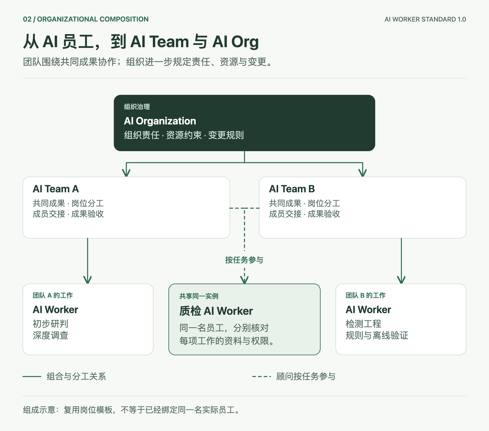

# AI Worker 开放定义标准 1.0

**用一套工作合同描述 AI 工作者、AI 团队和 AI 组织。**

**Max Luo、Morgan Chen｜Teloa 联合创始人** · 2026 年 10 月 18 日

[English](README.md) · [组成、架构与流程图解](docs/guide.zh-CN.md) · [Grok Bot 与 Teloa 映射](docs/mappings.md)

AI Worker 是身份和职责能够跨任务延续、在授权范围内工作、交付可验收成果的 AI 工作个体。一个 Worker 可以调用多个模型和临时 Agent，不要求独占机器、全天在线或一定具有长期记忆。

AI Team 围绕共同成果组织多个工作成员，明确分工、交接与验收。AI Organization 在组合之上明确组织责任、资源约束与变更规则。这里的“责任”指工作归属和可追溯性，不表示法律人格。

## 从哪里开始读

| 你想了解什么 | 阅读入口 |
| --- | --- |
| 员工由什么组成，团队怎样工作 | [通俗图解与具体示例](docs/guide.zh-CN.md) |
| Grok Bot、Teloa 员工与本标准怎样对应 | [产品与外部规范映射](docs/mappings.md) |
| 文件字段、固定版本与引用规则 | [核心规范](spec/core.zh-CN.md) |
| 工作合同、交接、例行与组织治理 | [工作与协作应用规范](spec/work-profile.zh-CN.md) |
| 可检查的完整定义 | [JSON、YAML 和组合示例](examples/README.md) |
| 可以声称什么，怎样证明 | [符合性范围](CONFORMANCE.md) |
| 怎样提意见和维护版本 | [维护规则](GOVERNANCE.md) |

核心规范与工作与协作应用规范统一采用 **1.0**。两份中文规范共同构成本版技术要求，英文说明用于帮助阅读。JSON 是规范性交换格式；YAML 可以作为编写入口，必须按规定转换。只保存名字和提示词，还不足以构成完整 Worker 定义。

## 与产品的关系

Teloa 继续使用“AI 员工”这个产品名称。Grok 继续使用 Bot。适配时逐项核对职责、工作合同和宿主行为，不要求产品统一改名。

Grok Team Bot 是供多人使用的一个 Bot，应先映射为共享 Worker；多个独立 Worker 共同承担交付，才进一步核对 AI Team 合同。共享岗位不会自动共享所有人的会话、连接权限和私人例行。

本规范吸收 OASF 的发现分类，以及 Oracle Agent Spec 的组件引用、输入输出与组合思路。具体采用方式与不支持项见[映射说明](docs/mappings.md)，不据此宣称全面兼容。

## 当前地位

这是由 Teloa 维护的开放规范，尚未取得行业或国际标准地位。公开示例不是可直接部署的产品包，也不证明跨平台运行已经打通。标准正文、示例检查、宿主适配和真实业务交付分别验收。

后续互操作验证需要两个独立实现，并覆盖非 SOC 场景。欢迎通过 [Issues](https://github.com/teloa-ai/ai-worker-standard/issues) 提交字段歧义、反例和带版本信息的实现报告。

原创内容采用 [Apache-2.0](LICENSE) 许可。实现本规范不需要 Teloa 账号或服务。产品名称与所链接第三方规范保留各自权利。
