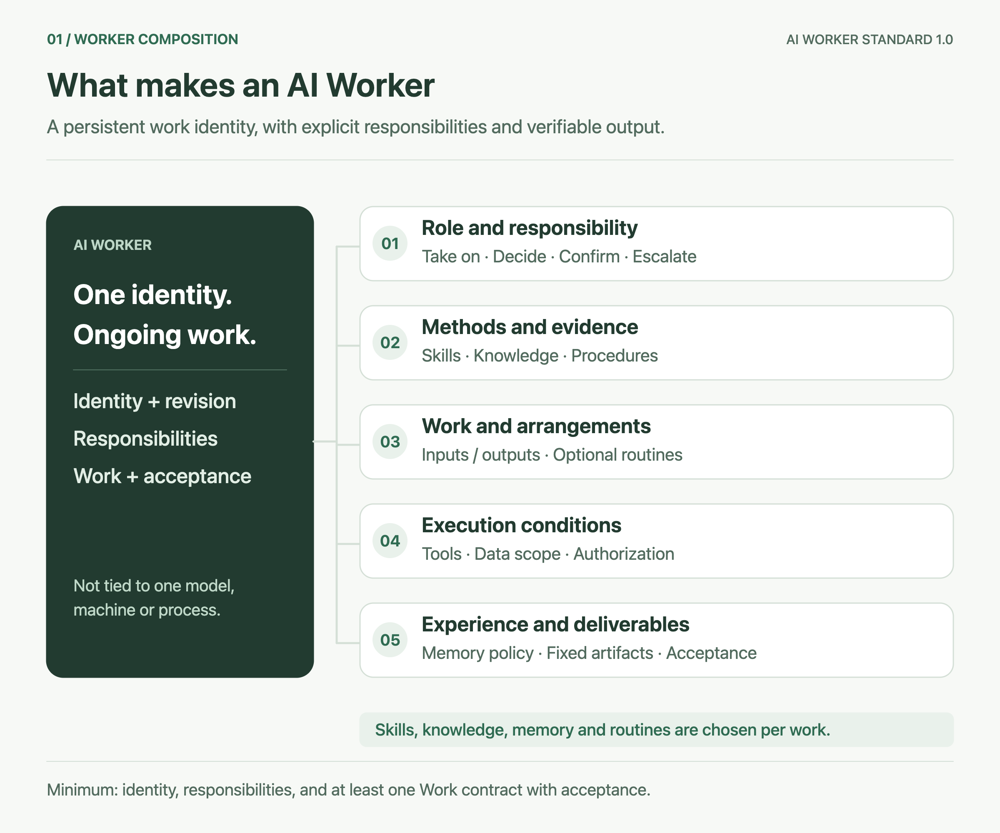
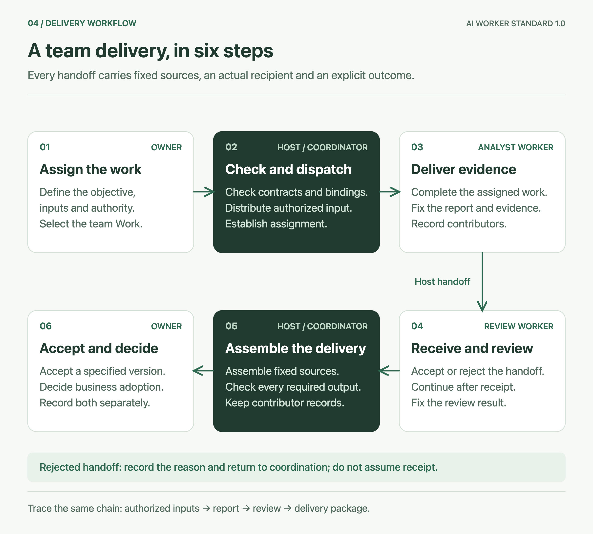
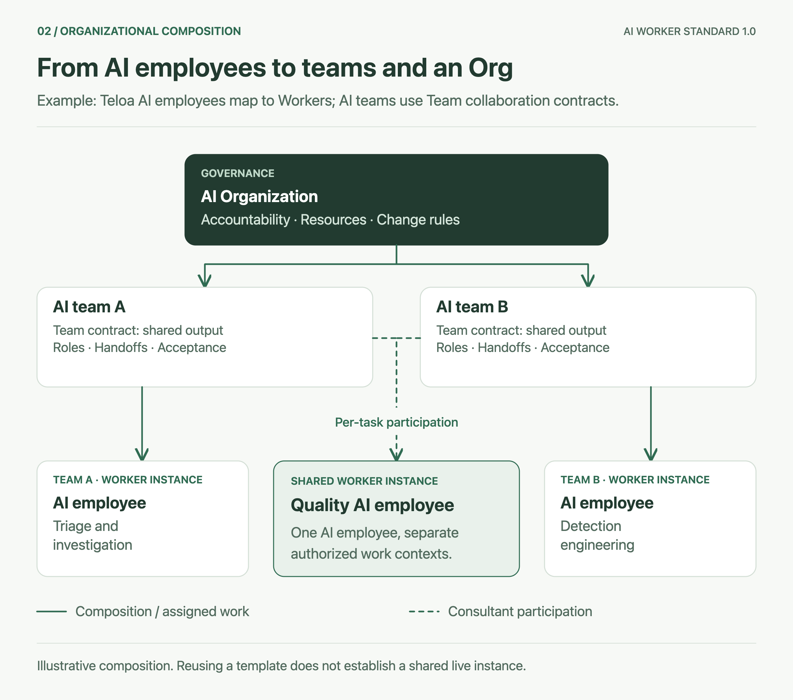
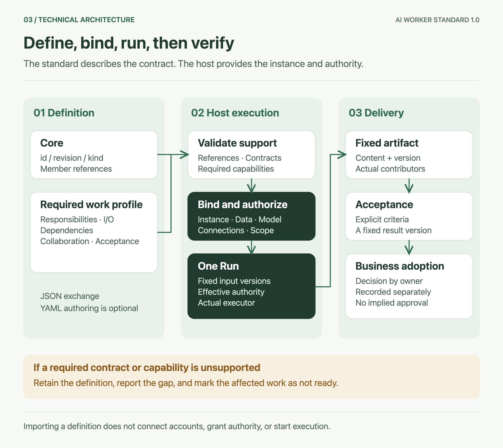

# AI Worker : comment un employé travaille et une équipe livre

[Languages / 语言](languages.md)

**Max Luo et Morgan Chen, cofondateurs de Teloa** · 18 octobre 2026

Cette traduction de la version 1.0 suit le [texte de référence en chinois simplifié](guide.zh-CN.md). Elle n’a pas encore fait l’objet d’une révision complète par des spécialistes du secteur de langue maternelle française ; veuillez signaler toute divergence. Les valeurs des exemples JSON et YAML restent identiques pour la comparaison entre langues. Les illustrations sont en anglais et accompagnées d’explications complètes en français.

Dans Teloa, les unités de travail que les utilisateurs créent et avec lesquelles ils collaborent sont des **employés IA**. **AI Worker est le concept général de normalisation sous-jacent** : identité durable, responsabilités, contrats de travail et limites de collaboration décrivent comment travaille un employé IA. Cette norme peut décrire la composition et les exigences de livraison des employés IA et de leurs équipes IA.

Donner un nom à un employé IA et écrire un prompt de poste suffit pour commencer un essai. Mais dès la deuxième mission, les questions deviennent concrètes : est-ce toujours le même employé ? Quels matériaux a-t-il utilisés cette fois ? Qu’a-t-il transmis au membre suivant ? Une fois le rapport révisé, qui décide de l’utiliser ?

La norme AI Worker rend ces accords explicites. Elle permet aux utilisateurs de vérifier ce qu’un employé IA a pris en charge et livré, tout en donnant aux produits un langage technique commun.

Cet article présente **AI Worker Standard 1.0**, avec son noyau et son profil de travail et de collaboration. Les exemples sont pédagogiques, pas des cas clients ni des preuves d’exécution. Le [texte de la spécification](../spec/core.fr.md) définit les exigences techniques.

Les trois concepts centraux se distinguent ainsi :

| Concept | Définition | Question traitée |
| --- | --- | --- |
| **AI Worker** | Unité de travail d’IA à identité durable qui assume des responsabilités, accepte du travail et livre des résultats vérifiables dans des limites d’autorisation explicites | Qui est cet employé IA, de quoi est-il responsable et comment prouver qu’il a terminé ? |
| **AI Team** | Ensemble collaboratif organisé autour d’un résultat commun, avec répartition des membres, transmissions de matériaux et exigences de réception explicites | Comment plusieurs employés IA accomplissent-ils ensemble un travail ? |
| **AI Organization (AI Org)** | Organisation ajoutant responsabilité organisationnelle, limites de ressources et d’information et gouvernance des changements à une composition d’unités et d’équipes | Qui répond de plusieurs équipes, comment répartir les ressources et gérer les changements ? |

L’« identité durable » permet de reconnaître le même travailleur entre tâches, sans exiger disponibilité permanente, machine exclusive ou mémoire à long terme. La « responsabilité » signifie attribution et traçabilité du travail, sans conférer de personnalité juridique à l’IA. Le texte, les tableaux et les étapes expliquent ces relations ; les illustrations donnent un aperçu visuel du même contenu.

## 01 Ce qu’il faut préciser pour un employé IA

Prenons un employé IA chargé de résumer des matériaux. Il produit une synthèse à partir des éléments fournis et conserve des questions lorsque les faits ne s’y trouvent pas. Il peut occuper ce poste à plusieurs reprises et utiliser différents modèles selon les tâches. Chaque résultat reste attribué au même employé IA ; techniquement, il correspond à une instance fixe de Worker dont la version de définition utilisée est enregistrée.



*Correspondance entre employé IA Teloa, Grok Bot et AI Worker, et cinq groupes de composantes.*

Les flèches représentent des correspondances conceptuelles : Teloa conserve l’appellation produit employé IA, Grok celle de Bot. Tous deux peuvent être décrits avec la définition commune AI Worker. L’illustration ne signifie pas qu’une adaptation est terminée ou certifiée par le fournisseur.

**Les cinq groupes de composantes d’un employé IA** indiquent ce que le poste doit convenir. Les ressources sont choisies selon le travail réel ; chaque employé n’a pas besoin de tous les outils.

| Composante | Sens général | Configuration de l’employé IA de synthèse |
| --- | --- | --- |
| **Poste et responsabilités** | Identité durable, mission, limites des responsabilités, règles de décision autonome, confirmation et escalade | Résumer les matériaux existants ; signaler les contradictions sans inventer des faits pour l’auteur |
| **Méthodes et fondements** | Skills pour les méthodes, connaissances pour les éléments de jugement, SOP pour les étapes, points de contrôle et exceptions ; provenance et version conservées séparément | Utiliser les matériaux de la tâche ; ajouter Skills, connaissances ou SOP pour des travaux plus complexes |
| **Travaux et planification** | Contrat précisant objectif, entrées, sorties, dépendances, position responsable et réception ; routines précisant quand appeler quel travail | Fournir `summarize` ; exécuter à réception d’une tâche, sans routine pour l’instant |
| **Conditions d’exécution** | Besoins applicatifs et outils, périmètre des matériaux, autorisation valide, modèle, budget et espace d’exécution | Lire uniquement les matériaux fournis sous autorisation ; confirmer séparément toute publication externe |
| **Expérience et résultats** | Règles de mémoire pour conservation, utilisation et retrait de l’expérience ; versions fixes des résultats et preuves, réception selon les exigences | Produire synthèse et questions ouvertes ; le responsable vérifie la fidélité au texte source |

Ni base de mémoire, ni connexion applicative, ni planification ne sont obligatoires ici. La nécessité d’une ressource dépend du travail promis. Consulter des informations externes exige de déclarer connexion et autorisation comme conditions ; résumer seulement le texte d’entrée ne justifie pas d’ajouter des outils pour compléter une liste de modules.

Une définition complète de Worker comprend au moins identité et révision, responsabilités et limites de décision, ainsi qu’un travail décrivant entrées, sorties, position responsable et réception. L’usage réel exige aussi que l’hôte lie instance concrète, conditions d’exécution et autorisation fiable. Les cinq groupes sont un mode de lecture couvrant identité, responsabilité, Skills, connaissances, SOP, modèles de travail, routines, applications, permissions, conditions d’exécution, expérience, résultats et qualité. Les champs sont détaillés dans le [profil de travail et de collaboration](../spec/work-profile.fr.md).

## 02 Une livraison d’équipe doit permettre de retracer chaque transmission

Supposons qu’un groupe demande à l’IA d’« organiser les matériaux et vérifier les conclusions ». L’employé IA d’analyse lit les matériaux, celui de révision vérifie les preuves, et l’équipe livre rapport et avis de révision. Un groupe de discussion facilite la communication ; le contrat d’équipe doit aussi préciser résultat commun, répartition des membres, conditions de transmission et règles d’arrêt.

**Une AI Team se compose de : objectif commun + membres et répartition des postes + limites du contexte partagé + transmissions collaboratives + organisation du travail + contraintes de ressources + réception des résultats.**

| Élément d’équipe | Accord à préciser |
| --- | --- |
| Objectif commun | Quels travaux l’équipe accepte de l’extérieur et quels résultats elle livre |
| Membres et répartition | Responsabilité de chacun ; participation des membres permanents et des consultants par tâche |
| Contexte partagé | Quels matériaux transmettre à quels membres et dans quelle version ; aucun partage par défaut de toutes les sessions ou mémoires privées |
| Transmissions collaboratives | Qui transmet quel résultat fixe à qui, comment associer les entrées, comment le destinataire accepte ou refuse |
| Organisation du travail | Qui distribue les entrées et agrège les sorties ; orchestration par l’hôte ou coordinateur expressément mandaté |
| Contraintes de ressources | Autorisations, applications, budgets et conditions d’arrêt de chaque travail ; destinataire d’escalade en l’absence de progrès |
| Réception des résultats | Quelles sorties contrôler, qui reçoit quelle version, si une révision indépendante est exigée |

Le coordinateur est facultatif ; toutes les équipes ne doivent pas adopter une hiérarchie. Une liste de membres, un groupe de discussion ou un organigramme ne remplace pas ces accords de travail.

L’ensemble lui-même possède une interface de travail. Par exemple, `deliver` de l’équipe reçoit `evidence` et doit fournir `report`, `evidence` et `review`. Le coordinateur ou l’hôte doit préciser qui reçoit l’entrée, de quels résultats fixes proviennent les trois sorties et qui en contrôle la complétude. Sans ces correspondances, le travail d’équipe n’est pas prêt.



*Des employés IA Teloa collaborent selon un contrat Team ; les personnes assurent approbation et réception.*

Le processus illustré comprend six étapes :

1. **Le responsable humain confie explicitement la mission.** Il fournit objectif, entrées et périmètre d’autorisation, choisit le point d’entrée de travail de l’équipe et fixe livraison et réception.
2. **L’hôte ou le coordinateur vérifie et distribue.** Il contrôle contrat, dépendances et liaisons d’instances, distribue uniquement les matériaux autorisés et établit l’attribution réelle des tâches.
3. **L’employé IA d’analyse soumet ses résultats.** Il exécute le travail confié, fixe versions du rapport et des preuves, puis enregistre les contributeurs réels.
4. **L’employé IA de révision confirme la réception et révise.** Il vérifie les entrées, réalise le contrôle après acceptation et fixe son avis ; en cas de refus, il enregistre la cause et renvoie à la coordination.
5. **L’hôte ou le coordinateur vérifie la complétude.** Il agrège les sources fixes selon le contrat d’équipe, contrôle les sorties nécessaires et conserve contributeurs et traces de transmission.
6. **Le responsable humain réceptionne et décide de l’adoption.** Il valide une version précise et enregistre séparément son éventuelle utilisation métier ; la réception ne donne pas automatiquement le droit d’agir à l’extérieur.

Cette répartition « analyse, révision, réception humaine » est un exemple ; chaque équipe suit son propre contrat. Une même chaîne de preuves traverse les étapes : **entrées autorisées → rapport fixe → avis de révision → paquet final de résultats**.

Une transmission entre membres peut être décrite par l’extrait suivant de l’[exemple complet de composition](../examples/composition-fixture.json) :

```json
{
  "id": "review-report",
  "from": "member/analyst/inspect",
  "to": "member/quality/review",
  "when": "已有固定报告与证据且获得本项交接授权",
  "inputs": {
    "report": "report",
    "evidence": "evidence"
  }
}
```

À gauche de `inputs` figurent les champs du destinataire, à droite ceux des sorties de l’expéditeur. La condition en chinois exige un rapport et des preuves fixes ainsi que l’autorisation de cette transmission. Cette définition n’envoie aucun message et n’affecte aucun travail. La transmission réelle doit aussi enregistrer expéditeur, destinataire, Run source, version du résultat, matériaux autorisés à la transmission et acceptation ou refus. Un message envoyé dans le groupe ne signifie pas que le destinataire a reçu des entrées utilisables.

L’employé IA de révision produit ici un avis ; le paquet complet reste réceptionné par le responsable désigné. Une réception indépendante doit examiner les contributeurs réels. Si le réviseur réécrit le rapport, sa contribution figure dans la nouvelle version ; il ne peut plus être considéré comme réceptionnaire indépendant de cette version.

## 03 Ce qu’une AI Org ajoute aux équipes

Une organisation peut composer plusieurs équipes et Workers et définir responsabilités interéquipes, limites de ressources et règles de changement. Ajouter des personnes ou un niveau de groupes ne crée pas automatiquement ces accords.

**Une AI Org se compose de : unités et équipes + responsabilité interéquipes + limites de ressources et d’information + règles d’escalade et de changement.**

| Élément organisationnel | Complément apporté aux équipes existantes |
| --- | --- |
| Composition d’unités et d’équipes | Énumérer membres et versions fixes ; les sous-équipes participent par leur propre interface de travail sans exposer automatiquement toutes leurs capacités internes |
| Responsabilité interéquipes | Définir l’acteur fiable responsable du périmètre de l’organisation et le destinataire des escalades interéquipes |
| Limites de ressources et d’information | Préciser à quels membres s’appliquent les limites de données, budget et exécution ; l’hôte les vérifie et les applique |
| Escalade et changements | Définir nomination et retrait des membres, changements de définition, suspension/reprise et traitement du travail en cours |



*Composition de Worker, AI Team et AI Org à partir d’employés IA Teloa.*

Par exemple, une organisation de sécurité opérationnelle peut réunir une équipe d’analyse et d’investigation et une équipe d’ingénierie de détection, partageant un employé IA de contrôle qualité. Le partage exige de lier la même instance réelle ; deux positions qui référencent le même modèle de poste ne prouvent pas qu’il s’agit du même employé.

L’organisation doit aussi préciser qui répond de son périmètre, qui décide de nommer ou retirer les membres, comment traiter les travaux en cours lorsqu’un employé est suspendu et quels matériaux ou budgets sont limités pour quels membres. Un même employé dans deux équipes ne rend pas leurs historiques mutuellement accessibles et ne double pas un budget initialement unique.

Cette structure organisationnelle est exprimable. Pour prouver son exécution dans un produit, celui-ci doit fournir des preuves de liaison, d’autorisation et de fonctionnement. Le scénario illustré diffère de la fixture structurelle téléchargeable : ses groupes A et B réutilisent tous deux les employés d’analyse et de qualité pour expliquer les liaisons d’instances, sans poste réel d’ingénierie de détection configuré.

## 04 Distinguer techniquement définition, instance et exécution

La définition du Worker ressemble à la fiche de poste et au contrat de travail de l’employé IA ; l’instance correspond à un employé IA concret dans Teloa ; un Run est une de ses exécutions. Une mise à jour du modèle de poste laisse l’ancienne version dans les anciens Runs. Changer de modèle ne doit pas non plus transformer l’historique d’un employé en celui d’un autre.



*Exemple Teloa : définition de Worker, instance d’employé IA, Run et réception des résultats.*

**La chaîne technique est : définition standard → validation du contrat → liaison par l’hôte → un Run → résultat fixe → enregistrement de réception → adoption métier.** Chaque étape répond à une question différente :

| Niveau | Objet ou étape | Contenu enregistré et vérifié |
| --- | --- | --- |
| Définition standard | Définition du noyau et extension de travail | `id`, `revision`, `kind` et références fixes de membres ; responsabilités, entrées/sorties, dépendances, collaboration et réception |
| Configuration de l’hôte | Vérification des contrats et capacités | Présence des références, complétude des contrats d’entrées/sorties, prise en charge des capacités nécessaires ; travaux concernés non prêts s’il manque des éléments |
| Configuration de l’hôte | Instance de Worker et liaisons | Identité durable de l’employé IA concret, matériaux, modèle, connexions applicatives et autorisation valide du travail |
| Exécution réelle | Work, tâche et Run | Work est un contrat réutilisable ; la tâche une mission concrète ; Run enregistre entrées, version de définition et exécutant réel d’une exécution |
| Livraison | Résultat fixe | Contenu consultable, version, preuves et contributeurs réels, pas seulement l’état « exécution terminée » |
| Livraison | Enregistrement de réception | Qui a vérifié quelle version selon quelles exigences et avec quelle conclusion ; vérifier aussi les contributeurs réels si l’indépendance est requise |
| Décision métier | Enregistrement d’adoption | Décision du responsable d’utiliser ou non le résultat ; adoption et réception distinctes, sans autorisation automatique de publication ou d’intervention |

Par exemple, « poste de synthèse, révision 2 » est une définition ; l’« organisateur de matériaux » créé à partir d’elle est une instance ; les synthèses de cette semaine et de la suivante sont deux tâches ayant chacune Run et résultat. Mettre à jour le modèle de poste ne réécrit pas les anciens Runs et ne réattribue pas les anciens résultats au nouvel employé.

Le noyau ne conserve que `agent` et `organization`. Un Worker utilise `agent` avec l’extension de travail obligatoire ; une Team, `organization` avec contrat de collaboration ; une Org ajoute la gouvernance. Les mêmes règles de référence et de version permettent ainsi la composition, sans nouveau type de fichier pour chaque nom produit.

L’hôte est la plateforme qui exécute réellement ces définitions, par exemple Teloa. Il les lie aux instances, matériaux, connexions d’outils, modèles et acteurs d’autorisation réels, vérifie entrées et dépendances, puis enregistre exécutions et résultats. Importer un fichier apporte seulement une définition à interpréter : aucun compte n’est connecté, aucune permission accordée, aucune exécution démarrée ni routine activée automatiquement. Validation structurelle, configuration prête, exécution réussie, réception du résultat et adoption métier exigent leurs propres preuves et ne se remplacent pas.

## 05 Un exemple vérifiable champ par champ

Le [Worker de synthèse de matériaux](../examples/document-worker.json) est une définition JSON complète contenant tous les champs obligatoires. Son `summarize` accepte une chaîne `material` non vide et produit une `summary` non vide et un tableau de chaînes `openQuestions`. Les entrées et sorties suivantes sont des exemples pédagogiques rédigés à la main :

```json
{
  "material": "示例周报：甲项目本周完成三份资料摘要。第二份缺少来源日期，负责人要求补充。材料没有提供工时或客户反馈。"
}
```

```json
{
  "summary": "甲项目本周完成三份资料摘要，其中第二份仍需补充来源日期。",
  "openQuestions": [
    "第二份资料的来源日期是什么？",
    "现有材料未提供工时或客户反馈，无法据此评价效率或满意度。"
  ]
}
```

Les valeurs chinoises conservées indiquent que le projet A a terminé trois synthèses cette semaine. La deuxième n’a pas de date de source, que le responsable a demandée. Aucune donnée d’heures de travail ou de retour client n’est fournie. La sortie résume les trois synthèses et la date encore manquante ; les questions ouvertes portent sur cette date et sur l’absence de base permettant d’évaluer efficacité ou satisfaction.

Un contrôle structurel détecte champs manquants et types incorrects. Le responsable doit aussi contrôler le contenu : est-il fidèle aux matériaux ? Transforme-t-il l’absence de données d’heures de travail en « gain d’efficacité » ? La réception porte sur une version fixe de sortie ; après modification, une nouvelle vérification est requise selon l’accord.

La même relation peut être utilisée pour une analyse SOC. Supposons que le matériau pédagogique contienne seulement une entrée WAF HTTP 403. Le rapport ne peut expliquer que les conclusions appuyées par cette entrée et doit signaler l’absence de preuves backend et terminal. Il ne peut en déduire ni compromission du serveur ni sécurité totale. Les données nécessaires à une investigation approfondie deviennent des lacunes explicites ; blocage, isolation et autres interventions exigent outils et autorisations correspondants. Cet exemple ne connecte aucun environnement réel et n’exécute aucune attaque.

## 06 Correspondance de Grok Bot et de Teloa

L’employé IA Teloa est l’expression produit concrète de l’AI Worker ; Grok Bot peut aussi être décrit comme AI Worker. Employé IA et Bot restent les concepts de leurs produits ; AI Worker fournit la définition technique commune. L’adaptation vérifie une à une responsabilités, contrats de travail et comportement de l’hôte. La présentation publique de Grok décrit des Bots durables avec Skills et Routines, ce qui permet une comparaison conceptuelle sans prouver l’existence d’un convertisseur ou d’une certification officielle de compatibilité. [Conception de Grok](https://x.ai/news/designing-grok-bot)

| Concept produit | Correspondance dans cette spécification | À confirmer lors de l’adaptation |
| --- | --- | --- |
| Employé IA Teloa ; Grok Bot | Définition de Worker et instance réelle | Complétude de l’identité durable, des responsabilités, des I/O de travail et de la réception |
| Prompt de poste, Bot profile | `instructions` et `responsibility` | Limites de travail concrètes ; ne pas déduire les informations manquantes du nom |
| Skills, connaissances, SOP | `resources` référencées selon leur usage | Version réelle, provenance et dépendances du travail |
| Outil ou plugin | Référence de capacité, ressource applicative et connexion de l’hôte | Autorisation réelle ; identifiants secrets conservés dans l’hôte |
| Groupes et projets Teloa | Supports de communication d’équipe et de contexte | Répartition, transmissions et contrat de résultat d’équipe encore nécessaires |
| Grok Team Bot | Worker partagé | Autorisations, sessions privées et routines privées des utilisateurs conservées séparément |

La documentation de Grok Team Bot décrit plusieurs personnes utilisant le même Bot. Ce n’est pas une AI Team dans laquelle plusieurs Workers se répartissent la production d’un résultat. Lors de l’adaptation d’un Worker partagé, les routines personnelles restent des arrangements privés de l’hôte, hors définition partagée. Seuls les modèles explicitement publiés par leur auteur et débarrassés de contenu privé peuvent être partagés ; ils ne sont toujours pas activés automatiquement après import. [Team Bots](https://docs.x.ai/grok-bot/team-bots)

Les correspondances détaillées des champs Teloa et les lacunes d’adaptation figurent dans le [document de correspondance](mappings.md).

## 07 Réutiliser les spécifications existantes en gardant un périmètre clair

OASF fournit des enregistrements de découverte d’Agents et des classifications de domaines et de capacités, utiles pour trouver des capacités candidates. Cette spécification conserve les classifications natives et leurs versions, puis décrit séparément entrées, sorties et réception par contrat de travail. Les Skills de classification OASF ne sont pas les mêmes objets que les paquets de Skills exécutables. [OASF Record Guide](https://docs.agntcy.org/oasf/agent-record-guide/)

Les références de composants, entrées/sorties et définitions de composition d’Oracle Agent Spec sont des idées utiles à réutiliser. Cette spécification s’en inspire ; l’adaptation d’une version concrète doit néanmoins convertir individuellement interfaces, références et sémantique d’exécution. Renommer des champs ne suffit pas à déclarer l’interopérabilité. [Oracle Agent Spec 26.1.2](https://oracle.github.io/agent-spec/26.1.2/agentspec/language_spec_26_1_2.html)

JSON échange des définitions fixes ; YAML peut servir à les rédiger. La conversion YAML doit rejeter les entrées hors convention, notamment clés dupliquées, ancres, alias, tags explicites, nombres non finis et documents multiples, et préserver le sens des nombres et chaînes. Par exemple, `revision: "1"` est une chaîne, tandis que `revision: 1` est rejeté pour type incorrect. Les deux fichiers ne peuvent être des sources indépendamment modifiables sous une même révision.

## 08 Commencer à l’adopter

Choisir un travail existant et préciser d’abord entrées, sorties, dépendances, position responsable et réception. Après exécution avec une instance réelle, vérifier les matériaux effectivement reçus par le destinataire et les résultats fixes, puis étendre aux équipes. Si la plateforme ne peut respecter une contrainte essentielle, marquer le travail concerné comme non prêt.

Cette version vise d’abord à définir clairement ces relations. Une spécification utilisable collectivement par le secteur nécessite encore des preuves d’interopérabilité d’implémentations indépendantes, des scénarios hors SOC et des discussions publiques de changement. Le dépôt utilise la licence Apache-2.0 ; toute contribution peut commencer par une ambiguïté précise ou un contre-exemple. [Dépôt de la norme](https://github.com/teloa-ai/ai-worker-standard) · [Retours](https://github.com/teloa-ai/ai-worker-standard/issues)
