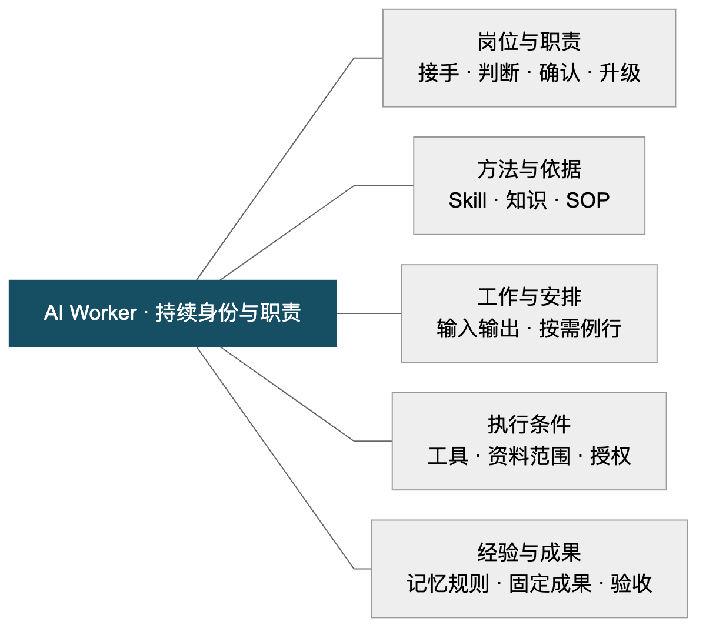
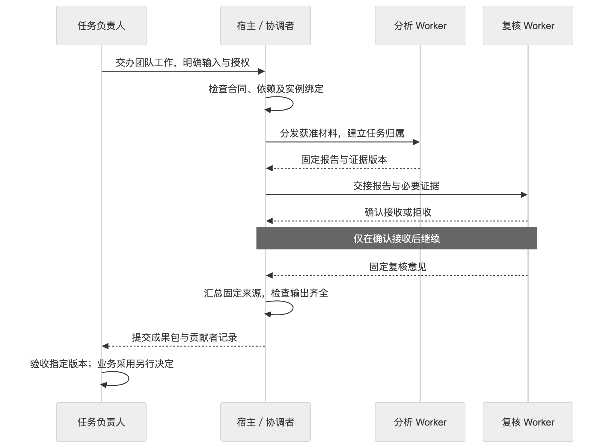
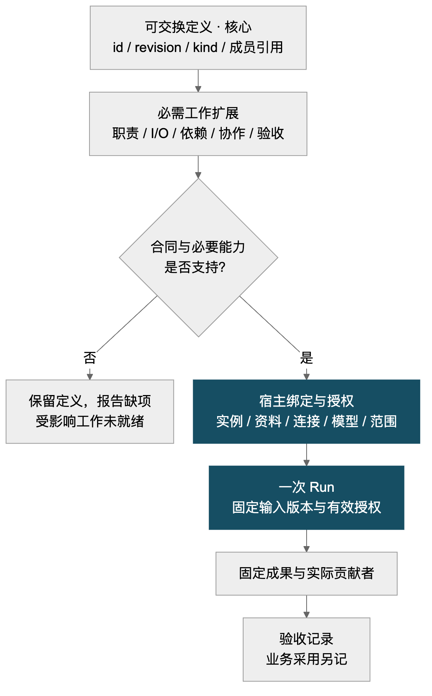

# AI Worker：一个员工怎样工作，一支团队怎样交付

**Max、Morgan｜Teloa 联合创始人** · 2026 年 10 月 18 日

给 AI 一个名字、写一段岗位提示词，已经可以开始试用。但第二次交办工作时，问题会变得具体：它还是上次那个员工吗？本次用了哪些材料？它把什么交给了下一位成员？报告经过复核以后，谁决定采用？

AI Worker 标准从这些问题出发。它把跨任务延续的身份、职责、工作接口和验收要求放在一起，让产品能够说明一个 AI 工作个体承担什么，也让使用者能够核对它交付了什么。

本文解释核心 `0.1.0-draft.7` 和工作应用规范 `0.1.0-draft.2`。这是开放草案；文中的例子是教学材料，不是客户案例或运行证明。[规范正文](../spec/core.zh-CN.md)规定技术要求。

## 一个 Worker，需要把哪些事情说清楚

以“材料摘要工作者”为例。它负责根据给定材料写摘要，材料没有提供的事实要留下问题。它可以反复承担这个岗位，具体任务可以使用不同模型。每轮结果仍归属于同一个实际 Worker，并记录采用的定义版本。



| 组成 | 摘要工作者的具体配置 |
| --- | --- |
| 岗位与职责 | 摘要已有材料；发现矛盾时列出，不替作者补造事实 |
| 方法与依据 | 本轮输入材料；复杂工作可以追加 Skill、知识或 SOP |
| 工作与安排 | 提供 `summarize` 工作入口；收到任务时执行，暂不设例行 |
| 执行条件 | 只读取获准提供的材料；对外发布另行确认 |
| 经验与成果 | 输出摘要和未决问题；任务负责人检查与原文是否一致 |

这里没有强制配置记忆库、应用连接或定时计划。资源是否必要，取决于承诺的工作。如果要查询外部资料，就必须把连接和授权列为条件；如果只摘要输入文本，就不必为了凑齐模块而增加工具。

一个完整 Worker 定义至少要有身份与修订、职责与判断边界，以及一项说明输入、输出、负责位置和验收要求的工作。图中的五组是阅读方式，具体字段以工作应用规范为准。

## 团队交付要能追到每次交接

假设一组人希望 AI 完成“整理资料并检查结论”。分析员工读取材料，复核员工检查证据，团队交付报告与复核意见。建立群聊可以方便交流；团队合同还要把共同成果、成员分工、交接条件和停止规则写清楚。

组合本身也有工作接口。例如团队的 `deliver` 接收 `evidence`，必须交付 `report`、`evidence` 和 `review`。协调者或宿主需要说明：输入交给谁，三个输出分别来自哪个固定成果，由谁检查是否齐全。缺少这些对应关系时，团队工作仍未就绪。



成员间的一次交接可以写成下面的合同片段，取自[完整组合示例](../examples/composition-fixture.json)：

```json
{
  "id": "review-report",
  "from": "member/analyst/inspect",
  "to": "member/quality/review",
  "when": "已有固定报告与证据且获得本项交接授权",
  "inputs": {
    "report": "report",
    "evidence": "evidence"
  }
}
```

`inputs` 左侧是接收方字段，右侧是发送方输出字段。这段定义不发送消息，也不执行派工。真正交接时，还要记录发送人与接收人、来源 Run、成果版本、获准传递的材料，以及接收或拒收结果。消息发到了群里，不等于接收方已经拿到可用输入。

图中复核员工产出的是复核意见；完整成果包仍由指定负责人验收。独立验收要检查实际贡献者。若复核人改写了报告，新的报告也包含其贡献，不能继续把这个人视为该版本的独立验收者。

## AI Org 在团队之上补充什么

组织可以组合多个团队和工作者，并约定跨团队的责任、资源限制与变更规则。增加人数或再建一层群，不会自动形成这些约定。


例如，一个安全运营组织可以由研判调查团队和检测工程团队组成，共用一名质检员工。共用需要绑定同一个实际实例，不能只因为两个位置引用同一岗位模板就推断是同一个员工。

组织还要说明谁对组织范围负责，谁决定成员任职或撤任，员工暂停以后在途工作怎样处理，以及哪些资料和预算限制适用于哪些成员。同一个员工参与两支团队，不代表两边历史可以互读，也不产生两份原本只有一份的预算。

这是一种可表达的组织结构。是否已在某个产品执行，需要该产品提供绑定、授权和运行证据。图中场景与下载的结构夹具不同：夹具的 A、B 两组同时复用分析和质检员工，用于说明实例绑定，未配置真实检测工程岗位。

## 技术上分清定义、实例和一次执行

定义像岗位说明和工作合同；实例是部署环境中的具体员工；Run 是这个员工的一次执行。岗位模板升级，旧 Run 仍保留原版本。更换模型，也不必把员工历史变成另一个人的历史。



核心格式只保留 `agent` 与 `organization`。Worker 使用 `agent` 加必需工作扩展，Team 使用 `organization` 加协作合同，Org 再增加治理合同。这样可以沿同一套引用和版本规则组合，无需为每种产品称呼另造文件类型。

宿主是实际运行这些定义的平台，例如 Teloa。它负责把定义绑定到真实实例、资料、工具连接、模型与授权主体，检查输入和依赖，并记录运行和成果。导入文件只带来一份待解释的定义，不会自动开通权限。

## 一个可以逐字段核对的例子

[材料摘要 Worker](../examples/document-worker.json)是一份完整 JSON 定义，包含全部必需字段。它的 `summarize` 接受一个非空 `material` 字符串，输出非空 `summary` 和字符串数组 `openQuestions`。以下输入输出是手写的教学示例：

```json
{
  "material": "示例周报：甲项目本周完成三份资料摘要。第二份缺少来源日期，负责人要求补充。材料没有提供工时或客户反馈。"
}
```

```json
{
  "summary": "甲项目本周完成三份资料摘要，其中第二份仍需补充来源日期。",
  "openQuestions": [
    "第二份资料的来源日期是什么？",
    "现有材料未提供工时或客户反馈，无法据此评价效率或满意度。"
  ]
}
```

结构检查能发现缺字段和错误类型。负责人还要检查内容：是否忠于材料，是否把没有工时数据的情况写成“效率提升”。验收针对固定输出版本；修改以后，需要按约定重新检查。

换成 SOC 研判，仍可复用这种关系。假设教学材料只包含一条 WAF 的 HTTP 403 记录，那么报告只能解释这条记录支持什么结论，并注明缺少后端和终端证据。它不能据此断言服务器已经失陷，也不能断言完全安全。更深调查需要哪些数据，写成明确缺口；封禁、隔离等处置需要相应工具与授权。这一例子没有连接真实环境或执行攻击。

## Grok Bot 与 Teloa 怎样对应

Teloa 的产品名称是“AI 员工”，Grok 使用 Bot。本草案用 AI Worker 表达二者可共同描述的工作个体，并逐项检查合同。Grok 的公开设计介绍了可持续存在的 Bot，以及 Skills、Routines 等组成；这支持概念上的比较，不等于已有转换器或官方兼容认证。[Grok 设计说明](https://x.ai/news/designing-grok-bot)

| 产品概念 | 在本草案中的对应 | 适配时需要确认 |
| --- | --- | --- |
| Teloa AI 员工；Grok Bot | Worker 定义与实际实例 | 持续身份、职责、工作 I/O 和验收是否完整 |
| 岗位提示词、Bot profile | `instructions` 与 `responsibility` | 工作边界是否具体，缺项不得从名字推断 |
| Skills、知识、SOP | 按用途引用的 `resources` | 真实版本、来源与工作依赖 |
| 工具或插件 | 能力引用、应用资源与宿主连接 | 实际授权，凭据留在宿主 |
| Teloa 群与项目 | 团队沟通和上下文载体 | 还需明确分工、交接和团队成果合同 |
| Grok Team Bot | 共享 Worker | 使用者的授权、私人会话与私人例行分别保留 |

Grok Team Bot 的文档描述的是多人使用同一个 Bot。它与“多个 Worker 分工完成一份成果”的 AI Team 不同。适配共享 Worker 时，个人例行保留在宿主的私人安排中，不进入共享定义；只有作者明确发布并移除私有内容的模板才能被分享，导入后仍不自动启用。[Team Bots](https://docs.x.ai/grok-bot/team-bots)

更细的 Teloa 字段对应与适配缺项见[映射文档](mappings.md)。

## 复用现有规范，保持范围清楚

OASF 提供 Agent 的发现记录、领域与能力分类，适合帮助使用者找到候选能力。本草案保留这些原生分类及其版本，另用工作合同说明输入、输出与验收。OASF 的分类技能和可执行 Skill 包不是同一种对象。[OASF Record Guide](https://docs.agntcy.org/oasf/agent-record-guide/)

Oracle Agent Spec 的组件引用、输入输出与组合定义值得复用。本草案借鉴这些思路；适配具体版本时仍须逐项转换接口、引用和执行语义，不能把字段改名就称为互通。[Oracle Agent Spec 26.1.2](https://oracle.github.io/agent-spec/26.1.2/agentspec/language_spec_26_1_2.html)

JSON 用于交换固定定义，YAML 可以用于编写。YAML 转换须拒绝重复键、锚点、别名、显式标签、非有限数值和多文档等不在约定内的输入，并保留数值与字符串含义。例如 `revision: "1"` 是字符串，`revision: 1` 会因类型错误被拒绝。两种文件不能成为同一修订下各自随意修改的来源。

## 怎样开始采用

选一项已有工作，先写清输入、输出、依赖、负责位置和验收。用真实实例执行后，检查接收方实际取得的材料与固定成果，再扩大到团队。如果当前平台无法兑现某项关键约束，就把相应工作标为未就绪。

本版希望先把这些关系定义清楚。要成为可由行业共同采用的规范，还需要独立实现的互操作证据、非 SOC 场景，以及公开的变更讨论。仓库采用 Apache-2.0 许可，欢迎从一个具体歧义或反例开始参与。[标准仓库](https://github.com/teloa-ai/ai-worker-standard) · [反馈入口](https://github.com/teloa-ai/ai-worker-standard/issues)
