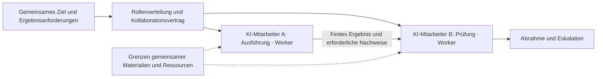
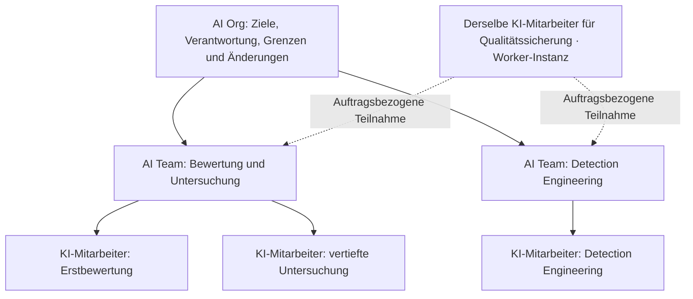
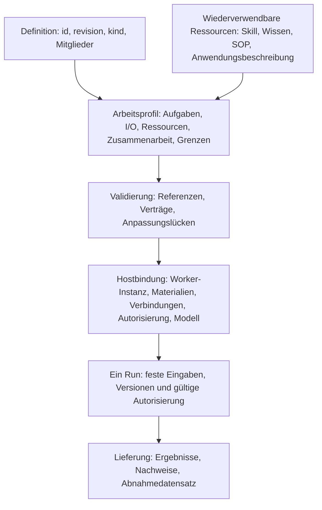
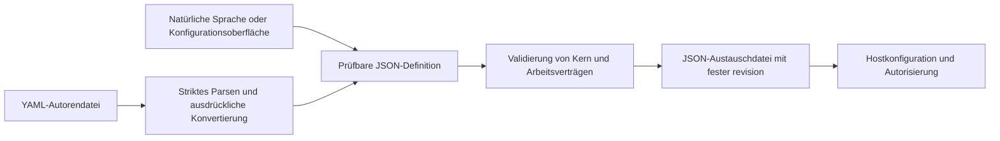

# Offener Definitionsstandard für AI Worker, AI Team und AI Organization 1.0

[Languages / 语言](../docs/languages.md)

**Max Luo und Morgan Chen, Mitgründer von Teloa**

Kernversion: `1.0`. Veröffentlichungsdatum: 2026-10-18. Status: offene Spezifikation.

Diese Übersetzung folgt dem [maßgeblichen vereinfachten chinesischen Text](core.zh-CN.md). Sie wurde noch nicht vollständig von muttersprachlichen Branchenfachleuten geprüft. Bitte melden Sie Abweichungen vom maßgeblichen Text. Die Werte der JSON- und YAML-Beispiele bleiben für den sprachübergreifenden Vergleich unverändert.

Dieses Dokument bildet zusammen mit dem [Arbeits- und Kollaborationsprofil](work-profile.de.md) die Spezifikation dieser Version. Die Abschnitte 1–3 erläutern die Begriffe; die Abschnitte 4–9 legen das Verhalten beim Austausch von Kerndefinitionen fest. Instanzkonfiguration und tatsächlicher Betrieb werden gesondert geprüft.

## 1. Den Aufbau in einfachen Worten verstehen

**Ein AI Worker ist eine KI-Arbeitseinheit mit einer dauerhaft wiedererkennbaren Identität, die innerhalb klarer Autorisierungsgrenzen Verantwortung übernimmt, Arbeit annimmt und abnahmefähige Ergebnisse liefert. Ein AI Team ist ein Verbund, der mit aufgeteilter Verantwortung auf ein gemeinsames Ergebnis hinarbeitet. Eine AI Organization ergänzt diesen Verbund um organisatorische Verantwortlichkeit, Ressourcenbeschränkungen und Regeln für Änderungen.**

In Teloa heißt eine solche Arbeitseinheit **KI-Mitarbeiter**; AI Worker ist der dahinterliegende allgemeine Standardbegriff. Die Einheiten, die Benutzer anlegen und mit denen sie zusammenarbeiten, heißen weiterhin KI-Mitarbeiter. Eine Worker-Definition beschreibt Aufgaben und Arbeitsverträge; eine Worker-Instanz kennzeichnet einen konkreten KI-Mitarbeiter. Auch ein Grok Bot lässt sich als AI Worker beschreiben. Diese begriffliche Zuordnung ist keine Herstellerzertifizierung; eine tatsächliche Anpassung muss weiterhin Verträge und Hostverhalten prüfen.

„Dauerhaft“ bedeutet hier, dass Identität und Aufgaben über einzelne Aufträge hinweg bestehen bleiben können. Es verlangt weder ständige Erreichbarkeit noch einen permanenten Prozess, eine exklusive Maschine oder zwingend ein Langzeitgedächtnis. Eine Arbeitseinheit kann mehrere Modelle und temporäre Agents einsetzen; ihre extern gelieferten Ergebnisse bleiben derselben nachvollziehbaren Worker-Instanz zugeordnet.

| Begriff | Bedeutung in diesem Standard | Grenze |
| --- | --- | --- |
| AI Agent | Allgemeiner technischer Begriff für Schlussfolgern, Werkzeugaufrufe oder Aufgabenausführung | Kann vorübergehend bestehen; die Bezeichnung allein belegt keinen Worker-Vertrag |
| AI Worker | Dauerhaft wiedererkennbare, beschränkte KI-Einheit mit Verantwortung für Arbeitsergebnisse | Verantwortung bedeutet Zuordnung und Nachvollziehbarkeit, keine Rechtspersönlichkeit |
| AI Team | Verbund mit gemeinsamer Arbeitsschnittstelle, Rollenverteilung und Kollaborationsvertrag | Ein Gruppenchat oder eine Mitgliederliste allein belegt keine Konformität |
| AI Organization | Verbund mit Kollaborationsvertrag und organisatorischem Governance-Vertrag | Wird nicht durch Personenzahl oder Hierarchiestufen abgegrenzt und ist nicht automatisch eine juristische Unternehmenseinheit |
| AI Workforce | Sammelbezeichnung für KI-Arbeitseinheiten und Arbeitskapazität in einem bestimmten Bereich | Diese Version führt dafür weder ein eigenes Objekt noch ein Format ein |
| KI-Mitarbeiter, Bot | Produkt- oder Geschäftsbezeichnungen | Werden anhand tatsächlicher Zusammensetzung und Verhaltensweisen zugeordnet; der Produktname bewirkt keine automatische Konformität |

AI Worker wird bereits öffentlich verwendet, etwa von [11x](https://www.11x.ai/11x-manifesto) und [Delos](https://marketplace.microsoft.com/en-us/product/office/WA200011292). Diese Spezifikation übernimmt einen bestehenden Begriff und legt eine eigene normative Definition fest. Sie beansprucht weder, den Namen erfunden zu haben, noch behandelt sie Herstellerbezeichnungen als einheitlichen Branchenstandard. Bei der ersten öffentlichen Verwendung sollte „AI Worker (softwarebasierte Arbeitseinheit)“ stehen, um Verwechslungen mit Menschen zu vermeiden, die in der KI-Branche arbeiten.

### 1.1 Woraus ein AI Worker besteht

| Bestandteil | Einfache Frage | Dahinterliegende Inhalte |
| --- | --- | --- |
| Rolle und Verantwortung | Wer bin ich, wofür bin ich zuständig, wann eskaliere ich? | Name, Aufgaben, ausgeschlossene Aufgaben, Entscheidungs- und Bestätigungsregeln |
| Methoden und Grundlagen | Wie arbeite ich, worauf stütze ich Urteile? | Skills, Wissen, SOPs; Methoden und Fakten werden getrennt referenziert |
| Arbeit und Planung | Welche Arbeit nehme ich an, wann erledige ich sie? | Arbeitsvorlagen, Ein- und Ausgaben, bedarfsabhängig konfigurierte Routinen |
| Ausführungsbedingungen | Welche Werkzeuge nutze ich, wie weit darf ich gehen? | Anwendungsbedarf, Informationsumfang, Berechtigungsbedingungen, Modell- und Budgetanforderungen |
| Erfahrung und Ergebnisse | Welche Erfahrung bleibt erhalten, wie belege ich den Abschluss? | Gedächtnisregeln, Ergebnisversionen, Nachweise und Abnahme |

Diese fünf Gruppen erleichtern die Lektüre und decken die bestehenden 12 Arten von Bestandteilen ab; sie führen keine fünf neuen Ressourcentypen ein. Eine minimale Worker-Definition muss Identität und Revision, Aufgaben- und Entscheidungsgrenzen sowie mindestens einen Arbeitsvertrag mit Eingaben, Ausgaben, verantwortlicher Position und Abnahmeanforderungen enthalten. Skill-Pakete, Wissensbestände, SOPs, Gedächtnis und Routinen werden nach Bedarf bereitgestellt. Ein leeres Ressourcenverzeichnis ist zulässig, darf aber nicht zur Umgehung tatsächlicher Abhängigkeiten dienen.

### 1.2 Woraus ein AI Team besteht

**Team = gemeinsames Ziel + Mitglieder und Rollenverteilung + Grenzen des gemeinsamen Kontexts + kollaborative Übergaben + Arbeitsplanung + Ressourcenbeschränkungen + Ergebnisabnahme.** Ein Gruppenchat kann der Kommunikation dienen; der Teamvertrag legt fest, wer verantwortlich ist, was geliefert wird, wer es annimmt und wann gestoppt wird. Ein Koordinator ist eine optionale Kollaborationsrolle; nicht jedes Team muss ein Vorgesetztenmodell verwenden.



Die Abbildung verwendet Teloa als Beispiel: KI-Mitarbeiter entsprechen Workern; ein KI-Team vereinbart gemeinsame Ergebnisse und Zusammenarbeit über einen Teamvertrag.

### 1.3 Wie aus Teams eine AI Organization entsteht

**Organisation = Verbund aus Einzelnen und Teams + teamübergreifende Verantwortlichkeit + Ressourcen- und Informationsgrenzen + Eskalations- und Änderungsregeln.** Teams können Mitglieder einer Organisation sein und weiterhin dieselben Arbeitsschnittstellen verwenden. Eine Organisation sagt nur ausdrücklich aufgeführte Arbeiten zu; sie erhält nicht automatisch alle Fähigkeiten und Berechtigungen ihrer Mitglieder.



Die Abbildung verwendet weiterhin Teloas Begriffe KI-Mitarbeiter und KI-Team, um den Verbund von Worker, Team und Org zu erläutern. Sie zeigt eine Zusammensetzung und behauptet keine bereits erfolgte Bereitstellung dieser Organisationen. Berater können auftragsbezogen teilnehmen, ohne allen Gruppen beizutreten. Die teamübergreifende gemeinsame Nutzung desselben KI-Mitarbeiters benötigt eine ausdrückliche Instanzbindung. Zwei KI-Mitarbeiter aus derselben Rollenvorlage zu erzeugen, ist eine andere Beziehung.

## 2. Die zugrunde liegende technische Architektur

Es gibt weiterhin nur zwei Kernobjekte für den Austausch: **agent** und **organization**. Das bestehende Format bleibt erhalten. Eine vollständige AI-Worker-Definition verwendet agent mit dem erforderlichen Arbeitsprofil; ein AI Team verwendet organization mit einem Kollaborationsvertrag; eine AI Organization ergänzt dasselbe Verbundobjekt um einen Governance-Vertrag. `kind: agent` bezeichnet lediglich die zugrunde liegende Strukturklasse und ist keine AI-Worker-Konformitätserklärung. Die drei Nutzungsformen erzeugen keine drei Kernformate.



In Teloa bindet der Host einen konkreten KI-Mitarbeiter; jeder Run ist eine Ausführung dieses Mitarbeiters. Definition, Instanz und Run werden getrennt aufgezeichnet. So werden Produktbezeichnungen und technische Begriffe aufeinander bezogen.

| Ebene | Verantwortung des Standards | Verantwortung des Hosts |
| --- | --- | --- |
| Definition | Feste Identität und Revision, Zusammensetzung, Arbeits- und Kollaborationsanforderungen | Lesen, validieren, berichten und verlustfrei speichern |
| Instanz | Festlegen, welche Identitäten und Geltungsbereiche eine Bindung unterscheiden muss | Mitarbeiter erstellen oder wiederverwenden; Verbindungen, Modelle, Berechtigungen und privates Gedächtnis binden |
| Ausführung | Semantik von Ein- und Ausgaben, Übergabe, Stopp und Abnahme | Schlussfolgern, Arbeitszuweisung, Planung, Budgetdurchsetzung, Autorisierungsprüfung und Ausführungsprotokolle |

Einzelne Einheiten und Verbünde beantworten dieselben vier Fragen: **Welche Eingaben nehmen sie an, welche Bedingungen benötigen sie, welche Ergebnisse liefern sie und welche Grenzen halten sie ein?** Der Host bestätigt die Instanzidentität. Umbenennen, Gruppenbeitritt, Vorlagenimport oder identische Definitionsreferenzen erteilen keine Autorisierung. Historische Ausführungen bleiben auf die alte Version festgelegt; ein Vorlagenupdate schreibt sie nicht um.

Diese Spezifikation schreibt weder eine Maschine pro Mitarbeiter noch ein einziges Modell, einen einzigen Scheduler oder ein vollständiges Organisationsverwaltungssystem vor. Zahlungen, Rechtspersönlichkeit und die Steuerung verkörperter Systeme sind nicht enthalten. Fehlende erforderliche Fähigkeiten müssen gemeldet werden; erfolgreiches Lesen einer Datei darf nicht mit Ausführbarkeit gleichgesetzt werden. Die erste Version umfasst Mitarbeiter, Teams und Organisationsverbünde.

### 2.1 Konformität mit dieser Version bestimmen

Im Folgenden bezeichnen „muss“ und „darf nicht“ verbindliche Anforderungen, „sollte“ eine Empfehlung und „kann“ eine Option. Beispiele erläutern nur das Format und belegen weder eine Bereitstellung noch eine erfolgreiche Betriebsprüfung.

| Erklärungsumfang | Erforderlich | Daraus zulässige Schlussfolgerung |
| --- | --- | --- |
| Austausch von Kerndefinitionen | Kernregeln der Abschnitte 4–9 | Die Datei lässt sich korrekt interpretieren und verlustfrei speichern; dies allein belegt keine AI-Worker-Anpassung |
| AI-Worker-Definition | agent-Kern + erforderlicher Arbeitsanhang + vollständige Aufgaben-, Arbeits- und Abnahmeverträge | Die Definition ist vollständig; Verbindungen, tatsächliche Identität und Ausführungsfähigkeit müssen noch durch den Host gebunden werden |
| AI-Worker-Instanz | Validierte Definition + stabile Instanzkennung + vertrauenswürdiger verwaltender Akteur + arbeitsbezogene Autorisierung und Ausführungsprotokolle | Die Identität ist auftragsübergreifend nachvollziehbar; Modellwechsel oder ein neuer Run bedeuten keinen neuen Mitarbeiter |
| AI-Team-Definition | organization-Kern + Arbeitsanhang + Rollenverteilung sowie Regeln für Übergaben, gemeinsame Nutzung und Stopp | Der Kollaborationsvertrag ist interpretierbar; automatische Zuweisung und tatsächliche Übergaben werden gesondert geprüft |
| AI-Organization-Definition | AI-Team-Vertrag + governance + Organisationsbeschränkungen | Der Governance-Vertrag ist vollständig; konkrete Identitäten, Verfahren und Durchsetzung der Beschränkungen werden gesondert geprüft |

Eine Verbunddefinition mit Governance kann sowohl die Team- als auch die Organization-Erklärung erfüllen; es handelt sich nicht um einander ausschließende Produkttypen. Definitionskonformität setzt keinen zuvor erfolgreichen Lauf voraus. Instanzbereitschaft und Erfolg einer bestimmten Ausführung benötigen jeweils eigene Nachweise. Ein Verbund ohne deklarierte Governance darf nicht allein durch Umbenennung Konformität mit AI Organization dieser Version beanspruchen.

Eine stabile Instanzkennung muss nur im deklarierten Bereich von Host und vertrauenswürdigem Akteur eindeutig sein; ein globales Konto oder ein dezentrales Identitätsnetz ist nicht erforderlich. Worker können nach Bedarf gestartet, pausiert oder stillgelegt werden. Der Host muss das tatsächliche Verhalten dieser Zustände aufzeichnen und vor einer Wiederaufnahme die gültige Autorisierung erneut prüfen. Stilllegung überträgt die Urheberschaft historischer Ergebnisse nicht auf eine neue Instanz. Konkrete Speicherung und Aufbewahrungsdauer richten sich nach der jeweiligen Bereitstellungsrichtlinie.

### 2.2 JSON für den Austausch, YAML für die Erstellung

**JSON ist die einzige normative Austauschdarstellung dieser Version; YAML ist eine optionale Eingabeform für Autoren.** Benutzer können dieselbe Definition auch aus natürlicher Sprache oder Formularen erzeugen. Ein Empfänger, der nur JSON implementiert, kann weiterhin Kern-Austauschkonformität erklären. YAML-Erstellung wird als gesonderter Unterstützungsumfang ausgewiesen; nicht jedes Produkt muss einen YAML-Editor anbieten.



Wer die YAML-Erstellungskonvention dieser Version unterstützt, muss zur Typauflösung das Core Schema von YAML 1.2 verwenden und genau ein Mapping-Dokument mit ausschließlich Zeichenfolgen als Schlüssel akzeptieren. Doppelte Schlüssel, nicht endliche Zahlen, benutzerdefinierte oder explizite Tags, Anker, Aliase, Einträge mit dem Schlüsseltext `<<` und Dokumentströme mit mehreren Dokumenten müssen abgelehnt werden. Nur verlustfrei als JSON darstellbare Werte sind zulässig; Zahlen dürfen nicht stillschweigend gerundet werden. Umgebungsvariablen, Vorlagenausdrücke und Dateieinbindungen werden nicht ausgewertet. `revision: "1"` ist eine Zeichenfolge, `revision: 1` eine Zahl; Letztere muss bei der Feldvalidierung abgelehnt werden. Parser und Version werden im Konvertierungsprotokoll festgehalten. [YAML 1.2.2](https://yaml.org/spec/1.2.2/)

YAML-Kommentare sind kein Bestandteil der Austauschsemantik; Berechtigungen, Einschränkungen und Abnahmebedingungen dürfen nicht nur in Kommentaren stehen. Nach dem Parsen vorhandene Zeilenumbrüche in Blocktexten gehören zum Zeichenfolgeninhalt und werden nach R02 verglichen. Autoren können YAML als Erstellungsquelle behalten und jeweils festes JSON exportieren. Beide dürfen nicht als zwei unabhängig bearbeitbare maßgebliche Quellen derselben Revision dienen. Nach Änderungen am Export muss aus der einheitlichen Quelle eine neue Revision erzeugt werden.

Dies ist kein Protokoll zur JSON-Byte-Kanonisierung oder Signatur. R02 vergleicht JSON-Werte; der digest von Ressourcenpaketen bezieht sich weiterhin auf tatsächliche Bytes. JSON Schema 2020-12 beschreibt Ein- und Ausgaben von Work. Beide Erstellungswege müssen denselben Vertragsprüfungen unterliegen. [JSON Schema](https://json-schema.org/draft/2020-12)

## 3. Wiederverwendung externer Definitionen

| Quelle | In dieser Version übernommen | Ausdrückliche Unterschiede |
| --- | --- | --- |
| OASF | Native discovery-Klassifikationen für Fähigkeiten, Domänen und Versionen; Metadaten und Ressourcenpositionen werden nach Bedarf zugeordnet | Klassifikations-Skills sind keine ausführbaren Methodenpakete; eine Klassifikation belegt keine Arbeitsqualität |
| Oracle Agent Spec 26.1.2 | Ideen zu Komponentenreferenzen und Komposition; explizite Ein- und Ausgaben; Trennung von Definition und Aufruf; gerichtete Zusammenarbeit | Diese Version verwendet JSON-Schema-Objekte als Arbeitsschnittstellen; sie gibt sich nicht als deren Komponentenkonfiguration aus und kopiert keinen vollständigen Ausführungsgraphen |
| Grok Bot | Dauerhafte Rollen, gemeinsame Methoden, Rollenkontext und Trennung von Skill und Routine | Öffentliche recipes sind Vorlagenmaterial; ein Team Bot ist ein von mehreren Personen verwendeter Bot, kein Team mehrerer Mitarbeiter |

OASF-discovery-Daten werden unverändert in einer festen Version mitgeführt; Einzelheiten stehen in §7 des Anhangs. Daraus können Auffindbarkeitsdatensätze abgeleitet werden, ohne eine zweite, gleichbedeutende Fähigkeitsklassifikation einzuführen. [OASF Record Guide](https://docs.agntcy.org/oasf/agent-record-guide/) · [Discovery Extension](https://docs.agntcy.org/oasf/discovery-extension/)

Agent Spec verwendet `$component_ref` für Referenzen innerhalb einer Konfiguration. Ein- und Ausgaben beruhen auf JSON Schema; Swarm und ManagerWorkers haben konkrete Kollaborationsverhaltensweisen. Diese Version behält dateiübergreifende id＋revision-Referenzen bei und behandelt Verantwortungsübergabe, Sitzungsübergabe und Berechtigungen getrennt. Bei Konvertierungen müssen die tatsächlichen Ein-/Ausgabebeschränkungen und das Kollaborationsverhalten geprüft werden; es wird weder standardmäßig die gesamte Sitzung geteilt noch eine implizite Typumwandlung von Ein- und Ausgaben vorgenommen. [Agent Spec 26.1.2](https://oracle.github.io/agent-spec/26.1.2/agentspec/language_spec_26_1_2.html)

Das Aufgreifen von Definitionen, der Erhalt nativer Daten und erfolgreich geprüfte Kompatibilität sind unterschiedliche Aussagen. Die Übernahme dieser Entwürfe bedeutet keine Kompatibilität mit allen OASF-Modulen oder Agent-Spec-Laufzeiten. [Grok-Designbeschreibung](https://x.ai/news/designing-grok-bot) · [Team Bots](https://docs.x.ai/grok-bot/team-bots)

## 4. Von der Kerndefinition zum vollständigen AI Worker

### 4.1 Minimale Kerndefinition für den Austausch

```json
{
  "specVersion": "1.0",
  "id": "urn:example:definition:research-assistant",
  "revision": "5",
  "kind": "agent",
  "name": "研究助手",
  "instructions": "根据提供的资料回答问题，保留来源，区分事实、推断和未知。"
}
```

Diese sechs Felder bilden nur eine minimale Austauschdefinition, noch keinen vollständigen AI Worker. capabilities werden ergänzt, wenn die Einheit als Ganzes externe Fähigkeiten benötigt. Wer Unterstützung für Worker-Arbeit oder Teamkollaborationsverträge dieser Version erklärt, muss auch das Arbeitsprofil im Anhang unterstützen; allein gespeicherte Prompts rechtfertigen keine Erklärung vollständiger Anpassung.

### 4.2 Minimale vollständige AI-Worker-Definition

Das folgende Beispiel ist ein branchenübergreifender Worker für Materialzusammenfassungen. Es enthält weder externe Anwendungen noch Skill-Pakete oder automatische Routinen, wohl aber klare Aufgaben, Ein- und Ausgaben sowie Abnahmebedingungen. Es definiert eine wiederholt einsetzbare Rolle für Zusammenfassungen; tatsächliche Instanz und verwaltender Akteur werden bei der Bereitstellung gebunden.

```json
{
  "specVersion": "1.0",
  "id": "urn:example:definition:document-worker",
  "revision": "2",
  "kind": "agent",
  "name": "材料摘要工作者",
  "instructions": "持续承担已提供材料的摘要工作，注明材料之外无法核实的内容。",
  "extensions": [{
    "id": "urn:teloa:profile:ai-work",
    "version": "1.0",
    "required": true,
    "data": {
      "responsibility": {
        "triggers": ["收到已授权的摘要任务"],
        "autonomousActions": ["读取本次提供的材料并撰写摘要"],
        "confirmationPoints": ["对外发布须由任务负责人另行确认"],
        "escalationRules": ["材料缺失或相互矛盾时报告缺口"],
        "deliveryChecks": ["摘要可回查材料，不补造事实"]
      },
      "resources": [],
      "authorityRoles": [{"id": "owner", "name": "任务负责人", "kind": "human"}],
      "works": [{
        "id": "summarize",
        "title": "材料摘要",
        "instructions": "根据输入材料交付摘要和未决问题。",
        "inputs": {
          "$schema": "https://json-schema.org/draft/2020-12/schema",
          "type": "object",
          "properties": {"material": {"type": "string", "minLength": 1}},
          "required": ["material"],
          "additionalProperties": false
        },
        "outputs": {
          "$schema": "https://json-schema.org/draft/2020-12/schema",
          "type": "object",
          "properties": {
            "summary": {"type": "string", "minLength": 1},
            "openQuestions": {"type": "array", "items": {"type": "string"}}
          },
          "required": ["summary", "openQuestions"],
          "additionalProperties": false
        },
        "requires": [],
        "responsible": "self",
        "acceptance": {
          "criteria": ["摘要与输入材料一致，未决问题单列"],
          "reviewer": "authority/owner",
          "independent": true
        }
      }]
    }
  }]
}
```

Die [JSON-Datei](../examples/document-worker.json) und die [YAML-Autorendatei](../examples/document-worker.yaml) dieses Beispiels werden aus dem Haupttext erzeugt und stellen dieselben JSON-Werte dar. Vollständige Beispiele für Teams, Organisationen und gemeinsam genutzte Instanzen enthält das [Kompositionsbeispiel](../examples/composition-fixture.json). Es sind Definitionsbeispiele; dadurch wird keine Autorisierung zum Verbinden, Ausführen oder Veröffentlichen erteilt.

## 5. Teams oder Organisationen in einer Datei zusammensetzen

```json
{
  "specVersion": "1.0",
  "id": "urn:example:definition:research-team",
  "revision": "5",
  "kind": "organization",
  "name": "研究小组",
  "instructions": "research 整理证据，review 检查来源和结论；发现分歧时保留分歧。",
  "members": [
    {
      "id": "research",
      "ref": {
        "id": "urn:example:definition:research-assistant",
        "revision": "5"
      }
    },
    {
      "id": "review",
      "ref": {
        "id": "urn:example:definition:research-assistant",
        "revision": "5"
      }
    }
  ]
}
```

Dieses Beispiel zeigt nur Referenzen einer Kernkomposition und ist keine vollständige AI-Team- oder AI-Organization-Definition. Arbeitsanhang und entsprechende Kollaborations- beziehungsweise Governance-Verträge müssen ergänzt werden.

Mitgliedseinträge referenzieren Definitionen einzelner Einheiten oder Unterorganisationen. Dieselbe Vorlage kann wiederverwendet werden, doch beide Mitgliedseinträge werden getrennt benannt. Dies belegt weder die Unabhängigkeit zweier tatsächlicher Ausführender noch eine Zwei-Personen-Freigabe. Ein Member ist ein Definitionsplatz im Verbund und entspricht nicht unmittelbar einem Gruppenmitglied oder Besetzungsdatensatz. Der Anhang erläutert Mitglieder, Berater, externe Verantwortungsrollen und Instanzbindungen. Tatsächliche Identitäten und Berechtigungen setzt der Host um.

## 6. Kernfelder

Außerhalb des Inneren von Erweiterungs-data akzeptieren alle Objekte nur die hier und im Folgenden definierten Felder. Neue Semantik wird durch extensions ausgedrückt.

| Feld | Typ und Bereich | Zweck |
| --- | --- | --- |
| specVersion | Erforderlich, exakt `1.0` | Legt die Interpretation der Datei fest |
| id | Erforderlich, absolute URI oder URN | Referenziert dieselbe Definition dateiübergreifend |
| revision | Erforderlich, nicht leere Zeichenfolge, darf nicht latest sein | Fixiert Inhalte und verhindert unbemerkte Referenzänderungen |
| kind | Erforderlich, agent oder organization | Unterscheidet einzelne Einheit und Verbund |
| name | Erforderlich, nicht leere Zeichenfolge | Ermöglicht menschliches Erkennen und Teilen |
| instructions | Erforderlich, nicht leere Zeichenfolge | Beschreibt Agent-Aufgaben oder organisatorische Kollaborationsanforderungen |
| capabilities | Optionales Capability-Array, nur für agent | Referenziert benötigte externe Fähigkeiten |
| members | Erforderliches, nicht leeres Member-Array für organization; für agent unzulässig | Beschreibt die Zusammensetzung der Organisation |
| extensions | Optionales Extension-Array | Nimmt Semantik außerhalb des Kerns auf |

- Nicht leere Zeichenfolgen dürfen nicht ausschließlich aus Leerraum bestehen. Die optionalen Arrays capabilities und extensions auf oberster Ebene dürfen fehlen oder leer sein; ihre Standardinterpretation ist gleich. Die ursprünglichen JSON-Werte sind dennoch verschieden und werden nach R02 verglichen. null ist kein Ersatz.
- LocalId entspricht `^[a-z][a-z0-9-]{0,63}$`. Die id-Werte von Member und Capability sind innerhalb ihres jeweiligen Arrays eindeutig. Erweiterungsverträge können Referenzen auf diese Einträge definieren, müssen dabei aber Definition und Array angeben; globale Eindeutigkeit von LocalId darf nicht vorausgesetzt werden.
- DefinitionRef enthält nur `id` und `revision` mit den Typen der obigen Tabelle.
- Member enthält nur `id: LocalId` und `ref: DefinitionRef`. Alle Mitgliedsreferenzen sind erforderlich.
- Capability enthält nur `id: LocalId`, `kind: "mcp" | "skills" | "a2a" | "resource"` und `config: object`; config wird in Abschnitt 7 beschrieben.
- Extension enthält nur `id: absolute URI oder URN`, `version: nicht leere, exakte Versionszeichenfolge`, `required: boolean` und `data: object`. version darf weder ein Bereich noch latest sein; Erweiterungs-id-Werte sind innerhalb einer Definition eindeutig.

## 7. Externe Fähigkeiten werden nur referenziert

Die folgenden vier kind-Werte sind optionale Bindungen: Wer eine Definition liest, muss sie nicht ausführen. Erst wer die Nutzung einer Bindung zusagt, muss deren natives Protokoll oder Format implementieren. config akzeptiert nur die Tabellenfelder; alle nicht als optional gekennzeichneten Felder sind erforderlich.

| kind | config-Felder | Bindungsgrenze |
| --- | --- | --- |
| mcp | `protocolVersion: nicht leere Zeichenfolge`; `transport: "stdio" \| "streamable-http"`; `connectionRef: nicht leere Zeichenfolge`; `selectors: Selector[], optional` | Referenziert eine vom Host aufgelöste MCP-Verbindung; Fähigkeiten und Autorisierung werden anhand der angegebenen nativen Version geprüft |
| skills | `formatSnapshot: URI`; `packageRef: URI`; `packageMediaType: "application/zip" \| "application/x-tar"`; `packageDigest: Digest` | Referenziert ein vollständiges Skill-Paket und einen festen Formatsnapshot; SKILL.md und Begleitdateien bleiben erhalten |
| a2a | `protocolVersion: nicht leere Zeichenfolge`; `agentCardRef: URI`; `interfaceUrl: URI`; `protocolBinding: nicht leere Zeichenfolge`; `skillIds: nicht leere Zeichenfolge[], optional`; `requiredExtensions: URI[], optional` | Referenziert eine bestimmte Schnittstelle eines A2A-Dienstes und erhält native Aufgaben, Ergebnisse und Zustände |
| resource | `uri: URI`; `mediaType: nicht leere Zeichenfolge`; `digest: Digest, optional` | Liest eine Ressource, ohne ihren Inhalt automatisch auszuführen |

Selector hat ausschließlich die Form `{"type":"tool" oder "prompt","name":nicht leere Zeichenfolge}` oder `{"type":"resource","uri":URI}`. Wenn selectors angegeben wird, darf das Array nicht leer sein und jeder Eintrag muss erfüllt sein. Fehlt es, bedeutet dies nur, dass die Verbindung benötigt wird; es autorisiert nicht alle Werkzeuge.

Alle URI-Werte sind absolute URIs oder URNs. Digest besteht aus `sha256:` und 64 kleingeschriebenen Hexadezimalzeichen. Protokollversionen müssen exakt sein und dürfen weder Bereiche noch latest verwenden. Verbindungsname, Card-Adresse und Paketposition stellen keine Autorisierung dar.

Beispiel: Der folgende Eintrag im capabilities-Array eines Agents erklärt den Bedarf an dieser MCP-Verbindung. Beispielverbindung und Version müssen bei der tatsächlichen Bereitstellung weiterhin geprüft werden.

```json
{
  "id": "knowledge",
  "kind": "mcp",
  "config": {
    "protocolVersion": "2026-07-28",
    "transport": "streamable-http",
    "connectionRef": "project-knowledge"
  }
}
```

**MCP:** Der Bereitsteller ordnet connectionRef zu. Die tatsächliche Verbindung muss angezeigt und gesondert autorisiert werden; token oder Startbefehle sind nicht enthalten. Discovery, Transport und Autorisierung müssen der deklarierten Version folgen. Allein anhand von Werkzeugnamen darf nicht automatisch eine andere Verbindung zugeordnet werden. Der Kern beschreibt weder jeden Werkzeugparameter noch eine allgemeine Sprache für Werkzeugberechtigungen. [MCP-Versionsregeln](https://modelcontextprotocol.io/docs/2026-07-28/learn/versioning)

**Skills:** formatSnapshot muss auf eine unveränderliche Quelle der Formatspezifikation verweisen. Der Digest bezieht sich auf die Originalbytes des vollständigen Pakets. Die Entpackwurzel ist ein Skill-Verzeichnis; Pfadausbrüche, doppelte normalisierte Pfade sowie symbolische und harte Links werden abgelehnt. Beim Import werden keine Skripte ausgeführt. ZIP/TAR sind Verpackungskonventionen dieser Spezifikation, keine native Anforderung von Agent Skills. [Agent-Skills-Format](https://agentskills.io/specification)

**A2A:** interfaceUrl, protocolBinding und protocolVersion müssen derselben Schnittstelle der tatsächlichen Card entsprechen. Deklarierte skillIds und beidseitig erforderliche Erweiterungen werden nach der nativen Spezifikation geprüft; die Autorisierung wird separat geprüft. Ein serverseitiger Abschluss bedeutet nicht, dass das Geschäftsziel erreicht wurde. Ein A2A AgentSkill ist kein Agent-Skills-Dateipaket. [A2A-Spezifikation](https://a2a-protocol.org/latest/specification/)

**Ressourcen:** Ohne digest werden Inhalte als veränderlich behandelt. Bei tatsächlicher Nutzung werden die abgerufene Version oder der Abrufzeitpunkt aufgezeichnet; Reproduzierbarkeit darf nicht behauptet werden. Private Ressourcen werden gemäß tatsächlicher Berechtigung gelesen.

Diese Felder beschreiben Referenzen dieser Spezifikation; sie sind keine an native Dienste gesendeten Anfragekörper. Wenn eine wesentliche Beschränkung mit dieser Version nicht ausdrückbar ist, muss sie in einer required-Erweiterung ausdrücklich formuliert werden. Der Host darf weder raten noch die Beschränkung stillschweigend verwerfen. Native Einzelheiten und Ausführungsgarantien verbleiben in den jeweiligen Bindungen und werden nicht als allgemeines Laufzeitprotokoll dupliziert.

## 8. Acht gemeinsame Regeln

**R01 Eindeutiges Format.** Austauschdateien müssen UTF-8-JSON-Objekte sein. Doppelte Schlüssel, unbekannte Kernfelder, unzulässige Feldtypen und nicht endliche Zahlen werden abgelehnt. Eine nicht unterstützte Kernversion muss ausdrücklich gemeldet werden und darf nicht nach einer älteren Version interpretiert werden. Interne Felder unbekannter Erweiterungs-data werden nicht vom Kern validiert.

**R02 Unveränderliche Revisionen.** id und revision werden als ursprüngliche Zeichenfolgen exakt verglichen, ohne URI-Normalisierung; zusammen identifizieren sie eine feste Definition. Ändert sich der nach den folgenden Regeln verglichene JSON-Wert, muss eine neue revision vergeben werden. Unterschiedliche Werte für dasselbe Paar müssen als Konflikt gemeldet werden und dürfen nicht überschrieben werden. Der Vergleich ignoriert Objektschlüsselreihenfolge und Leerraum außerhalb von Zeichenfolgen, erhält aber Arrayreihenfolge und Zeichenfolgeninhalt. Unterschiedliche JSON-Typen sind ungleich; Zahlen werden nach mathematischem Wert verglichen, etwa 10 gleich 10.0. Verschiedene Zahlen dürfen nicht durch Rundung gleichgesetzt werden. Ein fehlendes Feld und ein ausdrücklich leeres Array sind unterschiedliche JSON-Werte und werden nicht wegen gleicher Standardinterpretation zusammengeführt.

**R03 Auflösbare Referenzen.** Vor der Assemblierung einer Organisation müssen alle direkten und indirekten Mitgliedsreferenzen rekursiv bis zur angegebenen Revision aufgelöst werden. Fehlende Referenzen, abweichende Versionen oder Zyklen müssen gemeldet werden und die Assemblierung stoppen; Versionen dürfen nicht automatisch ersetzt werden. Eine Erklärung vollständiger Organisationsunterstützung muss die erforderlichen Fähigkeiten und Erweiterungen aller Mitgliedsdefinitionen im transitiven Referenzabschluss abdecken. Definitionsreferenzen bilden einen azyklischen Graphen; dies beschränkt keine wechselseitige Zusammenarbeit im Betrieb. id ist keine Downloadadresse. Der Host bestimmt, wie Definitionen beschafft werden; das Lesen einer Datei darf keine automatische Netzwerkverbindung auslösen.

**R04 Komposition führt Berechtigungen nicht zusammen.** Mitglieder verwenden jeweils ihre eigenen Definitionen und Fähigkeiten. Organisations-instructions beschreiben Kollaborationsanforderungen, überschreiben aber keine Mitglieds-instructions und fügen Mitgliedern nicht automatisch Werkzeuge oder Berechtigungen hinzu. Betroffene Arbeiten dürfen bei ungelösten Konflikten nicht starten. Gleichnamige Fähigkeiten werden nach Mitglied unterschieden; Verbindungen dürfen nicht zusammengeführt werden. Der Kern definiert weder Scheduling noch Prompt-Zusammenführung oder die Zuweisung tatsächlicher Identitäten.

**R05 Zusagen müssen erfüllt werden.** Jeder capabilities-Eintrag ist eine erklärte erforderliche Abhängigkeit des Agents; keine Bindung darf standardmäßig ignoriert werden. Kann eine davon nicht bereitgestellt werden, müssen die fehlenden Elemente aufgelistet werden. Nach dieser Definition darf weder gestartet noch vollständige Unterstützung erklärt werden. Auch eine Organisation darf erforderliche Mitglieder mit fehlenden Abhängigkeiten nicht umgehen. Anzeigen und Speichern bleiben zulässig; Löschen oder Ändern von Fähigkeiten verlangt eine neue revision. Die tatsächliche Ausführung muss native Unterstützung und Autorisierung prüfen; erfolgreiches Lesen bedeutet keine Ausführbarkeit.

resources im Anhang bilden ein je nach Arbeit nutzbares Verzeichnis und entsprechen nicht capabilities. Sowohl allgemeine Bedingungen als auch die erforderlichen Bedingungen der gewählten Arbeit müssen erfüllt sein. Nicht bereite Ressourcen, die ausschließlich andere Arbeiten benötigen, blockieren nur diese Arbeiten. Vollständige Unterstützung, Bereitschaft einer bestimmten Arbeit und tatsächliche Autorisierung werden getrennt gemeldet. Das Profil darf nicht zur Umgehung der allgemeinen Abhängigkeitsanforderungen dieser Regel dienen.

**R06 Erweiterungen scheitern ausdrücklich.** Ein Erweiterungsvertrag wird durch id und exakte version festgelegt und definiert mindestens data-Struktur, Semantik und Validierungsmethode. Struktur- oder Semantikänderungen erfordern eine neue Version. Verbraucher müssen die Unterstützung ausdrücklich implementieren; aus dem Lesen einer URI darf kein automatischer Download von Validatoren oder Code folgen. Unbekannte Erweiterungen müssen mit ihren JSON-Werten erhalten und gemeldet werden. Bei required=true darf nach dieser Definition weder assembliert noch ausgeführt noch vollständige Unterstützung erklärt werden. required=false ist ausschließlich für Zusatzinformationen zulässig, die die grundlegende Laufzeitbedeutung nicht ändern. Herausgeber dürfen Berechtigungen, Zahlungen, Ausführungsbedingungen und Abnahmebeschränkungen nicht als ignorierbar kennzeichnen. Erkennt ein Verbraucher in einer unterstützten Erweiterung einen solchen Verstoß, muss er Assemblierung, Ausführung und Erklärungen vollständiger Unterstützung ablehnen und darf keine erfolgreiche Validierung melden. Die problematische Datei darf erhalten, angesehen oder unverändert mit Fehlerbericht exportiert werden. Der Kern beansprucht nicht, jede Bedeutung unbekannter data zu erkennen. Widersprüchliche erforderliche Beschränkungen dürfen nicht durch Auswahl der lockereren aufgelöst werden.

**R07 Definitionen erteilen keine Rechte.** Ein Import darf nicht automatisch laufende Einheiten erzeugen, Code installieren, Dienste verbinden, Aufgaben ausführen oder Zahlungen leisten. Definitionen dürfen keine Schlüssel, token, cookies oder unmittelbar verwendbaren Autorisierungsnachweise enthalten. Vorlagen, Rollenbeschreibungen und Organisationsbeziehungen erzeugen weder Identität noch Vertretungsmacht oder Ausführungsautorisierung; diese prüft der Host vor tatsächlichen Aktionen.

**R08 Konformitätsaussagen brauchen Nachweise.** Die minimale Konformität lautet ausschließlich „unterstützt den Definitionsaustausch dieser Version“ und verlangt korrektes Lesen, Validieren, Berichten, Speichern und verlustfreies Exportieren. Bei gültigen Dokumenten müssen die JSON-Werte nach Import und erneutem Export unverändert bleiben, einschließlich unbekannter Erweiterungen. Änderungen müssen eine neue Revision erzeugen. Tatsächliche Unterstützung von Bindungen und Erweiterungen wird gesondert nach Namen, Version und Prüfbereich aufgeführt. Aus Austauschkonformität dürfen weder Betriebsfähigkeit noch Geschäftsqualität oder plattformübergreifende Instanzmigration abgeleitet werden.

## 9. Konformität und Abnahme

Konformität wird für klar abgegrenzte Bereiche erklärt; ein einziges „kompatibel“ darf nicht alle Fähigkeiten abdecken: Kernaustausch, Interpretation des Arbeitsprofils, Abbildung einer bestimmten Quelle/Version und Betrieb für einen bestimmten Host, eine Arbeit und einen Eingabebereich. Geschäftsqualität benötigt eine aufgabenbezogene Bewertung und wird nicht aus Strukturprüfungen abgeleitet.

Die folgenden sechs Prüfungen betreffen die Abnahme des Kerndefinitionsaustauschs. Positive und negative Profilbeispiele stehen im Anhang; den Prüfbereich erläutert die [Konformitätsbeschreibung](../CONFORMANCE.md). Zusätzliche Beispielprüfungen sind weder eine vollständige Konformitätsimplementierung noch Interoperabilität zweier unabhängiger Implementierungen.

| Kennung | Eingabe oder Aktion | Zwingend beobachtbares Ergebnis |
| --- | --- | --- |
| T01 | Doppelte Schlüssel, unbekannte Kernfelder, unzulässiges kind oder Typen, unbekannte Kernversion | Ablehnung oder ausdrückliche Meldung einer nicht unterstützten Version |
| T02 | Die Beispiele aus Abschnitt 4 und 5, gültige Definitionen mit unbekannten Erweiterungen und eine Zusammensetzung, deren Mitglieder jeweils gleichnamige Fähigkeiten deklarieren, zusammen mit deren Mitgliedsdefinitionen importieren und erneut exportieren | JSON-Werte bleiben unverändert; gleichnamige Fähigkeiten unterschiedlicher Mitglieder werden nicht zusammengeführt |
| T03 | Verschiedene Werte mit gleicher id/revision; zusätzlich Schlüsselreihenfolge, Leerraum, 10 und 10.0 sowie fehlende und explizit leere Arrays vergleichen | Entscheidung nach R02; nur unterschiedliche Werte erzeugen einen Konflikt, Überschreiben ist unzulässig; fehlend und leeres Array kollidieren, Wertänderungen benötigen eine neue revision |
| T04 | Verschachtelte Referenzen A → B → C; fehlende Referenz, abweichende Revision, Zyklus oder lediglich andere Groß-/Kleinschreibung; C fehlt eine erforderliche Fähigkeit oder required-Erweiterung | Referenzfehler werden lokalisiert und stoppen die Assemblierung; weder automatischer Netzwerkzugriff noch Ergänzung durch Normalisierung; bei fehlenden Voraussetzungen von C darf A keine vollständige Unterstützung erklären, die Ausführung wird nach R05/R06 beschränkt |
| T05 | Unbekannte optional-/required-Erweiterungen; eine unterstützte Beschränkungserweiterung wird unzulässig als optional markiert | Alle unbekannten Einträge bleiben erhalten und werden gemeldet; required verhindert Assemblierung, Ausführung und vollständige Unterstützung; auch bekannte unzulässige Beschränkungen werden abgelehnt und nicht als validiert markiert; die Originaldatei darf mit Fehlerbericht erhalten bleiben |
| T06 | Nur eine Datei mit Fähigkeitsreferenzen importieren | Keine Installation, Verbindung oder Ausführung; Ausführung wird als ungeprüft ausgewiesen, konfigurierte Nutzbarkeit wird nicht behauptet |

Tatsächliche Ausführung von Bindungen und Hosts wird gesondert geprüft: mindestens Startverhinderung bei fehlenden erforderlichen Fähigkeiten, tatsächliche Autorisierung, Isolation innerhalb von Organisationsverbünden sowie native Fehler und unbekannte Ergebnisse. JSON-Prüfungen dürfen diese Nachweise nicht ersetzen.

Nicht alle Hosts müssen dieselben Fehlercodes oder internen Zustandsautomaten verwenden. Fehler müssen jedoch das betroffene Objekt lokalisieren und die Ursache erklären. Verschiedene Implementierungen sollten bei den oben beschriebenen Annahme-, Ablehnungs- und Erhaltungsregeln zu gleichen Ergebnissen kommen.

## 10. Weiterentwicklung und Umsetzungsgrenzen

Aktuell bleibt ein gemeinsames Arbeitsprofil erhalten, das Arbeitsverträge von Worker, Team und Organization sowie erforderliche Hostanforderungen ausdrückt. Gedächtnisinhalte, tatsächliche Zeitplanung, Kontoidentitäten und Organisationsverwaltung implementiert der Host; neue Interoperabilitätsanforderungen werden als Erweiterungen bewertet. Neue Protokolle können über required-URI-Erweiterungen angebunden werden, ohne alle in die Kernaufzählung aufzunehmen.

Eine erste Demonstration kann ein lokales Verzeichnis mit einer JSON-Datei je Definition verwenden, indiziert anhand der enthaltenen id/revision. Dateinamen tragen keine Semantik. Dies ist eine beispielhafte Bereitstellung, kein neues Verteilungsprotokoll. Dazu kommen verschachtelte Beispiele sowie Gegenbeispiele für fehlende und widersprüchliche Referenzen mit erwarteten Ergebnissen; anschließend werden Validierung, Import und Export mit zwei unabhängigen Implementierungen verglichen. Danach wird eine tatsächlich benötigte Fähigkeitsbindung ausgewählt und der Weg „Import → Verbindung/Autorisierung konfigurieren → ausführen → Ergebnis erhalten“ geprüft. Vor Abschluss dieses Weges wird der Umfang nicht zu einem allgemeinen Laufzeit-, Zahlungs- oder Lebenszyklusstandard erweitert.

Ein Upgrade der Spezifikationsversion muss erneut validiert werden, specVersion und Anhangsversion aktualisieren und eine neue revision erzeugen; Mitgliedsreferenzen werden entsprechend festgelegt. Alte Definitionen und Runs werden nicht in-place umgeschrieben. Unterschiedliche Spezifikationsversionen sind nicht automatisch kompatibel; semantische Änderungen benötigen Migrationshinweise, siehe [Pflegeregeln](../GOVERNANCE.md).

### 10.1 Allgemeiner Kern und Branchenkonfiguration

| Beispielbereich | Unterschiedlich konfigurierte Inhalte | Wiederverwendete gemeinsame Verträge |
| --- | --- | --- |
| SOC | Beweisquellen, Methoden zur Alarmbewertung, Eskalationsbedingungen, Reaktionsautorisierung | Identität, Aufgaben, Arbeits-I/O, Übergaben, Ergebnisabnahme |
| Kundendienst | Produktwissen, Ticketklassifikation, Servicefristen, Eskalation an Menschen | Wie oben; SOC-Werkzeuge und -Begriffe werden nicht in den Kundendienst übertragen |
| Inhaltserstellung | Materialumfang, redaktionelle Regeln, Prüf- und Veröffentlichungsrechte | Wie oben; ein fertiger Text ist noch keine Veröffentlichung |

Die Tabelle zeigt nur, dass diese Arbeiten auf Definitionsebene ausdrückbar sind; sie behauptet keine abgeschlossene Branchenvalidierung. Branchenanforderungen werden durch Ressourcen, Arbeiten und erforderliche Erweiterungen konfiguriert. Der Kern schreibt weder feste Rollenzahlen noch Modelle, Werkzeuganbieter, Qualitätswerte oder Ausführungsfrequenzen vor.

### 10.2 Aktueller Status und Voraussetzungen für den Fortschritt

Dies ist derzeit eine von Teloa gepflegte offene Spezifikation ohne Status als Branchen- oder internationaler Standard. Die ursprüngliche Spezifikation und ihre Beispiele stehen unter [Apache-2.0](../LICENSE). Pflege, Feedback und Versionsregeln stehen in [GOVERNANCE.md](../GOVERNANCE.md), Erklärungsgrenzen in [CONFORMANCE.md](../CONFORMANCE.md). Aussagen über Brancheninteroperabilität benötigen mindestens zwei unabhängige Implementierungen und öffentlich reproduzierbare Nachweise einschließlich Nicht-SOC-Szenarien. Review-Kommentare und Beispielprüfungen ersetzen diese Nachweise nicht.

Die Interpretation von Definitionen darf weder ein Teloa-Konto noch Cloud-Dienste oder private Datenbanken voraussetzen. `urn:teloa:profile:ai-work` ist der Herausgebernamensraum der bestehenden Erweiterung und bleibt erhalten, damit keine gleichbedeutenden Kennungen auseinanderlaufen. Er verlangt keinen Teloa-Host und ist keine Billigung durch eine Branchenaufsicht. Produkte können weiterhin aus einem Absatz natürlicher Sprache eine zu bestätigende Definition erzeugen.
