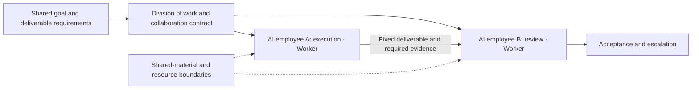
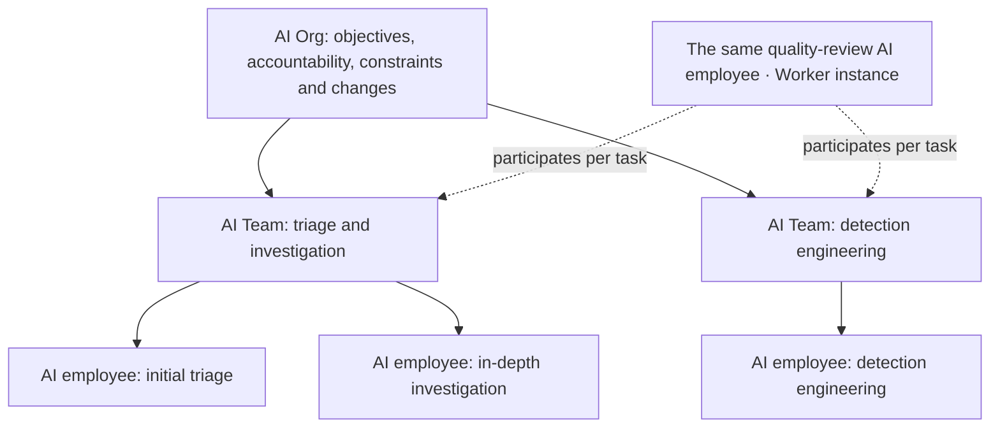
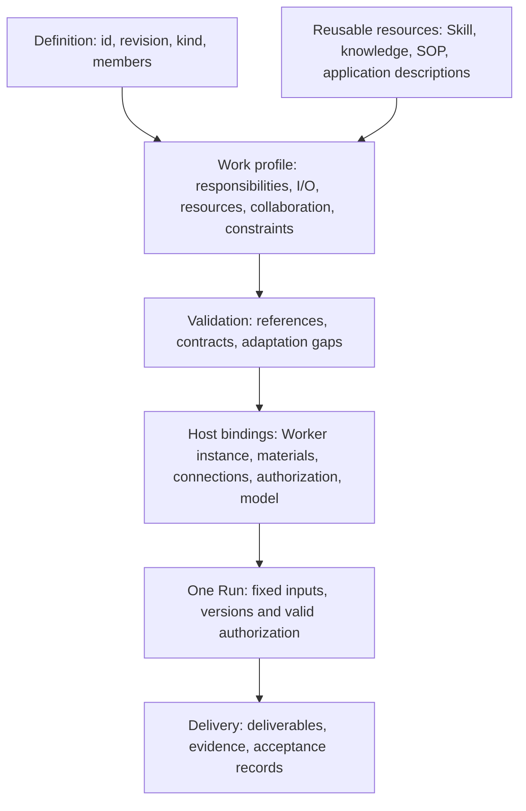
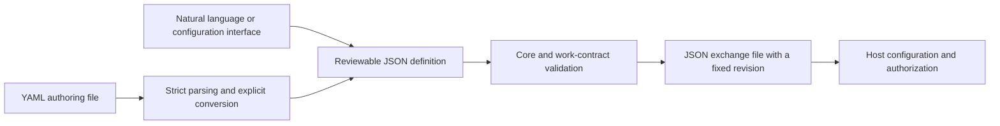

# AI Worker, AI Team and AI Organization Open Definition Standard 1.0

[Languages / 语言](../docs/languages.md)

**Max Luo and Morgan Chen, co-founders of Teloa**

Core version: `1.0`. Publication date: 2026-10-18. Status: open specification.

> This is a complete English translation of the [authoritative Simplified Chinese specification](core.zh-CN.md). It has not received a full review by native-speaking industry experts. If the texts conflict, the Simplified Chinese text governs; please report translation issues. JSON/YAML examples retain their original Chinese values so that examples remain identical across languages. Mermaid display labels are translated; node identifiers and graph structure are unchanged.

This document and the [Work and Collaboration Profile](work-profile.en.md) together constitute this edition of the specification. Sections 1–3 explain the concepts; sections 4–9 specify core exchange behavior. Instance configuration and actual operation require separate verification.

## 1. Understanding the composition in plain language

**An AI Worker is an AI work entity with a persistently identifiable identity that carries responsibilities, accepts work and delivers verifiable results within an explicit authorization boundary. An AI Team is a composition whose members divide responsibilities and collaborate toward a shared deliverable. An AI Organization adds organizational accountability, resource constraints and change governance to that composition.**

In Teloa, these work entities are called **AI employees**; AI Worker is the general standard concept behind them. What users create and collaborate with is still called an AI employee. A Worker definition describes responsibilities and work contracts, while a Worker instance identifies a particular AI employee. A Grok Bot can also be described as an AI Worker. This conceptual mapping does not imply vendor certification; an actual adaptation must still check the contracts and host behavior.

Here, “persistent” means that identity and responsibilities can continue across tasks. It does not require continuous availability, a permanent process, a dedicated machine or long-term memory. A work entity may invoke several models and temporary Agents; its external deliverables remain attributable to the same traceable Worker instance.

| Term | Meaning in this standard | Boundary |
| --- | --- | --- |
| AI Agent | A general technical concept for reasoning, tool use or task execution | May be temporary; the name alone does not establish a Worker contract |
| AI Worker | A persistently identifiable, constrained AI entity accountable for work delivery | “Accountable” means work attribution and traceability, not legal personality |
| AI Team | A composition with a shared work interface, assigned member responsibilities and a collaboration contract | A group chat or member list alone does not demonstrate conformance |
| AI Organization | A composition with both a collaboration contract and an organizational governance contract | Not distinguished by headcount or number of levels; does not automatically represent a legal business entity |
| AI Workforce | A collective term for AI workers and work capacity within a given scope | This edition adds no separate object or format |
| AI employee, Bot | Names used by products or businesses | Mapped according to actual composition and behavior; product names do not confer conformance |

AI Worker is already used publicly, for example by [11x](https://www.11x.ai/11x-manifesto) and [Delos](https://marketplace.microsoft.com/en-us/product/office/WA200011292). This specification adopts an existing term and supplies its own normative definition. It does not claim to have coined the name or treat vendors’ terminology as a common industry standard. On first public use, write “AI Worker (software work entity)” to avoid confusion with people working in the AI industry.

### 1.1 What makes up an AI Worker

| Component | Plain-language question | Underlying content |
| --- | --- | --- |
| Role and responsibilities | Who am I, what am I responsible for, and when do I escalate? | Name, responsibilities, explicit exclusions, judgment and confirmation rules |
| Methods and evidence | How do I work, and what supports my judgments? | Skills, knowledge and SOPs; methods and facts are referenced separately |
| Work and scheduling | What work do I accept, and when do I do it? | Work templates, inputs and outputs, and routines configured as needed |
| Execution conditions | Which tools do I use, and how far may I go? | Application requirements, material scope, permission conditions, model and budget requirements |
| Experience and deliverables | What experience carries forward, and how is completion demonstrated? | Memory rules, deliverable versions, evidence and acceptance |

These five groups aid reading and cover the existing 12 categories of components; they do not introduce five new resource types. A minimum Worker definition MUST include identity and revision, responsibilities and judgment boundaries, and at least one work contract with inputs, outputs, a responsible position and acceptance requirements. Skill packages, knowledge bases, SOPs, memory and routines are provided as needed. An empty resource catalog is valid but MUST NOT be used to bypass actual dependencies.

### 1.2 What makes up an AI Team

**Team = shared goal + members and division of roles + shared-context boundaries + collaboration and handoffs + work arrangements + resource constraints + deliverable acceptance.** A group chat can carry communication; the team contract specifies who is responsible, what is delivered, who receives it and when to stop. A coordinator is an optional collaboration role. Teams are not required to use a manager-led structure.



The diagram uses Teloa as an example: AI employees correspond to Workers, and an AI team uses a Team contract to specify shared deliverables and collaboration.

### 1.3 How an AI Organization grows from teams

**Organization = a composition of individuals and teams + cross-team accountability + resource and information boundaries + escalation and change rules.** A team may be a member of an organization while continuing to use the same work interface. An organization promises only the work it explicitly lists; it does not automatically acquire all its members’ capabilities or permissions.



The diagram retains Teloa’s AI employee and AI team terminology to illustrate how Worker, Team and Org compose. It is a composition diagram, not a claim that these organizations have been deployed. Consultants can participate per task without joining every group. Sharing one AI employee across teams requires explicit instance bindings. Reusing a role template to create two AI employees is a different relationship.

## 2. The underlying technical architecture

The core exchange objects remain **agent** and **organization**, preserving the existing format. A complete AI Worker definition uses agent plus the required work profile; an AI Team uses organization plus a collaboration contract; an AI Organization adds a governance contract to the same composition object. `kind: agent` is only an underlying structural category, not a claim of AI Worker conformance. The three usage forms do not create three core formats.



In Teloa, the host binds a particular AI employee; each Run is one execution by that employee. Definition, instance and Run are recorded separately, connecting the product terminology to the technical concepts.

| Layer | What the standard specifies | What the host provides |
| --- | --- | --- |
| Definition | Fixed identity and revision, composition, work and collaboration requirements | Reading, validation, reporting and lossless preservation |
| Instance | The identities and scopes that bindings must distinguish | Creating or reusing employees; binding connections, models, permissions and private memory |
| Execution | Input/output, handoff, stopping and acceptance semantics | Reasoning, delegation, scheduling, budget enforcement, authorization checks and execution records |

Both individuals and compositions answer four questions: **What inputs do they accept, what conditions do they require, what results do they deliver, and what boundaries do they observe?** The host verifies instance identity. Renaming, joining a group, importing a template or referring to the same definition grants no authorization. Historical executions retain their previous versions; template upgrades do not rewrite them.

This specification does not prescribe one machine per employee, a single model, a single scheduler or a complete organization management system. It does not cover payments, legal personality or embodied control. Missing required capabilities MUST be reported; successfully reading a file MUST NOT be treated as evidence that it can be executed. This first edition covers employees, teams and organizational compositions.

### 2.1 How conformance to this edition is determined

In this document, MUST and MUST NOT indicate mandatory requirements, SHOULD indicates a recommendation, and MAY indicates an option. Examples illustrate the format only; they do not represent deployment or successful runtime verification.

| Claim scope | Required elements | What the claim establishes |
| --- | --- | --- |
| Core definition exchange | Core rules in sections 4–9 | Files can be interpreted correctly and preserved losslessly; this alone does not establish AI Worker adaptation |
| AI Worker definition | agent core + required work appendix + complete responsibility, work and acceptance contracts | The definition is complete; connections, actual identity and execution capabilities still require host binding |
| AI Worker instance | Validated definition + stable instance identifier + trusted managing principal + per-work authorization and execution records | Identity can be traced across tasks; replacing a model or starting a new Run does not mean a new employee |
| AI Team definition | organization core + work appendix + division of responsibilities, handoffs, sharing and stopping rules | The collaboration contract can be interpreted; automatic delegation and actual handoffs require separate verification |
| AI Organization definition | AI Team contract + governance + organizational constraints | The governance contract is complete; specific identities, policies and constraint enforcement require separate verification |

The same composition definition with governance can satisfy both Team and Organization claims; these are not mutually exclusive product types. Definition conformance does not require prior successful execution. Instance readiness and success of a particular execution require separate evidence. A composition without declared governance MUST NOT claim AI Organization conformance to this edition merely by changing its name.

A stable instance identifier only needs to be unique within the declared host and trusted-principal scope; a global account or decentralized identity network is not required. Workers may start on demand, pause or retire. The host MUST record the actual behavior associated with these states and recheck valid authorization before resuming. Retirement does not reattribute historical deliverables to a new instance. The actual deployment policy determines storage and retention periods.

### 2.2 JSON for exchange, YAML for authoring

**JSON is the sole normative exchange representation in this edition; YAML is optional author input.** Users may also generate the same definition through natural language or forms. A receiver that implements only JSON may still claim core exchange conformance. YAML authoring is listed as a separate supported capability; not every product is required to provide a YAML editor.



A converter claiming support for this edition’s YAML authoring convention MUST parse types using the YAML 1.2 Core Schema, accept a single mapping document with string keys, and reject duplicate keys, non-finite numbers, custom or explicit tags, anchors, aliases, entries whose key text is `<<`, and multi-document streams. It MUST accept only values that can be represented losslessly in JSON and MUST NOT silently round numbers. Environment variables, template expressions and file includes are not evaluated. `revision: "1"` is a string; `revision: 1` is a number and MUST be rejected by field validation. The parser and its version are recorded in the conversion record. [YAML 1.2.2](https://yaml.org/spec/1.2.2/)

YAML comments do not enter exchange semantics. Permissions, restrictions and acceptance MUST NOT appear only in comments. Line breaks in parsed block text are part of the string content and are compared under R02. Authors may retain YAML as the authoring source and export fixed JSON each time; the two MUST NOT become independently editable sources of truth for the same revision. Changes to exported results MUST return to the common source to generate a new revision.

This is not a JSON byte-canonicalization or signature protocol. R02 compares JSON values; resource-package digests still apply to actual bytes. JSON Schema 2020-12 describes Work inputs and outputs. Both authoring paths MUST undergo the same contract checks. [JSON Schema](https://json-schema.org/draft/2020-12)

## 3. Reusing external definitions

| Source | Adopted in this edition | Explicit differences |
| --- | --- | --- |
| OASF | Capability taxonomies, domains and version information from native discovery; metadata and resource locations mapped as needed | A taxonomy skill is not an executable method package, and classification does not establish work quality |
| Oracle Agent Spec 26.1.2 | Ideas for component references and composition; explicit inputs and outputs; separation of definition and invocation; directed collaboration relationships | This edition’s work interfaces use JSON Schema objects; they do not masquerade as Agent Spec component configurations or reproduce its complete execution graphs |
| Grok Bot | Persistent roles, shared methods, role context, and separation of Skills and Routines | Public recipes are template material; a Team Bot is one Bot used by multiple people, not a team of multiple employees |

OASF discovery data is carried unchanged at a fixed version; see appendix §7. Discovery records may be derived from it without creating another synonymous capability taxonomy. [OASF Record Guide](https://docs.agntcy.org/oasf/agent-record-guide/) · [Discovery Extension](https://docs.agntcy.org/oasf/discovery-extension/)

Agent Spec uses `$component_ref` for references within a configuration. Its inputs and outputs are based on JSON Schema, while Swarm and ManagerWorkers have specific collaboration behavior. This edition retains cross-file id + revision references and treats responsibility handoff, conversation transfer and permissions separately. Conversion MUST validate the actual input/output constraints and collaboration behavior; it does not share the entire conversation by default or implicitly convert input/output types. [Agent Spec 26.1.2](https://oracle.github.io/agent-spec/26.1.2/agentspec/language_spec_26_1_2.html)

Borrowing definitions, preserving native data and passing compatibility verification are different claims. Adopting these designs does not mean compatibility with all OASF modules or Agent Spec runtimes has been established. [Grok design overview](https://x.ai/news/designing-grok-bot) · [Team Bots](https://docs.x.ai/grok-bot/team-bots)

## 4. From a core definition to a complete AI Worker

### 4.1 Minimum core exchange definition

```json
{
  "specVersion": "1.0",
  "id": "urn:example:definition:research-assistant",
  "revision": "5",
  "kind": "agent",
  "name": "研究助手",
  "instructions": "根据提供的资料回答问题，保留来源，区分事实、推断和未知。"
}
```

These six fields constitute only a minimum exchange definition, not a complete AI Worker. Add capabilities when the individual needs external capabilities as global prerequisites. A claim to support this edition’s Worker work or team collaboration contracts also requires support for the work profile in the appendix; storing a prompt alone cannot establish complete adaptation.

### 4.2 Minimum complete AI Worker definition

The following is a cross-industry document-summary worker. It has no external applications, skill packages or automatic routines, but has explicit responsibilities, inputs, outputs and acceptance. It defines a role that can repeatedly perform summary work; its actual instance and managing principal are bound at deployment.

```json
{
  "specVersion": "1.0",
  "id": "urn:example:definition:document-worker",
  "revision": "2",
  "kind": "agent",
  "name": "材料摘要工作者",
  "instructions": "持续承担已提供材料的摘要工作，注明材料之外无法核实的内容。",
  "extensions": [{
    "id": "urn:teloa:profile:ai-work",
    "version": "1.0",
    "required": true,
    "data": {
      "responsibility": {
        "triggers": ["收到已授权的摘要任务"],
        "autonomousActions": ["读取本次提供的材料并撰写摘要"],
        "confirmationPoints": ["对外发布须由任务负责人另行确认"],
        "escalationRules": ["材料缺失或相互矛盾时报告缺口"],
        "deliveryChecks": ["摘要可回查材料，不补造事实"]
      },
      "resources": [],
      "authorityRoles": [{"id": "owner", "name": "任务负责人", "kind": "human"}],
      "works": [{
        "id": "summarize",
        "title": "材料摘要",
        "instructions": "根据输入材料交付摘要和未决问题。",
        "inputs": {
          "$schema": "https://json-schema.org/draft/2020-12/schema",
          "type": "object",
          "properties": {"material": {"type": "string", "minLength": 1}},
          "required": ["material"],
          "additionalProperties": false
        },
        "outputs": {
          "$schema": "https://json-schema.org/draft/2020-12/schema",
          "type": "object",
          "properties": {
            "summary": {"type": "string", "minLength": 1},
            "openQuestions": {"type": "array", "items": {"type": "string"}}
          },
          "required": ["summary", "openQuestions"],
          "additionalProperties": false
        },
        "requires": [],
        "responsible": "self",
        "acceptance": {
          "criteria": ["摘要与输入材料一致，未决问题单列"],
          "reviewer": "authority/owner",
          "independent": true
        }
      }]
    }
  }]
}
```

The example’s [JSON file](../examples/document-worker.json) and [YAML authoring file](../examples/document-worker.yaml) are generated from the specification text and express the same JSON value. For complete team, organization and shared-instance examples, see the [composition example](../examples/composition-fixture.json). These are definition examples; none thereby receives authorization to connect, execute or publish.

## 5. Composing a team or organization in one file

```json
{
  "specVersion": "1.0",
  "id": "urn:example:definition:research-team",
  "revision": "5",
  "kind": "organization",
  "name": "研究小组",
  "instructions": "research 整理证据，review 检查来源和结论；发现分歧时保留分歧。",
  "members": [
    {
      "id": "research",
      "ref": {
        "id": "urn:example:definition:research-assistant",
        "revision": "5"
      }
    },
    {
      "id": "review",
      "ref": {
        "id": "urn:example:definition:research-assistant",
        "revision": "5"
      }
    }
  ]
}
```

This example expresses only core composition references. It is not a complete AI Team or AI Organization definition; the work appendix and the relevant collaboration and governance contracts must also be supplied.

Each member entry references an individual or suborganization definition. The same template may be reused, but the two member entries still have separate names. This does not automatically establish that two actual executors are independent, nor does it create two-person approval. A Member is a definition slot within a composition, not directly a group member or appointment record. The appendix specifies members, consultants, external authority roles and instance bindings; the host establishes actual identities and permissions.

## 6. Core fields

Except inside extension data, all objects accept only fields defined in the following table and subsequent text. New semantics are expressed through extensions.

| Field | Type and scope | Why it is retained |
| --- | --- | --- |
| specVersion | Required; exactly `1.0` | Determines how the file is interpreted |
| id | Required; absolute URI or URN | References the same definition across files |
| revision | Required; non-empty string; MUST NOT be latest | Fixes content and prevents references from changing silently |
| kind | Required; agent or organization | Distinguishes individuals from compositions |
| name | Required; non-empty string | Enables human recognition and sharing |
| instructions | Required; non-empty string | Expresses agent responsibilities or organizational collaboration requirements |
| capabilities | Optional; array of Capability; available only to agent | References required external capabilities |
| members | Required non-empty array of Member for organization; MUST NOT be used by agent | Expresses organizational composition |
| extensions | Optional; array of Extension | Accommodates semantics outside the core |

- A non-empty string MUST NOT consist solely of whitespace. The optional top-level arrays capabilities and extensions may be omitted or empty; both are valid and have the same default interpretation. Their original JSON values still differ and are compared under R02. null MUST NOT be used instead.
- LocalId matches `^[a-z][a-z0-9-]{0,63}$`. Member and Capability ids are unique within their respective arrays. An extension contract may define references to these entries but MUST identify the owning definition and array; LocalIds MUST NOT be assumed globally unique.
- DefinitionRef contains only `id` and `revision`, with the types specified above.
- Member contains only `id: LocalId` and `ref: DefinitionRef`. All member references are required.
- Capability contains only `id: LocalId`, `kind: "mcp" | "skills" | "a2a" | "resource"`, and `config: object`; see section 7 for config.
- Extension contains only `id: absolute URI or URN`, `version: non-empty exact version string`, `required: boolean`, and `data: object`. version MUST NOT be a range or latest. Extension ids are unique within a definition.

## 7. External capabilities are references only

The following four kinds are optional bindings: reading a definition does not require the receiver to execute them. Implementing the corresponding native protocol or format is required only when claiming the ability to use that binding. config accepts only the fields in this table; all fields are required unless marked optional.

| kind | config fields | Binding boundary |
| --- | --- | --- |
| mcp | `protocolVersion: non-empty string`; `transport: "stdio" \| "streamable-http"`; `connectionRef: non-empty string`; `selectors: Selector[], optional` | References a host-resolved MCP connection; capabilities and authorization are checked against the specified native version |
| skills | `formatSnapshot: URI`; `packageRef: URI`; `packageMediaType: "application/zip" \| "application/x-tar"`; `packageDigest: Digest` | References a complete skill package and fixed format snapshot, preserving SKILL.md and accompanying files |
| a2a | `protocolVersion: non-empty string`; `agentCardRef: URI`; `interfaceUrl: URI`; `protocolBinding: non-empty string`; `skillIds: non-empty string[], optional`; `requiredExtensions: URI[], optional` | References a specified interface of an A2A service, preserving native tasks, artifacts and states |
| resource | `uri: URI`; `mediaType: non-empty string`; `digest: Digest, optional` | Reads a resource only; does not automatically execute its content |

Selector is only `{"type":"tool" or "prompt","name":non-empty string}` or `{"type":"resource","uri":URI}`. When selectors is declared, the array MUST NOT be empty and every entry MUST be satisfied. Omitting it means only that the connection is needed, not that all its tools are authorized.

Every URI is an absolute URI or URN. Digest is `sha256:` followed by 64 lowercase hexadecimal characters. Protocol versions MUST be exact, not ranges or latest. Connection names, Card addresses and package locations do not confer authorization.

Example: placing the following entry in an agent’s capabilities array indicates that it requires this MCP connection. The example connection and version must still be verified in the actual deployment.

```json
{
  "id": "knowledge",
  "kind": "mcp",
  "config": {
    "protocolVersion": "2026-07-28",
    "transport": "streamable-http",
    "connectionRef": "project-knowledge"
  }
}
```

**MCP:** The deployer maps connectionRef. The actual connection MUST be displayed and independently authorized; connectionRef contains no token or startup command. The declared version’s discovery, transport and authorization rules apply. An implementation MUST NOT automatically match a different connection by tool name alone. The core does not describe individual tool parameters or define a general tool-permission language. [MCP versioning rules](https://modelcontextprotocol.io/docs/2026-07-28/learn/versioning)

**Skills:** formatSnapshot MUST be an immutable source for the format specification. The digest covers the complete package’s original bytes. The extraction root is a single skill directory. Path traversal, duplicate normalized paths, symbolic links and hard links are rejected; import does not execute scripts. ZIP/TAR is this specification’s packaging convention, not a native Agent Skills requirement. [Agent Skills format](https://agentskills.io/specification)

**A2A:** interfaceUrl, protocolBinding and protocolVersion MUST correspond to the same interface on the actual Card. Declared skillIds and extensions required by either party are checked against the native specification; authorization is checked separately. Server-side completion does not mean the business objective has been achieved. An A2A AgentSkill is not an Agent Skills file package. [A2A specification](https://a2a-protocol.org/latest/specification/)

**Resources:** A resource without a digest is treated as mutable content. Actual use records the retrieved version or time; reproducibility cannot be claimed. Private resources are read under actual permissions.

These fields describe references in this specification; they are not request bodies sent to native services. Critical constraints that this edition cannot express MUST be explicitly represented in a required extension, not guessed by the host or silently discarded. Native details and execution guarantees remain within each binding rather than being duplicated in a general runtime protocol.

## 8. Eight common rules

**R01 Explicit format.** Exchange files MUST be UTF-8 JSON objects. Duplicate keys, unknown core fields, invalid field types and non-finite numbers are rejected. An unsupported core version MUST be explicitly reported; it MUST NOT be interpreted using an older version. The core does not validate internal fields of unknown extension data.

**R02 Immutable revisions.** id and revision are compared exactly as their original strings, without URI normalization; together they identify a fixed definition. A change to the JSON value under the comparison rules below MUST receive a new revision. Different values for the same pair MUST be reported as a conflict and MUST NOT overwrite one another. Comparison ignores object-key order and whitespace outside strings, but preserves array order and string content. Different JSON types are unequal; numbers are compared by mathematical value (for example, 10 equals 10.0), and distinct numbers MUST NOT be treated as equal because of rounding. An omitted field and an explicit empty array are different JSON values; they are not merged merely because their default interpretation is the same.

**R03 Resolvable references.** Before assembling an organization, all direct and indirect member references MUST be resolved recursively to their specified revisions. Missing references, revision mismatches or cycles MUST be reported and assembly MUST stop; versions MUST NOT be substituted automatically. A claim of full organizational support MUST cover all required capabilities and extensions of every member definition in that reference closure. Definition references form a directed acyclic graph; this does not restrict back-and-forth collaboration during execution. An id is not a download address. The host determines how definitions are obtained; reading a file MUST NOT automatically access the network.

**R04 Composition does not merge permissions.** Members use their own definitions and capabilities. Organization instructions describe collaboration requirements; they neither override member instructions nor automatically add tools or permissions to members. Affected work MUST NOT start while conflicts remain unresolved. Capabilities with the same name remain distinguished by their owning members; connections MUST NOT be merged. The core does not define scheduling, prompt merging or actual identity assignment.

**R05 Declarations must be fulfilled.** Every capabilities entry is a declared required dependency of that agent; no binding is “ignorable by default.” When an entry cannot be provided, the missing dependency MUST be listed. The agent MUST NOT start under that definition or claim full support, and an organization MUST NOT bypass a required member with missing dependencies to execute. Viewing and preservation remain allowed; removing or changing capabilities requires a new revision. Actual execution requires native-support and authorization checks; successful reading does not mean executable readiness.

The appendix’s resources form a catalog selected per work, not capabilities. Both global conditions and the selected work’s required conditions must be met; unavailable resources exclusive to other work block only that other work. Full support, readiness for particular work and actual authorization are reported separately. The profile MUST NOT be used to bypass this rule’s global dependency requirements.

**R06 Extensions fail explicitly.** An extension contract is fixed by id and exact version and defines at least its data structure, semantics and validation method. Structural or semantic changes MUST change the version. Consumers MUST explicitly support it; reading a URI MUST NOT automatically download validators or code. Unknown extensions MUST be preserved as JSON values and reported. When required=true, the definition MUST NOT be assembled or executed and full support MUST NOT be claimed. required=false is only for supplementary information that does not change basic operational meaning. Publishers MUST NOT mark permissions, payments, execution conditions or acceptance constraints as ignorable. When a consumer detects such a violation in a supported extension, it MUST reject assembly, execution and full-support claims and MUST NOT mark validation as passed. The problematic file may still be preserved, viewed or exported unchanged with an error report. The core does not claim to recognize every meaning of unknown data. Mutually conflicting required constraints MUST NOT be relaxed by choosing one over another.

**R07 Definitions grant no rights.** Import MUST NOT automatically create runtime individuals, install code, connect services, execute tasks or make payments. Definitions MUST NOT contain keys, tokens, cookies or directly usable authorization credentials. Templates, role descriptions and organizational relationships do not establish identity, authority to represent others or execution authorization; the host verifies these before an actual operation.

**R08 Conformance claims require evidence.** The minimum conformance claim is only “supports definition exchange for this version,” requiring correct reading, validation, reporting, preservation and lossless export. For valid documents, the JSON value MUST remain unchanged after import and re-export, including unknown extensions. Editing MUST generate a new revision. Actual support for bindings and extensions is listed separately by name, version and verified scope. Exchange conformance MUST NOT be used to infer runtime capability, business quality or cross-platform migration of individuals.

## 9. Conformance and acceptance

Conformance is declared within an explicit scope; one claim of “compatibility” does not cover all capabilities. Scopes include core exchange; interpretation of the work profile; mappings from specified sources and versions; and operation for a particular host, work and input scope. Business quality requires task-specific evaluation and cannot be inferred from structural checks.

The following six items are acceptance checks for core definition exchange. Positive and negative profile examples appear in the appendix; verification scope is described in the [conformance statement](../CONFORMANCE.md). Auxiliary example checks do not constitute a complete conformance implementation or interoperability between two independent implementations.

| ID | Input or operation | Required observable result |
| --- | --- | --- |
| T01 | Duplicate keys, unknown core fields, invalid kind/types, unknown core version | Reject, or explicitly report the version as unsupported |
| T02 | Import and re-export the examples in sections 4 and 5, valid definitions with unknown extensions, and a composition whose members each declare a same-named capability, together with its member definitions | JSON values remain unchanged; same-named capabilities of different members are not merged |
| T03 | Different values for the same id/revision; also compare key order, whitespace, 10 versus 10.0, omitted arrays versus explicit empty arrays | Apply R02; conflict only when values differ, with no overwrite; omission and an empty array conflict; value changes require a new revision |
| T04 | Nested references A → B → C; missing references, revision mismatches, cycles or case-only differences; C lacks a required capability or required extension | Identify reference errors and stop assembly; do not automatically access the network or normalize references to fill gaps; when C lacks a requirement, A MUST NOT claim full support and execution is restricted under R05/R06 |
| T05 | Unknown optional/required extensions; a supported constraint extension incorrectly marked optional | Preserve and report all unknown entries; required blocks assembly, execution and full-support claims; known invalid constraints are likewise rejected and MUST NOT be marked as validation passed; preserving the original file with an error report is allowed |
| T06 | Only import a file containing capability references | Do not install, connect or execute; state that execution is unverified and do not claim usable configuration |

Actual execution of bindings and hosts requires separate verification, covering at least refusal to start when required capabilities are missing, actual authorization, isolation in organizational composition, and native failures and unknown results. JSON checks MUST NOT be presented as proof that these have passed.

Hosts are not required to share one error-code set or internal state machine, but errors MUST locate the object and explain the reason. Different implementations SHOULD reach consistent results for the acceptance, rejection and preservation behavior above.

## 10. Evolution and implementation boundaries

A single common work profile is retained to express Worker, Team and Organization work contracts and necessary host requirements. Hosts implement memory content, actual schedules, account identity and organization management; new interoperability needs can prompt evaluation of extensions. New protocols may be introduced through required URI extensions without adding all of them to core enumerations.

An initial demonstration may use a local directory with one JSON file per definition, indexed by the content’s id/revision. Filenames carry no semantics. This is an example delivery method, not a new distribution protocol. Include nested-reference, missing-reference and conflict counterexamples with expected results, then use two independent implementations to check validation, import and export behavior. Next, choose a genuinely needed capability binding and verify “import → configure connection/authorization → execute → obtain deliverable.” Until this path is complete, the standard does not expand into general runtime, payment or lifecycle management.

Upgrading the specification version requires revalidation, updated specVersion and appendix version, and a new revision. Member references are fixed accordingly. Old definitions and Runs are not rewritten in place. Different specification versions are not automatically compatible; semantic changes require migration notes. See the [maintenance rules](../GOVERNANCE.md).

### 10.1 Common core and industry configurations

| Example domain | What is configured differently | Common contracts reused |
| --- | --- | --- |
| SOC | Evidence sources, alert-triage methods, escalation conditions and response authorization | Identity, responsibilities, work I/O, handoffs and deliverable acceptance |
| Customer service | Product knowledge, ticket classification, service time limits and escalation to a human | Same contracts; SOC tools and terminology are not imported into customer service |
| Content work | Material scope, editorial rules, review and publishing permissions | Same contracts; a completed manuscript does not mean it has been published |

The table shows only that the definition layer can express this work; it does not claim completed validation in these industries. Industry requirements are configured through resources, work and required extensions. The core prescribes no fixed number of roles, model, tool vendor, quality score or execution frequency.

### 10.2 Current standing and conditions for progress

This is currently a Teloa-maintained open specification, without industry or international standard status. Original specification text and examples are licensed under [Apache-2.0](../LICENSE). Maintenance, feedback and version rules are in [GOVERNANCE.md](../GOVERNANCE.md), and claim scopes are in [CONFORMANCE.md](../CONFORMANCE.md). Industry interoperability claims still require at least two independent implementations and publicly reproducible verification evidence that includes a non-SOC scenario. Review feedback and example checks do not replace that evidence.

Interpreting definitions MUST NOT depend on a Teloa account, cloud service or private database. `urn:teloa:profile:ai-work` is the existing extension’s publisher namespace, retained to prevent fragmentation into synonymous identifiers. It requires no Teloa host and carries no endorsement from an industry governing body. Products may still generate a definition for confirmation from a single natural-language description.
