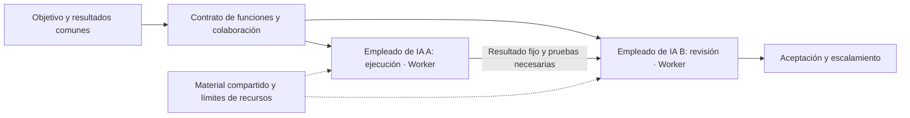
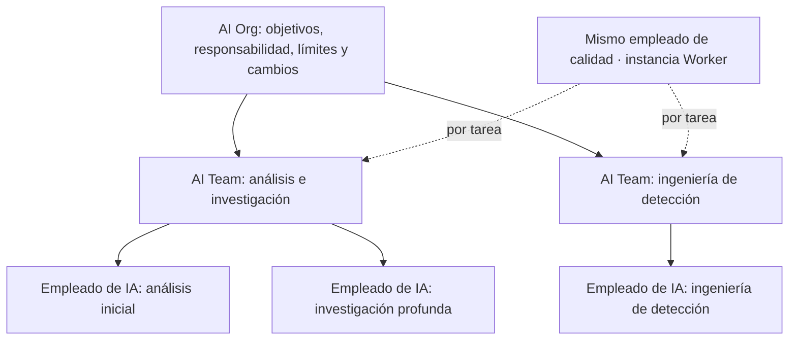
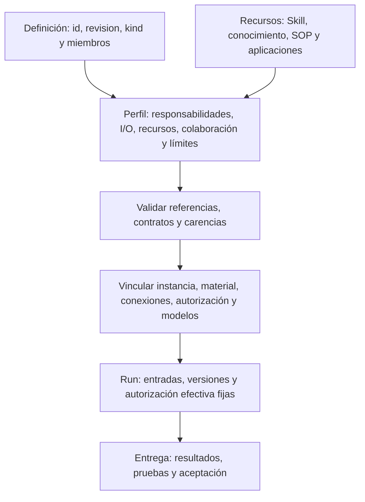
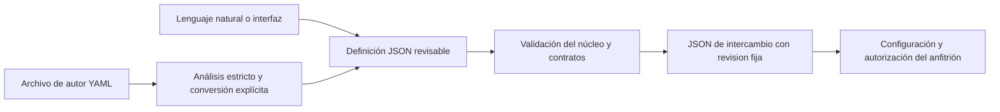

# Estándar abierto de definición de AI Worker, AI Team y AI Organization 1.0

[Languages / 语言](../docs/languages.md)

**Max Luo y Morgan Chen, cofundadores de Teloa**

Versión del núcleo: `1.0`. Publicación: 2026-10-18. Estado: especificación abierta.

Esta es una traducción completa del [texto chino simplificado de referencia](core.zh-CN.md). No ha recibido una revisión completa por especialistas del sector de habla nativa. Si encuentra discrepancias, comuníquelas; prevalece el texto de referencia. Los valores de los ejemplos JSON se conservan sin traducir para que representen las mismas definiciones en todos los idiomas.

Este documento y el [perfil de trabajo y colaboración](work-profile.es.md) forman la especificación de esta edición. Las secciones 1–3 explican los conceptos; las secciones 4–9 establecen el comportamiento del intercambio básico. La configuración de instancias y la ejecución real se verifican por separado.

## 1. Comprender la composición en términos sencillos

**Un AI Worker es una entidad de trabajo de IA con identidad persistente que asume responsabilidades, acepta trabajo y entrega resultados verificables dentro de un límite explícito de autorización. Un AI Team es una composición que distribuye el trabajo para producir un resultado común. Una AI Organization añade responsabilidad organizativa, restricciones de recursos y gobernanza de cambios a esa composición.**

En Teloa, estas entidades se llaman **empleados de IA**; AI Worker es el concepto general del estándar que las describe. El usuario sigue creando empleados de IA y colaborando con ellos. La definición Worker describe responsabilidades y contratos de trabajo; la instancia Worker identifica a un empleado concreto. Grok Bot también puede describirse como AI Worker. Esta correspondencia conceptual no implica certificación del proveedor: la adaptación debe comprobar los contratos y el comportamiento del anfitrión.

«Persistente» significa que identidad y responsabilidades pueden continuar entre tareas. No exige disponibilidad permanente, un proceso perpetuo, una máquina exclusiva ni memoria a largo plazo. La entidad puede invocar varios modelos y agentes temporales; su entrega externa sigue atribuida a una misma instancia Worker trazable.

| Término | Significado en este estándar | Límite |
| --- | --- | --- |
| AI Agent | Concepto técnico general para razonamiento, uso de herramientas o ejecución de tareas | Puede ser temporal; el nombre no demuestra que tenga un contrato Worker |
| AI Worker | Entidad de IA identificable de forma persistente, sujeta a restricciones y responsable de sus entregas | Responsabilidad significa atribución y trazabilidad del trabajo, no personalidad jurídica |
| AI Team | Composición con una interfaz de trabajo común, reparto de funciones y contrato de colaboración | Un chat o una lista de miembros no demuestra conformidad |
| AI Organization | Composición con contrato de colaboración y contrato de gobernanza organizativa | No se distingue por número de miembros o niveles, ni representa automáticamente una entidad jurídica |
| AI Workforce | Denominación colectiva de trabajadores de IA y capacidad de trabajo en un ámbito | Esta edición no añade un objeto o formato independiente |
| Empleado de IA, Bot | Nombres de producto o de negocio | Se adaptan según composición y comportamiento reales, no solo por su nombre |

AI Worker ya tiene usos públicos, por ejemplo en [11x](https://www.11x.ai/11x-manifesto) y [Delos](https://marketplace.microsoft.com/en-us/product/office/WA200011292). Esta especificación adopta el término existente y establece su propia definición normativa; no reivindica haber acuñado el nombre ni trata las denominaciones comerciales como un estándar sectorial común. En la primera mención pública, utilice «AI Worker (entidad de trabajo de software)» para evitar confusión con personas que trabajan en el sector de la IA.

### 1.1 Componentes de un AI Worker

| Grupo | Pregunta práctica | Contenido |
| --- | --- | --- |
| Puesto y responsabilidades | Quién soy, de qué me encargo y cuándo escalo | Nombre, responsabilidades, exclusiones, reglas de decisión y confirmación |
| Métodos y fundamentos | Cómo trabajo y en qué baso mis decisiones | Skills, conocimiento y SOP; métodos y hechos se referencian por separado |
| Trabajo y planificación | Qué trabajo acepto y cuándo lo hago | Plantillas de trabajo, entradas, salidas y rutinas opcionales |
| Condiciones de ejecución | Qué herramientas uso y hasta dónde puedo actuar | Aplicaciones, ámbito de datos, permisos, modelos y presupuesto |
| Experiencia y resultados | Qué experiencia conservo y cómo demuestro la finalización | Políticas de memoria, versiones de resultados, pruebas y aceptación |

Estos cinco grupos facilitan la lectura y abarcan las 12 categorías existentes; no crean cinco tipos nuevos de recurso. Una definición Worker mínima debe incluir identidad y revisión, responsabilidades y límites de decisión, y al menos un contrato con entradas, salidas, posición responsable y requisitos de aceptación. Los paquetes de habilidades, bases de conocimiento, SOP, memoria y rutinas se incorporan cuando hacen falta. Un catálogo de recursos vacío es válido, pero no permite eludir dependencias reales.

### 1.2 Componentes de un AI Team

**Equipo = objetivo común + miembros y funciones + límites del contexto compartido + traspasos de trabajo + planificación + restricciones de recursos + aceptación de resultados.** Un chat permite comunicarse; el contrato del equipo determina quién responde, qué entrega, quién recibe y cuándo se detiene. El coordinador es opcional; no se exige una estructura jerárquica para todos los equipos.



El diagrama usa Teloa como ejemplo: los empleados de IA corresponden a Workers; el contrato Team establece la colaboración y la entrega común.

### 1.3 Cómo una AI Organization combina equipos

**Organización = composición de individuos y equipos + responsabilidad entre equipos + límites de recursos e información + reglas de escalamiento y cambio.** Un equipo puede ser miembro de una organización y conservar su interfaz de trabajo. La organización solo promete el trabajo expresamente declarado; no adquiere automáticamente todas las capacidades y autorizaciones de sus miembros.



El diagrama conserva los nombres de producto empleado de IA y equipo de IA para explicar la relación entre Worker, Team y Org. Es un ejemplo de composición, no una afirmación de despliegue. Un consultor puede participar por tarea sin incorporarse a todos los grupos. Compartir el mismo empleado entre equipos requiere una vinculación explícita de instancia. Crear dos empleados a partir de una plantilla es una relación distinta.

## 2. Arquitectura técnica

Solo hay dos tipos de objeto básico de intercambio: **agent** y **organization**, conservando el formato existente. Un AI Worker completo utiliza agent con el perfil de trabajo obligatorio; un AI Team utiliza organization con contrato de colaboración; una AI Organization añade gobernanza al mismo objeto compuesto. `kind: agent` es una categoría estructural, no una declaración de conformidad Worker. Las tres formas de uso no crean tres formatos básicos distintos.



En Teloa, el anfitrión vincula un empleado de IA concreto; cada Run es una ejecución de ese empleado. Definición, instancia y Run se registran por separado, conectando el nombre de producto con los conceptos técnicos.

| Capa | Responsabilidad del estándar | Responsabilidad del anfitrión |
| --- | --- | --- |
| Definición | Identidad y revisión fijas, composición y requisitos de trabajo y colaboración | Lectura, validación, informes y conservación sin pérdidas |
| Instancia | Identidades y ámbitos que debe distinguir la vinculación | Crear o reutilizar empleados; vincular conexiones, modelos, permisos y memoria privada |
| Ejecución | Semántica de I/O, traspaso, parada y aceptación | Razonamiento, asignación, planificación, control presupuestario, autorización y registros |

Individuos y composiciones responden cuatro preguntas: **qué entradas reciben, qué condiciones necesitan, qué resultados entregan y qué límites respetan.** El anfitrión confirma la identidad de instancia; cambiar el nombre, entrar en un grupo, importar una plantilla o referenciar una misma definición no otorga autorización. Las ejecuciones históricas fijan la versión usada; actualizar la plantilla no las reescribe.

Esta especificación no exige una máquina por empleado, un único modelo, un planificador único ni un sistema completo de gestión organizativa. No abarca pagos, personalidad jurídica ni control físico incorporado. Debe informarse de capacidades necesarias ausentes; leer correctamente un archivo no significa poder ejecutarlo. La edición cubre empleados, equipos y organizaciones compuestas.

### 2.1 Cómo determinar la conformidad

«Debe» y «no debe» expresan requisitos obligatorios; «debería» expresa una recomendación; «puede» expresa una opción. Los ejemplos ilustran formatos, no despliegues ni ejecuciones verificadas.

| Declaración | Requisitos | Conclusión permitida |
| --- | --- | --- |
| Intercambio básico | Reglas de las secciones 4–9 | El archivo puede interpretarse y conservarse sin pérdidas; no demuestra adaptación Worker completa |
| Definición AI Worker | Núcleo agent, perfil obligatorio y contratos completos de responsabilidades, trabajo y aceptación | La definición está completa; faltan las vinculaciones reales de identidad, conexiones y ejecución |
| Instancia AI Worker | Definición validada, identificador estable, responsable de gestión fiable y autorización y registros por trabajo | La identidad es trazable entre tareas; cambiar modelo o iniciar otro Run no crea otro empleado |
| Definición AI Team | Núcleo organization, perfil, funciones, traspasos, compartición y reglas de parada | El contrato se interpreta; asignación automática y traspaso real se verifican aparte |
| Definición AI Organization | Contrato Team, governance y restricciones organizativas | La gobernanza está definida; identidad y aplicación real de políticas y restricciones se verifican aparte |

Una definición compuesta con gobernanza puede satisfacer las declaraciones Team y Organization; no son tipos de producto excluyentes. La conformidad de definición no exige una ejecución previa satisfactoria. La preparación de instancia y el éxito de una ejecución necesitan pruebas distintas. Una composición sin gobernanza no debe declararse AI Organization conforme solo cambiando su nombre.

El identificador estable solo debe ser único dentro del anfitrión y del ámbito del principal fiable declarados. No se exige una cuenta global ni una red de identidad descentralizada. Un Worker puede iniciarse, pausarse o retirarse según necesidad; el anfitrión debe registrar el comportamiento real de esos estados y volver a comprobar la autorización antes de reanudarlo. La retirada no transfiere sus resultados históricos a otra instancia. Almacenamiento y plazos de conservación dependen de la política de despliegue.

### 2.2 JSON para intercambio, YAML para redacción

**JSON es la única representación normativa de intercambio; YAML es una entrada de autor opcional.** El lenguaje natural o un formulario también pueden producir la misma definición. Un receptor que solo implemente JSON puede declarar conformidad de intercambio básico. El soporte de autoría YAML se declara por separado; no se exige editor YAML a todos los productos.



Quien declare soporte de la convención YAML debe usar el Core Schema de YAML 1.2 para resolver tipos, aceptar un único documento de mapeo con claves de cadena, y rechazar claves duplicadas, números no finitos, etiquetas explícitas o personalizadas, anclas, alias, entradas cuya clave sea `<<` y flujos multidocumento. Solo se aceptan valores representables en JSON sin pérdidas; no se deben redondear números silenciosamente. No se evalúan variables de entorno, expresiones de plantilla ni inclusiones de archivos. `revision: "1"` es una cadena; `revision: 1` es un número y la validación del campo debe rechazarlo. El registro de conversión identifica el analizador y su versión. [YAML 1.2.2](https://yaml.org/spec/1.2.2/)

Los comentarios YAML no forman parte de la semántica intercambiada; permisos, límites y aceptación no pueden quedar solo en comentarios. Los saltos de línea del texto de bloque analizado forman parte de la cadena y se comparan según R02. El autor puede conservar YAML como fuente y exportar JSON fijo; ambos no deben convertirse en fuentes independientes editables para una misma revisión. Cambiar la exportación exige volver a la fuente única y generar otra revisión.

Esto no es un protocolo de canonicalización de bytes JSON ni de firma. R02 compara valores JSON; el digest de un paquete sigue describiendo sus bytes reales. JSON Schema 2020-12 describe las entradas y salidas Work, y ambas entradas de autor pasan los mismos controles de contrato. [JSON Schema](https://json-schema.org/draft/2020-12)

## 3. Reutilización de definiciones externas

| Fuente | Qué adopta esta edición | Diferencias explícitas |
| --- | --- | --- |
| OASF | Clasificaciones de capacidades, dominios y versiones de discovery; metadatos y localizadores según necesidad | Una habilidad taxonómica no es un paquete ejecutable ni demuestra calidad |
| Oracle Agent Spec 26.1.2 | Referencias y composición; I/O explícitas; separación de definición e invocación; relaciones dirigidas | Work utiliza objetos JSON Schema; no se presenta como configuración nativa ni copia todo el grafo de ejecución |
| Grok Bot | Roles persistentes, métodos compartidos, contexto del puesto y separación de Skill y Routine | Una recipe pública es material de plantilla; Team Bot es un Bot usado por varias personas, no un equipo de múltiples empleados |

Los datos discovery de OASF se conservan sin cambios y con versión fija; véase §7 del perfil. Pueden generar registros de descubrimiento sin inventar otra taxonomía equivalente. [OASF Record Guide](https://docs.agntcy.org/oasf/agent-record-guide/) · [Discovery Extension](https://docs.agntcy.org/oasf/discovery-extension/)

Agent Spec usa `$component_ref` dentro de la configuración; sus I/O se basan en JSON Schema, y Swarm y ManagerWorkers tienen comportamientos concretos. Este estándar conserva id + revision entre archivos y separa responsabilidad, transferencia de sesión y permisos. Una conversión debe verificar el patrón real; no comparte toda la sesión por defecto ni convierte tipos implícitamente. [Agent Spec 26.1.2](https://oracle.github.io/agent-spec/26.1.2/agentspec/language_spec_26_1_2.html)

Inspirarse en definiciones, conservar datos nativos y verificar compatibilidad son declaraciones distintas. Adoptar estos diseños no implica compatibilidad con todos los módulos OASF o entornos Agent Spec. [Diseño de Grok](https://x.ai/news/designing-grok-bot) · [Team Bots](https://docs.x.ai/grok-bot/team-bots)

## 4. De la definición básica al AI Worker completo

### 4.1 Definición mínima de intercambio básico

```json
{
  "specVersion": "1.0",
  "id": "urn:example:definition:research-assistant",
  "revision": "5",
  "kind": "agent",
  "name": "研究助手",
  "instructions": "根据提供的资料回答问题，保留来源，区分事实、推断和未知。"
}
```

Estos seis campos forman una definición mínima de intercambio, todavía no un AI Worker completo. Si el individuo necesita capacidades externas para todas sus operaciones, se añaden capabilities. Declarar soporte del trabajo Worker o la colaboración de equipos requiere el perfil obligatorio; almacenar solo un prompt no demuestra adaptación completa.

### 4.2 Definición mínima de AI Worker completo

El siguiente trabajador de resúmenes sirve para distintos sectores. No tiene aplicaciones externas, paquetes de habilidades ni rutinas automáticas, pero sí responsabilidades, I/O y aceptación explícitas. Define un puesto repetible de resumen; instancia y principal de gestión se vinculan en el despliegue.

```json
{
  "specVersion": "1.0",
  "id": "urn:example:definition:document-worker",
  "revision": "2",
  "kind": "agent",
  "name": "材料摘要工作者",
  "instructions": "持续承担已提供材料的摘要工作，注明材料之外无法核实的内容。",
  "extensions": [{
    "id": "urn:teloa:profile:ai-work",
    "version": "1.0",
    "required": true,
    "data": {
      "responsibility": {
        "triggers": ["收到已授权的摘要任务"],
        "autonomousActions": ["读取本次提供的材料并撰写摘要"],
        "confirmationPoints": ["对外发布须由任务负责人另行确认"],
        "escalationRules": ["材料缺失或相互矛盾时报告缺口"],
        "deliveryChecks": ["摘要可回查材料，不补造事实"]
      },
      "resources": [],
      "authorityRoles": [{"id": "owner", "name": "任务负责人", "kind": "human"}],
      "works": [{
        "id": "summarize",
        "title": "材料摘要",
        "instructions": "根据输入材料交付摘要和未决问题。",
        "inputs": {
          "$schema": "https://json-schema.org/draft/2020-12/schema",
          "type": "object",
          "properties": {"material": {"type": "string", "minLength": 1}},
          "required": ["material"],
          "additionalProperties": false
        },
        "outputs": {
          "$schema": "https://json-schema.org/draft/2020-12/schema",
          "type": "object",
          "properties": {
            "summary": {"type": "string", "minLength": 1},
            "openQuestions": {"type": "array", "items": {"type": "string"}}
          },
          "required": ["summary", "openQuestions"],
          "additionalProperties": false
        },
        "requires": [],
        "responsible": "self",
        "acceptance": {
          "criteria": ["摘要与输入材料一致，未决问题单列"],
          "reviewer": "authority/owner",
          "independent": true
        }
      }]
    }
  }]
}
```

El [archivo JSON](../examples/document-worker.json) y el [archivo YAML de autor](../examples/document-worker.yaml) se derivan de este ejemplo y representan el mismo valor JSON. Véase el [ejemplo de composición](../examples/composition-fixture.json) para equipos, organizaciones e instancias compartidas. Ninguno de estos ejemplos otorga autorización para conectar, ejecutar o publicar.

## 5. Componer equipos u organizaciones en un archivo

```json
{
  "specVersion": "1.0",
  "id": "urn:example:definition:research-team",
  "revision": "5",
  "kind": "organization",
  "name": "研究小组",
  "instructions": "research 整理证据，review 检查来源和结论；发现分歧时保留分歧。",
  "members": [
    {
      "id": "research",
      "ref": {
        "id": "urn:example:definition:research-assistant",
        "revision": "5"
      }
    },
    {
      "id": "review",
      "ref": {
        "id": "urn:example:definition:research-assistant",
        "revision": "5"
      }
    }
  ]
}
```

Este ejemplo solo expresa referencias de composición básica; no es una definición completa AI Team ni AI Organization. Hay que añadir el perfil y los contratos correspondientes de colaboración y gobernanza.

Cada miembro referencia una definición individual o de suborganización. Se puede reutilizar una plantilla, pero cada posición conserva su nombre. Esto no demuestra dos ejecutores independientes ni crea aprobación de dos personas. Member es una posición de definición en la composición, no directamente un miembro de chat ni un nombramiento. El perfil distingue miembros, consultores, roles externos e instancias; el anfitrión determina identidades y permisos reales.

## 6. Campos básicos

Salvo dentro de extension.data, los objetos solo aceptan los campos de esta tabla y las definiciones posteriores; toda semántica adicional se expresa mediante extensions.

| Campo | Tipo y alcance | Motivo |
| --- | --- | --- |
| specVersion | Obligatorio, exactamente `1.0` | Determina cómo interpretar el archivo |
| id | Obligatorio, URI absoluto o URN | Referencia la misma definición entre archivos |
| revision | Obligatorio, cadena no vacía, nunca latest | Fija contenido y evita cambios silenciosos |
| kind | Obligatorio, agent u organization | Distingue individuo de composición |
| name | Obligatorio, cadena no vacía | Identificación y difusión humanas |
| instructions | Obligatorio, cadena no vacía | Responsabilidades o requisitos de colaboración |
| capabilities | Opcional, array Capability; solo agent | Referencias a capacidades externas necesarias |
| members | Array Member no vacío obligatorio para organization; prohibido en agent | Composición organizativa |
| extensions | Opcional, array Extension | Semántica ajena al núcleo |

- Una cadena no vacía no puede contener solo espacios. Los arrays opcionales superiores capabilities y extensions pueden omitirse o estar vacíos: su interpretación por defecto coincide, pero sus valores JSON son diferentes según R02. No se permite null como sustituto.
- LocalId cumple `^[a-z][a-z0-9-]{0,63}$`. Los id de Member y Capability son únicos en su propio array. Las extensiones pueden definir referencias indicando la definición y el array propietarios; no se presume unicidad global de LocalId.
- DefinitionRef solo contiene `id` y `revision`, con los tipos anteriores.
- Member solo contiene `id: LocalId` y `ref: DefinitionRef`. Todas las referencias de miembros son obligatorias.
- Capability solo contiene `id: LocalId`, `kind: "mcp" | "skills" | "a2a" | "resource"` y `config: object`; config se define en §7.
- Extension solo contiene `id: URI absoluto o URN`, `version: cadena no vacía de versión exacta`, `required: boolean` y `data: object`. version no puede ser un intervalo ni latest; id es único entre las extensiones de una definición.

## 7. Las capacidades externas se referencian

Estos cuatro kind son vinculaciones opcionales: leer una definición no exige ejecutarlas. Solo al declarar soporte de una vinculación debe implementarse su protocolo o formato nativo. config acepta exclusivamente los campos de la tabla; son obligatorios salvo indicación expresa.

| kind | Campos config | Límite |
| --- | --- | --- |
| mcp | `protocolVersion: cadena no vacía`; `transport: "stdio" \| "streamable-http"`; `connectionRef: cadena no vacía`; `selectors: Selector[]`, opcional | Conexión resuelta por el anfitrión; capacidades y autorización verificadas para la versión nativa indicada |
| skills | `formatSnapshot: URI`; `packageRef: URI`; `packageMediaType: "application/zip" \| "application/x-tar"`; `packageDigest: Digest` | Paquete completo y formato fijo, conservando SKILL.md y archivos auxiliares |
| a2a | `protocolVersion: cadena no vacía`; `agentCardRef: URI`; `interfaceUrl: URI`; `protocolBinding: cadena no vacía`; `skillIds: array de cadenas no vacías`, opcional; `requiredExtensions: URI[]`, opcional | Interfaz concreta A2A; conserva tareas, resultados y estados nativos |
| resource | `uri: URI`; `mediaType: cadena no vacía`; `digest: Digest`, opcional | Lectura del recurso sin ejecutar su contenido automáticamente |

Selector solo puede ser `{"type":"tool" o "prompt","name":cadena no vacía}` o `{"type":"resource","uri":URI}`. Si se declara selectors, el array no debe estar vacío y deben satisfacerse todas sus entradas. Omitirlo solo declara que la conexión es necesaria, no que todas sus herramientas estén autorizadas.

Los URI son absolutos o URN. Digest es `sha256:` seguido de 64 caracteres hexadecimales en minúscula. Las versiones de protocolo son exactas, nunca intervalos ni latest. Nombre de conexión, dirección de Card y ubicación del paquete no son autorización.

Por ejemplo, incluir la siguiente entrada en capabilities declara la necesidad de esa conexión MCP. La conexión y versión del ejemplo aún deben verificarse en el despliegue real.

```json
{
  "id": "knowledge",
  "kind": "mcp",
  "config": {
    "protocolVersion": "2026-07-28",
    "transport": "streamable-http",
    "connectionRef": "project-knowledge"
  }
}
```

**MCP:** el responsable del despliegue mapea connectionRef, muestra la conexión real y la autoriza por separado. No contiene tokens ni comandos de inicio. Deben respetarse descubrimiento, transporte y autorización de la versión declarada; no se permite seleccionar otra conexión solo por nombre de herramienta. El núcleo no describe cada parámetro ni define un lenguaje universal de permisos de herramientas. [Versiones MCP](https://modelcontextprotocol.io/docs/2026-07-28/learn/versioning)

**Skills:** formatSnapshot debe referenciar una especificación de formato inmutable. El digest corresponde a los bytes originales del paquete completo. La raíz extraída es un directorio de habilidad; se rechazan escapes de ruta, rutas normalizadas duplicadas y enlaces simbólicos o duros. La importación no ejecuta scripts. ZIP/TAR es una convención de este estándar, no un requisito nativo de Agent Skills. [Formato Agent Skills](https://agentskills.io/specification)

**A2A:** interfaceUrl, protocolBinding y protocolVersion deben corresponder a la misma interfaz de la Card real. Los skillIds declarados y las extensiones obligatorias de ambas partes se comprueban según el protocolo; la autorización se comprueba aparte. La finalización del servidor no demuestra el objetivo de negocio. A2A AgentSkill no es un paquete de archivos Agent Skills. [Especificación A2A](https://a2a-protocol.org/latest/specification/)

**Recursos:** sin digest se consideran mutables; el uso real registra la versión obtenida o el momento de lectura y no puede declararse reproducible. Los recursos privados se leen conforme a permisos efectivos.

Estos campos describen referencias del estándar, no cuerpos de solicitudes nativas. Una restricción crítica no representable debe expresarse mediante una extensión required, nunca mediante suposiciones del anfitrión ni omisión silenciosa. Los detalles y garantías nativos permanecen en cada vinculación, sin duplicarlos en otro protocolo general de ejecución.

## 8. Ocho reglas comunes

**R01 Formato explícito.** El intercambio debe ser un objeto JSON UTF-8. Se rechazan claves duplicadas, campos básicos desconocidos, tipos inválidos y números no finitos. Una versión del núcleo no soportada debe informarse explícitamente, sin interpretarla como una anterior. El núcleo no valida los campos internos de data en extensiones desconocidas.

**R02 Revisiones inmutables.** id y revision se comparan como cadenas originales exactas, sin normalización URI, y juntos identifican una definición fija. Cambiar el valor JSON según estas reglas exige una nueva revision. Si el mismo par identifica valores distintos, debe informarse el conflicto, nunca sobrescribirlos. Se ignoran el orden de claves de objetos y los espacios fuera de cadenas; se conservan el orden de arrays y el contenido de cadenas. Tipos JSON distintos no son iguales. Los números se comparan por valor matemático —10 y 10.0 son iguales—, sin redondear valores diferentes hasta hacerlos iguales. Un campo omitido y un array explícitamente vacío son valores distintos aunque tengan la misma interpretación por defecto.

**R03 Referencias resolubles.** Antes de ensamblar una organización deben resolverse recursivamente todos sus miembros directos e indirectos a las revisiones especificadas. Referencias ausentes, versiones incorrectas o ciclos deben informarse y detener el ensamblaje, sin sustituir versiones automáticamente. Una declaración de soporte completo cubre todas las capacidades y extensiones necesarias de todas las definiciones en ese cierre de referencias. Las referencias forman un grafo acíclico; ello no prohíbe intercambios de colaboración de ida y vuelta. id no es una dirección de descarga; el anfitrión determina cómo obtener definiciones y leer un archivo no debe activar acceso de red automático.

**R04 La composición no combina permisos.** Cada miembro utiliza su definición y sus capacidades. Las instructions organizativas describen colaboración: no sustituyen las instructions de miembros ni añaden herramientas o permisos. Un conflicto sin resolver impide iniciar el trabajo afectado. Capacidades del mismo nombre se distinguen por miembro y no fusionan conexiones. El núcleo no define planificación, fusión de prompts ni asignación real de identidades.

**R05 Las declaraciones deben cumplirse.** Cada entrada de capabilities es una dependencia obligatoria del agente; ninguna vinculación se considera ignorable por defecto. Si falta una, debe indicarse: no se puede iniciar conforme a esa definición ni declarar soporte completo. La organización tampoco puede eludir un miembro obligatorio que tenga carencias. Aún se permite visualizar y guardar. Eliminar o cambiar capacidades exige nueva revision. La ejecución real comprueba soporte nativo y autorización; lectura satisfactoria no significa ejecutabilidad.

El catálogo resources del perfil permite seleccionar recursos por trabajo y no equivale a capabilities. Deben satisfacerse las condiciones globales y las del trabajo elegido. Si un recurso exclusivo de otro trabajo no está preparado, solo bloquea ese otro trabajo. Soporte completo, preparación de un trabajo y autorización efectiva se declaran por separado; el perfil no permite eludir las dependencias globales de esta regla.

**R06 Fallo explícito de extensiones.** id y version exacta fijan el contrato de extensión, que define al menos estructura data, semántica y validación. Un cambio estructural o semántico requiere otra versión. El consumidor declara soporte explícito; leer un URI no descarga validadores ni código. Toda extensión desconocida debe conservar su valor JSON y ser informada. Con required=true, se prohíben ensamblaje, ejecución y declaración de soporte completo conforme a esa definición. required=false solo sirve para información auxiliar que no cambie la semántica básica. El publicador no debe hacer ignorables permisos, pagos, condiciones de ejecución ni aceptación. Si una extensión soportada infringe esta regla, el consumidor debe rechazar ensamblaje, ejecución y soporte completo; no puede marcarla como validada. Puede conservar, visualizar o reexportar el archivo original junto con el informe de errores. El núcleo no pretende reconocer toda la semántica de data desconocido. No se pueden relajar restricciones obligatorias en conflicto eligiendo la más permisiva.

**R07 Las definiciones no otorgan derechos.** La importación no crea individuos ejecutables, instala código, conecta servicios, ejecuta tareas ni paga automáticamente. Las definiciones no deben contener claves, tokens, cookies ni credenciales de autorización utilizables directamente. Plantillas, puestos y relaciones organizativas no crean identidad, representación ni permiso de ejecución; el anfitrión los verifica antes de actuar.

**R08 La conformidad requiere pruebas.** La declaración mínima es soporte del intercambio de definiciones de esta versión: lectura, validación, informes, conservación y exportación sin pérdidas. Para documentos válidos, importar y exportar debe preservar el valor JSON, incluidas extensiones desconocidas. Editar exige nueva revisión. El soporte real de vinculaciones y extensiones declara nombres, versiones y alcance verificado por separado. La conformidad de intercambio no demuestra ejecución, calidad de negocio ni migración de individuos entre plataformas.

## 9. Conformidad y aceptación

Cada declaración tiene alcance explícito: intercambio básico, interpretación del perfil, mapeo de una fuente y versión, o ejecución en determinado anfitrión con un trabajo y entradas concretos. «Compatible» no debe englobarlo todo. La calidad de negocio requiere evaluación específica de la tarea, no se deduce de la estructura.

Las seis pruebas siguientes corresponden al intercambio básico. Los casos positivos y negativos del perfil y los límites de verificación están en el perfil y en [conformidad](../CONFORMANCE.md). Comprobar ejemplos auxiliares no equivale a una implementación completa de conformidad ni a interoperabilidad entre dos implementaciones independientes.

| ID | Entrada u operación | Resultado obligatorio |
| --- | --- | --- |
| T01 | Claves duplicadas, campos básicos desconocidos, kind/tipos inválidos o versión desconocida | Rechazar o informar explícitamente de versión no soportada |
| T02 | Importar definiciones válidas de §§4–5 y con extensiones desconocidas; exportar | Mismo valor JSON; no fusionar capacidades homónimas de miembros distintos |
| T03 | Valores distintos para el mismo id/revision; comparar orden, espacios, 10/10.0, array omitido/vacío | Aplicar R02; solo un valor distinto produce conflicto, sin sobrescritura; omitido y vacío entran en conflicto; cambiar valor exige revision nueva |
| T04 | A → B → C; referencia ausente, revisión incorrecta, ciclo o solo diferencia de mayúsculas; C sin capacidad o extensión required | Localizar el error y detener ensamblaje; no acceder a red ni normalizar para rellenar; A no declara soporte completo si C tiene carencias y aplica R05/R06 |
| T05 | Extensiones optional/required desconocidas; restricción soportada marcada ilegalmente optional | Conservar e informar todas las desconocidas; required bloquea ensamblaje, ejecución y soporte completo; rechazar también la restricción conocida inválida, sin marcar validación satisfactoria; puede conservarse el original con informe |
| T06 | Solo importar un archivo con referencias de capacidades | No instalar, conectar ni ejecutar; indicar ejecución no verificada, sin declarar configuración utilizable |

La ejecución de vinculaciones y anfitrión se verifica aparte: al menos ausencia de inicio ante capacidad obligatoria faltante, autorización efectiva, aislamiento de la composición y tratamiento de fallos nativos y resultados desconocidos. Una comprobación JSON no puede presentarse como prueba de esos comportamientos.

No se exige el mismo código de error o máquina de estados internos para todos los anfitriones. Los errores deben localizar el objeto e indicar la causa. Implementaciones diferentes deberían coincidir en aceptación, rechazo y conservación conforme a estas pruebas.

## 10. Evolución y límites de implementación

Un perfil de trabajo común expresa los contratos Worker, Team y Organization y los requisitos necesarios del anfitrión. El anfitrión implementa memoria real, planificación, cuentas y gestión organizativa; nuevas necesidades de interoperabilidad pueden motivar extensiones. Nuevos protocolos pueden incorporarse mediante extensiones URI required, sin añadirlos todos a la enumeración del núcleo.

Una primera demostración puede usar un directorio local con un JSON por definición, indexado por su id/revision; los nombres de archivo no tienen semántica. Es una forma ilustrativa de entrega, no otro protocolo de distribución. Añádanse casos anidados, referencias ausentes y conflictos con resultados esperados, y compruébense validación, importación y exportación en dos implementaciones independientes. Después, elíjase una vinculación realmente necesaria y verifíquese «importar → configurar conexión/autorización → ejecutar → obtener resultados». Antes de completar este camino no se amplía la declaración a un estándar universal de ejecución, pagos o gestión del ciclo de vida.

Actualizar la versión de especificación exige revalidar, actualizar specVersion y la versión del perfil, y generar nueva revision; las referencias de miembros se fijan coherentemente. Las definiciones y Runs anteriores no se reescriben. Versiones distintas no son automáticamente compatibles; un cambio semántico requiere instrucciones de migración, según las [reglas de mantenimiento](../GOVERNANCE.md).

### 10.1 Núcleo común y configuración sectorial

| Sector ilustrativo | Configuración diferente | Contrato común reutilizado |
| --- | --- | --- |
| SOC | Fuentes de evidencia, métodos de análisis, escalamiento y autorización de respuesta | Identidad, responsabilidades, I/O, traspasos y aceptación |
| Atención al cliente | Conocimiento del producto, clasificación de tickets, plazos y escalamiento humano | El mismo contrato; sin trasladar herramientas o terminología SOC |
| Contenidos | Ámbito de fuentes, edición, revisión y permisos de publicación | El mismo contrato; un texto terminado no equivale a publicación |

La tabla muestra expresividad de definiciones, no validación sectorial completada. Los requisitos sectoriales se configuran mediante recursos, trabajos y extensiones necesarias. El núcleo no fija número de puestos, modelos, proveedores, puntuaciones de calidad ni frecuencia de ejecución.

### 10.2 Situación actual y condiciones de avance

Es una especificación abierta mantenida por Teloa, no un estándar adoptado por una industria o un organismo internacional. El material original y los ejemplos tienen licencia [Apache-2.0](../LICENSE). Véanse [GOVERNANCE.md](../GOVERNANCE.md) y [CONFORMANCE.md](../CONFORMANCE.md) para mantenimiento, cambios y declaraciones. La interoperabilidad sectorial necesita al menos dos implementaciones independientes y pruebas públicas reproducibles que incluyan un caso ajeno a SOC. Opiniones de revisión y comprobaciones de ejemplos no sustituyen esas pruebas.

Interpretar definiciones no debe depender de una cuenta Teloa, servicio en la nube o base privada. `urn:teloa:profile:ai-work` es el espacio de nombres del publicador de la extensión; se conserva para evitar identificadores equivalentes fragmentados. No obliga a usar Teloa como anfitrión ni implica respaldo institucional. Los productos pueden seguir generando una definición revisable a partir de una instrucción en lenguaje natural.
