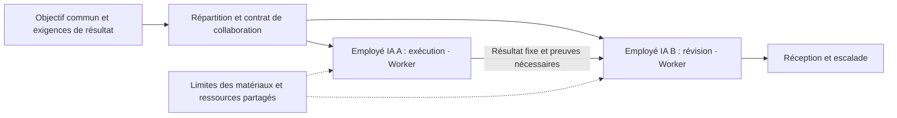
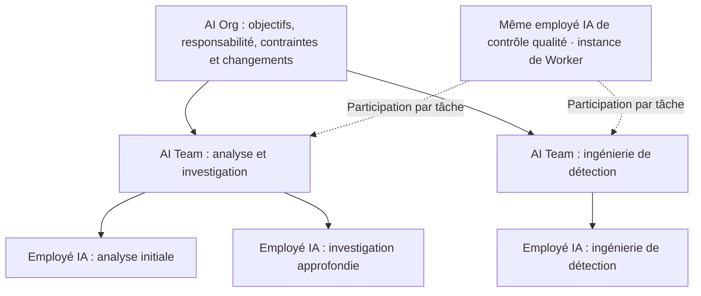
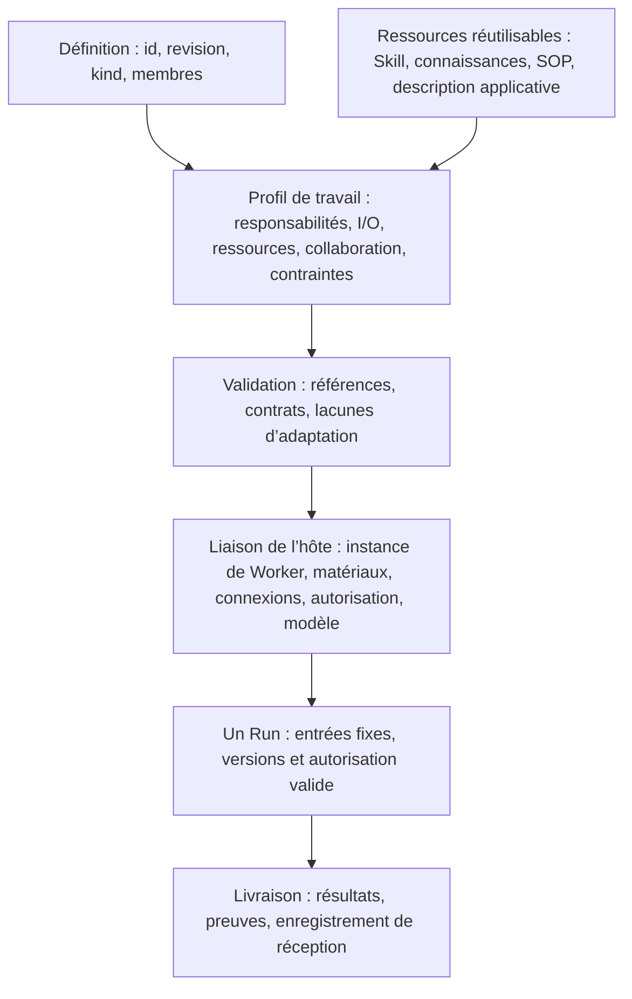
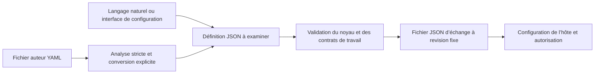

# Norme ouverte de définition des AI Workers, AI Teams et AI Organizations 1.0

[Languages / 语言](../docs/languages.md)

**Max Luo et Morgan Chen, cofondateurs de Teloa**

Version du noyau : `1.0`. Publication : 2026-10-18. Statut : spécification ouverte.

Cette traduction suit le [texte de référence en chinois simplifié](core.zh-CN.md). Elle n’a pas encore fait l’objet d’une révision complète par des spécialistes du secteur de langue maternelle française. Veuillez signaler toute divergence avec le texte de référence. Les valeurs des exemples JSON et YAML sont conservées à l’identique pour permettre la comparaison entre langues.

Ce document et le [profil de travail et de collaboration](work-profile.fr.md) constituent ensemble la spécification de cette version. Les sections 1 à 3 expliquent les concepts ; les sections 4 à 9 définissent le comportement d’échange du noyau. La configuration des instances et l’exécution réelle sont vérifiées séparément.

## 1. Comprendre simplement la composition

**Un AI Worker est une unité de travail d’IA dotée d’une identité identifiable dans la durée, qui assume des responsabilités, reçoit du travail et livre des résultats vérifiables dans un périmètre d’autorisation explicite. Une AI Team est un ensemble collaboratif qui répartit le travail autour d’un résultat commun. Une AI Organization ajoute à cet ensemble une responsabilité organisationnelle, des contraintes de ressources et une gouvernance des changements.**

Dans Teloa, ces unités de travail sont appelées **employés IA** ; AI Worker est le concept général de normalisation sous-jacent. Les objets que les utilisateurs créent et avec lesquels ils collaborent restent des employés IA. La définition du Worker décrit ses responsabilités et contrats de travail ; l’instance du Worker identifie un employé IA concret. Un Grok Bot peut également être décrit comme un AI Worker. Cette correspondance conceptuelle ne constitue pas une certification du fournisseur ; l’adaptation réelle doit toujours vérifier les contrats et le comportement de l’hôte.

La « continuité » signifie ici que l’identité et les responsabilités peuvent persister entre les tâches. Elle n’exige ni disponibilité permanente, ni processus permanent, ni machine exclusive, ni nécessairement une mémoire à long terme. L’unité de travail peut faire appel à plusieurs modèles et Agents temporaires ; ses livraisons externes restent attribuées à une même instance de Worker traçable.

| Terme | Sens dans cette norme | Limite |
| --- | --- | --- |
| AI Agent | Concept technique général de raisonnement, d’appel d’outils ou d’exécution de tâches | Peut être temporaire ; son nom ne prouve pas l’existence d’un contrat de Worker |
| AI Worker | Unité d’IA identifiable dans la durée, soumise à des contraintes et responsable de livraisons | La responsabilité signifie attribution du travail et traçabilité, pas personnalité juridique |
| AI Team | Ensemble doté d’une interface de travail commune, d’une répartition des responsabilités et d’un contrat de collaboration | Un groupe de discussion ou une liste de membres ne suffit pas à prouver la conformité |
| AI Organization | Ensemble doté d’un contrat de collaboration et d’un contrat de gouvernance organisationnelle | Ne se distingue pas par le nombre de personnes ou de niveaux ; ne représente pas automatiquement une entité juridique |
| AI Workforce | Désignation collective des travailleurs IA et de la capacité de travail dans un périmètre | Cette version n’ajoute aucun objet ou format indépendant |
| Employé IA, Bot | Désignations de produit ou d’activité | Correspondance fondée sur la composition et le comportement réels, sans conformité automatique déduite du nom |

Le terme AI Worker est déjà utilisé publiquement, notamment par [11x](https://www.11x.ai/11x-manifesto) et [Delos](https://marketplace.microsoft.com/en-us/product/office/WA200011292). Cette spécification reprend un terme existant et lui donne sa propre définition normative. Elle ne revendique pas l’invention du nom et ne considère pas les appellations des fournisseurs comme une norme sectorielle unifiée. À la première utilisation publique, écrire « AI Worker (unité de travail logicielle) » pour éviter la confusion avec les personnes qui travaillent dans le secteur de l’IA.

### 1.1 De quoi se compose un AI Worker

| Composante | Question simple | Contenu sous-jacent |
| --- | --- | --- |
| Poste et responsabilités | Qui suis-je, de quoi suis-je responsable, quand escalader ? | Nom, responsabilités, exclusions, règles de décision et de confirmation |
| Méthodes et fondements | Comment travailler, sur quoi fonder les décisions ? | Skills, connaissances, SOP ; méthodes et faits référencés séparément |
| Travaux et organisation | Quels travaux accepter, quand les exécuter ? | Modèles de travail, entrées et sorties, routines configurées selon les besoins |
| Conditions d’exécution | Quels outils utiliser, jusqu’où agir ? | Besoins applicatifs, périmètre des données, conditions de permission, exigences de modèle et de budget |
| Expérience et résultats | Quelle expérience conserver, comment prouver l’achèvement ? | Règles de mémoire, versions des résultats, preuves et réception |

Ces cinq groupes facilitent la lecture et couvrent les 12 catégories de composantes existantes ; ils ne créent pas cinq nouveaux types de ressources. Une définition minimale de Worker doit contenir identité et révision, responsabilités et limites de décision, ainsi qu’au moins un contrat de travail précisant entrées, sorties, position responsable et exigences de réception. Paquets de Skills, bases de connaissances, SOP, mémoire et routines sont fournis selon les besoins. Un catalogue de ressources vide est valide, mais ne peut servir à contourner des dépendances réelles.

### 1.2 De quoi se compose une AI Team

**Équipe = objectif commun + membres et répartition des postes + limites du contexte partagé + transmissions collaboratives + organisation du travail + contraintes de ressources + réception des résultats.** Un groupe de discussion porte la communication ; le contrat d’équipe précise qui est responsable, ce qui est livré, qui le reçoit et quand arrêter. Le coordinateur est un rôle de collaboration facultatif ; toutes les équipes ne doivent pas adopter un modèle hiérarchique.



Le diagramme prend Teloa comme exemple : les employés IA correspondent aux Workers ; l’équipe IA utilise un contrat de Team pour fixer résultats communs et collaboration.

### 1.3 Comment une AI Organization se construit à partir d’équipes

**Organisation = composition d’unités et d’équipes + responsabilité interéquipes + limites de ressources et d’information + règles d’escalade et de changement.** Une équipe peut être membre d’une organisation et continuer à utiliser la même interface de travail. Une organisation ne promet que les travaux explicitement énumérés ; elle n’acquiert pas automatiquement toutes les capacités et permissions de ses membres.



Le diagramme conserve les appellations d’employé IA et d’équipe IA de Teloa pour expliquer les relations entre Worker, Team et Org. Il illustre une composition sans affirmer que ces organisations sont déployées. Les consultants peuvent participer à une tâche sans rejoindre tous les groupes ; le partage du même employé IA entre équipes exige une liaison d’instance explicite. Créer deux employés IA à partir du même modèle de poste est une autre relation.

## 2. L’architecture technique sous-jacente

Le noyau ne conserve que deux objets d’échange, **agent** et **organization**, en préservant le format existant. Une définition complète d’AI Worker utilise agent avec le profil de travail obligatoire ; une AI Team utilise organization avec un contrat de collaboration ; une AI Organization ajoute un contrat de gouvernance au même objet de composition. `kind: agent` est seulement une catégorie structurelle sous-jacente, pas une déclaration de conformité AI Worker. Ces trois usages ne produisent pas trois formats de noyau.



Dans Teloa, l’hôte lie un employé IA concret ; chaque Run représente une exécution de cet employé. Définition, instance et Run sont enregistrés séparément, ce qui relie les noms de produit aux concepts techniques.

| Niveau | Responsabilité de la norme | Responsabilité de l’hôte |
| --- | --- | --- |
| Définition | Identité et révision fixes, composition, exigences de travail et de collaboration | Lecture, validation, rapport et conservation sans perte |
| Instance | Identités et périmètres que la liaison doit distinguer | Créer ou réutiliser un employé, lier connexions, modèles, permissions et mémoire privée |
| Exécution | Sémantique des entrées/sorties, transmissions, arrêts et réception | Raisonnement, affectation, planification, application du budget, vérification des autorisations et traces d’exécution |

Unités et ensembles répondent aux mêmes quatre questions : **quelles entrées accepter, quelles conditions exiger, quels résultats livrer, quelles limites respecter ?** L’identité d’instance est confirmée par l’hôte. Renommer, rejoindre un groupe, importer un modèle de poste ou référencer une même définition ne crée aucune autorisation. Les exécutions historiques restent fixées à l’ancienne version ; une mise à jour du modèle de poste ne les réécrit pas.

Cette spécification n’impose ni une machine par employé, ni un modèle unique, ni un ordonnanceur unique, ni un système complet de gestion organisationnelle. Elle ne couvre ni paiement, ni personnalité juridique, ni commande de systèmes incarnés. Toute capacité nécessaire manquante doit être signalée ; réussir à lire un fichier ne prouve pas son exécutabilité. La première version couvre les employés, équipes et compositions organisationnelles.

### 2.1 Déterminer la conformité à cette version

Ci-dessous, « doit » et « ne doit pas » indiquent des exigences obligatoires, « devrait » une recommandation et « peut » une option. Les exemples illustrent le format et ne prouvent ni déploiement ni validation en fonctionnement.

| Portée de la déclaration | Éléments obligatoires | Conclusion permise |
| --- | --- | --- |
| Échange de définitions du noyau | Règles du noyau des sections 4 à 9 | Fichier correctement interprétable et conservable sans perte ; ne suffit pas à déclarer une adaptation AI Worker |
| Définition d’AI Worker | Noyau agent + annexe de travail obligatoire + contrats complets de responsabilités, travail et réception | Définition complète ; connexions, identité réelle et capacité d’exécution restent à lier par l’hôte |
| Instance d’AI Worker | Définition validée + identifiant stable d’instance + acteur de gestion fiable + autorisations par travail et traces d’exécution | Identité traçable entre tâches ; remplacer le modèle ou lancer un nouveau Run ne signifie pas créer un nouvel employé |
| Définition d’AI Team | Noyau organization + annexe de travail + répartition des membres, transmissions, partage et arrêts | Contrat de collaboration interprétable ; affectation automatique et transmissions réelles vérifiées séparément |
| Définition d’AI Organization | Contrat AI Team + governance + contraintes organisationnelles | Contrat de gouvernance complet ; identités, procédures et application des contraintes vérifiées séparément |

Une même définition de composition avec gouvernance peut satisfaire les deux déclarations Team et Organization ; ce ne sont pas des types de produits mutuellement exclusifs. La conformité d’une définition ne nécessite pas une exécution préalablement réussie. La disponibilité d’une instance et la réussite d’une exécution donnée exigent des preuves distinctes. Une composition sans gouvernance déclarée ne peut revendiquer la conformité AI Organization par un simple changement de nom.

L’identifiant stable d’instance doit seulement être unique dans le périmètre déclaré de l’hôte et de l’acteur fiable ; aucun compte mondial ni réseau d’identité décentralisé n’est requis. Un Worker peut être démarré, suspendu ou retiré selon les besoins. L’hôte doit enregistrer le comportement réel de ces états et vérifier de nouveau l’autorisation valide avant la reprise. Le retrait ne transfère pas l’attribution des résultats historiques à une nouvelle instance. Stockage et durée de conservation dépendent de la politique de déploiement.

### 2.2 JSON pour échanger, YAML pour rédiger

**JSON est l’unique représentation normative d’échange de cette version ; YAML est une entrée facultative pour les auteurs.** Les utilisateurs peuvent aussi générer la même définition par langage naturel ou formulaire. Un destinataire qui n’implémente que JSON peut déclarer la conformité d’échange du noyau. La rédaction YAML est déclarée séparément comme capacité prise en charge ; tous les produits ne doivent pas proposer un éditeur YAML.



Pour déclarer la prise en charge de la convention de rédaction YAML de cette version, le convertisseur doit utiliser la résolution des types du Core Schema de YAML 1.2 et accepter un seul document de mapping dont toutes les clés sont des chaînes. Il doit rejeter les clés dupliquées, nombres non finis, tags personnalisés ou explicites, ancres, alias, entrées dont le texte de clé est `<<` et flux multidocuments. Seules les valeurs représentables sans perte en JSON sont admises ; aucun arrondi silencieux des nombres n’est permis. Variables d’environnement, expressions de modèle et inclusions de fichiers ne sont pas évaluées. `revision: "1"` est une chaîne ; `revision: 1` est un nombre et doit être rejeté par la validation du champ. Le parseur et sa version figurent dans la trace de conversion. [YAML 1.2.2](https://yaml.org/spec/1.2.2/)

Les commentaires YAML n’entrent pas dans la sémantique d’échange ; permissions, restrictions et réception ne peuvent figurer uniquement dans les commentaires. Les sauts de ligne issus du traitement des blocs de texte font partie de la chaîne et sont comparés selon R02. L’auteur peut garder YAML comme source de rédaction et exporter chaque fois un JSON fixe. Les deux ne peuvent être deux sources de référence indépendamment modifiables d’une même révision. Après modification d’un export, il faut revenir à la source unique et produire une nouvelle révision.

Ce n’est pas un protocole de canonisation des octets JSON ou de signature. R02 compare les valeurs JSON ; le digest d’un paquet de ressources porte toujours sur les octets réels. JSON Schema 2020-12 décrit les entrées et sorties de Work ; les deux modes de rédaction doivent subir les mêmes vérifications de contrat. [JSON Schema](https://json-schema.org/draft/2020-12)

## 3. Réutiliser les définitions externes

| Source | Éléments repris dans cette version | Différences explicites |
| --- | --- | --- |
| OASF | Catégories de capacités, domaines et versions de discovery natif ; métadonnées et localisation des ressources selon les besoins | Une compétence de classification n’est pas un paquet de méthodes exécutables ; une classification ne prouve pas la qualité du travail |
| Oracle Agent Spec 26.1.2 | Références de composants et composition ; entrées/sorties explicites ; séparation entre définition et appel ; collaboration orientée | Les interfaces de travail utilisent ici des objets JSON Schema ; elles ne se présentent pas comme ses configurations de composants et ne copient pas son graphe d’exécution complet |
| Grok Bot | Poste durable, méthodes partagées, contexte du poste, séparation Skill/Routine | Les recipes publiques sont des matériaux de modèle ; Team Bot est un Bot utilisé par plusieurs personnes, pas une équipe de plusieurs employés |

Les données OASF discovery sont conservées à l’identique dans une version fixe ; voir §7 de l’annexe. Des enregistrements de découverte peuvent en être dérivés, sans créer une deuxième classification équivalente des capacités. [OASF Record Guide](https://docs.agntcy.org/oasf/agent-record-guide/) · [Discovery Extension](https://docs.agntcy.org/oasf/discovery-extension/)

Les références de composants d’Agent Spec utilisent `$component_ref` à l’intérieur d’une configuration. Ses entrées/sorties reposent sur JSON Schema ; Swarm et ManagerWorkers possèdent des comportements de collaboration concrets. Cette version conserve id＋revision entre fichiers et sépare transmission de responsabilité, transfert de session et permissions. Une conversion doit vérifier les contraintes réelles d’entrée/sortie et le comportement de collaboration ; elle ne partage pas par défaut une session entière et ne convertit pas implicitement les types d’entrée/sortie. [Agent Spec 26.1.2](https://oracle.github.io/agent-spec/26.1.2/agentspec/language_spec_26_1_2.html)

S’inspirer de définitions, préserver des données natives et réussir une validation de compatibilité sont des déclarations distinctes. Reprendre ces conceptions n’implique pas la compatibilité avec tous les modules OASF ou moteurs Agent Spec. [Conception de Grok](https://x.ai/news/designing-grok-bot) · [Team Bots](https://docs.x.ai/grok-bot/team-bots)

## 4. De la définition du noyau à un AI Worker complet

### 4.1 Définition minimale d’échange du noyau

```json
{
  "specVersion": "1.0",
  "id": "urn:example:definition:research-assistant",
  "revision": "5",
  "kind": "agent",
  "name": "研究助手",
  "instructions": "根据提供的资料回答问题，保留来源，区分事实、推断和未知。"
}
```

Ces six champs constituent uniquement une définition minimale d’échange, pas un AI Worker complet. On ajoute capabilities lorsque des capacités externes sont nécessaires à l’unité entière. Déclarer la prise en charge du travail d’un Worker ou des contrats de collaboration d’équipe de cette version exige aussi le profil de travail de l’annexe ; enregistrer seulement des prompts ne permet pas de revendiquer une adaptation complète.

### 4.2 Définition minimale complète d’un AI Worker

L’exemple suivant est un Worker transversal de synthèse de documents : sans application externe, paquet de Skills ou routine automatique, mais avec responsabilités, entrées/sorties et réception explicites. Il définit un poste pouvant effectuer des synthèses répétées ; l’instance réelle et son acteur de gestion sont liés au déploiement.

```json
{
  "specVersion": "1.0",
  "id": "urn:example:definition:document-worker",
  "revision": "2",
  "kind": "agent",
  "name": "材料摘要工作者",
  "instructions": "持续承担已提供材料的摘要工作，注明材料之外无法核实的内容。",
  "extensions": [{
    "id": "urn:teloa:profile:ai-work",
    "version": "1.0",
    "required": true,
    "data": {
      "responsibility": {
        "triggers": ["收到已授权的摘要任务"],
        "autonomousActions": ["读取本次提供的材料并撰写摘要"],
        "confirmationPoints": ["对外发布须由任务负责人另行确认"],
        "escalationRules": ["材料缺失或相互矛盾时报告缺口"],
        "deliveryChecks": ["摘要可回查材料，不补造事实"]
      },
      "resources": [],
      "authorityRoles": [{"id": "owner", "name": "任务负责人", "kind": "human"}],
      "works": [{
        "id": "summarize",
        "title": "材料摘要",
        "instructions": "根据输入材料交付摘要和未决问题。",
        "inputs": {
          "$schema": "https://json-schema.org/draft/2020-12/schema",
          "type": "object",
          "properties": {"material": {"type": "string", "minLength": 1}},
          "required": ["material"],
          "additionalProperties": false
        },
        "outputs": {
          "$schema": "https://json-schema.org/draft/2020-12/schema",
          "type": "object",
          "properties": {
            "summary": {"type": "string", "minLength": 1},
            "openQuestions": {"type": "array", "items": {"type": "string"}}
          },
          "required": ["summary", "openQuestions"],
          "additionalProperties": false
        },
        "requires": [],
        "responsible": "self",
        "acceptance": {
          "criteria": ["摘要与输入材料一致，未决问题单列"],
          "reviewer": "authority/owner",
          "independent": true
        }
      }]
    }
  }]
}
```

Le [fichier JSON](../examples/document-worker.json) et le [fichier auteur YAML](../examples/document-worker.yaml) de cet exemple sont générés à partir du texte et expriment les mêmes valeurs JSON. Les exemples complets d’équipes, d’organisations et d’instances partagées figurent dans l’[exemple de composition](../examples/composition-fixture.json). Ce sont des exemples de définition ; ils n’acquièrent de ce fait aucune autorisation de connexion, d’exécution ou de publication.

## 5. Composer une équipe ou une organisation dans un fichier

```json
{
  "specVersion": "1.0",
  "id": "urn:example:definition:research-team",
  "revision": "5",
  "kind": "organization",
  "name": "研究小组",
  "instructions": "research 整理证据，review 检查来源和结论；发现分歧时保留分歧。",
  "members": [
    {
      "id": "research",
      "ref": {
        "id": "urn:example:definition:research-assistant",
        "revision": "5"
      }
    },
    {
      "id": "review",
      "ref": {
        "id": "urn:example:definition:research-assistant",
        "revision": "5"
      }
    }
  ]
}
```

Cet exemple exprime uniquement des références de composition du noyau ; il ne constitue pas une définition complète d’AI Team ou d’AI Organization. Il faut ajouter l’annexe de travail et les contrats correspondants de collaboration et de gouvernance.

Un membre référence une définition d’unité ou de sous-organisation. Le même modèle de poste peut être réutilisé, mais les deux entrées de membre restent nommées séparément. Cela ne prouve pas l’indépendance de deux exécutants réels et ne crée pas une approbation à deux personnes. Member est un emplacement de définition dans la composition, pas directement un membre de groupe ou un enregistrement d’affectation. L’annexe précise membres, consultants, rôles externes et liaisons d’instances ; l’hôte met en œuvre identités et permissions réelles.

## 6. Champs du noyau

En dehors de l’intérieur de data des extensions, tous les objets n’acceptent que les champs définis ci-dessous et dans la suite. Toute nouvelle sémantique passe par extensions.

| Champ | Type et portée | Raison de sa présence |
| --- | --- | --- |
| specVersion | Obligatoire, exactement `1.0` | Détermine comment interpréter le fichier |
| id | Obligatoire, URI absolue ou URN | Référence la même définition entre fichiers |
| revision | Obligatoire, chaîne non vide, ne doit pas être latest | Fixe le contenu et évite les changements silencieux de référence |
| kind | Obligatoire, agent ou organization | Distingue unité et composition |
| name | Obligatoire, chaîne non vide | Permet identification et partage par les personnes |
| instructions | Obligatoire, chaîne non vide | Exprime les responsabilités de l’agent ou exigences de collaboration de l’organisation |
| capabilities | Tableau Capability facultatif, uniquement pour agent | Référence les capacités externes nécessaires |
| members | Tableau Member non vide obligatoire pour organization ; interdit pour agent | Exprime la composition organisationnelle |
| extensions | Tableau Extension facultatif | Porte la sémantique hors noyau |

- Une chaîne non vide ne peut contenir uniquement des espaces blancs. Les tableaux facultatifs capabilities et extensions au niveau supérieur peuvent être omis ou vides, avec la même interprétation par défaut. Leurs valeurs JSON originales restent différentes et se comparent selon R02. null ne peut les remplacer.
- LocalId correspond à `^[a-z][a-z0-9-]{0,63}$`. Les id de Member et Capability sont uniques dans leur tableau respectif. Un contrat d’extension peut définir des références à ces éléments, mais doit préciser définition et tableau ; l’unicité mondiale de LocalId ne peut être supposée.
- DefinitionRef contient uniquement `id` et `revision`, de mêmes types que dans le tableau.
- Member contient uniquement `id: LocalId` et `ref: DefinitionRef`. Toutes les références de membres sont obligatoires.
- Capability contient uniquement `id: LocalId`, `kind: "mcp" | "skills" | "a2a" | "resource"` et `config: object` ; config est décrit en section 7.
- Extension contient uniquement `id: URI absolue ou URN`, `version: chaîne de version exacte non vide`, `required: boolean`, `data: object`. version ne doit être ni une plage ni latest ; l’id d’extension est unique dans une définition.

## 7. Les capacités externes sont seulement référencées

Les quatre valeurs de kind suivantes sont des liaisons facultatives : lire une définition n’oblige pas le destinataire à les exécuter. Déclarer pouvoir utiliser une liaison exige l’implémentation de son protocole ou format natif. config n’accepte que les champs du tableau ; tous sont obligatoires sauf mention contraire.

| kind | Champs config | Limite de la liaison |
| --- | --- | --- |
| mcp | `protocolVersion: chaîne non vide` ; `transport: "stdio" \| "streamable-http"` ; `connectionRef: chaîne non vide` ; `selectors: Selector[], facultatif` | Référence une connexion MCP résolue par l’hôte ; capacités et autorisation vérifiées selon la version native indiquée |
| skills | `formatSnapshot: URI` ; `packageRef: URI` ; `packageMediaType: "application/zip" \| "application/x-tar"` ; `packageDigest: Digest` | Référence le paquet de Skill complet et un instantané fixe du format ; conserve SKILL.md et les fichiers associés |
| a2a | `protocolVersion: chaîne non vide` ; `agentCardRef: URI` ; `interfaceUrl: URI` ; `protocolBinding: chaîne non vide` ; `skillIds: chaîne non vide[], facultatif` ; `requiredExtensions: URI[], facultatif` | Référence une interface précise d’un service A2A, en conservant tâches, résultats et états natifs |
| resource | `uri: URI` ; `mediaType: chaîne non vide` ; `digest: Digest, facultatif` | Lecture de ressource uniquement, sans exécution automatique du contenu |

Selector prend uniquement la forme `{"type":"tool" ou "prompt","name":chaîne non vide}` ou `{"type":"resource","uri":URI}`. Lorsque selectors est déclaré, le tableau ne doit pas être vide et chaque entrée doit être satisfaite. Son absence signifie seulement que la connexion est nécessaire, pas que tous ses outils sont autorisés.

Toute URI est absolue ou une URN. Digest est `sha256:` suivi de 64 caractères hexadécimaux minuscules. Les versions de protocole doivent être exactes, jamais des plages ou latest. Nom de connexion, adresse de Card et emplacement de paquet ne représentent pas une autorisation.

Exemple : insérer l’entrée suivante dans capabilities d’un agent indique qu’il a besoin de cette connexion MCP. La connexion et la version de l’exemple doivent encore être vérifiées au déploiement réel.

```json
{
  "id": "knowledge",
  "kind": "mcp",
  "config": {
    "protocolVersion": "2026-07-28",
    "transport": "streamable-http",
    "connectionRef": "project-knowledge"
  }
}
```

**MCP :** connectionRef est résolu par le déployeur. La connexion réelle doit être affichée et autorisée séparément ; aucun token ni commande de démarrage n’y figure. Découverte, transport et autorisation doivent respecter la version déclarée. Aucun rattachement automatique à une autre connexion ne doit reposer uniquement sur le nom des outils. Le noyau ne décrit pas chaque paramètre d’outil et n’invente pas de langage général de permissions d’outils. [Règles de version MCP](https://modelcontextprotocol.io/docs/2026-07-28/learn/versioning)

**Skills :** formatSnapshot doit être une source immuable de spécification du format. Le digest porte sur les octets originaux du paquet entier. La racine d’extraction est un répertoire de Skill ; échappements de chemin, chemins normalisés dupliqués et liens symboliques ou physiques sont rejetés. L’import n’exécute pas de scripts. ZIP/TAR sont des conventions d’emballage de cette spécification, pas des exigences natives d’Agent Skills. [Format Agent Skills](https://agentskills.io/specification)

**A2A :** interfaceUrl, protocolBinding et protocolVersion doivent correspondre à la même interface de la Card réelle. Les skillIds déclarés et extensions requises par les deux parties sont vérifiés selon la spécification native ; l’autorisation est vérifiée séparément. L’achèvement côté serveur ne signifie pas la réalisation de l’objectif métier. Un AgentSkill A2A n’est pas un paquet de fichiers Agent Skills. [Spécification A2A](https://a2a-protocol.org/latest/specification/)

**Ressources :** sans digest, le contenu est traité comme mutable ; l’utilisation réelle enregistre la version obtenue ou l’heure d’acquisition, sans pouvoir revendiquer la reproductibilité. Les ressources privées sont lues selon les permissions réelles.

Ces champs décrivent les références de cette spécification ; ils ne sont pas des corps de requêtes envoyés aux services natifs. Une contrainte essentielle impossible à exprimer dans cette version doit être explicitée par une extension required ; l’hôte ne peut ni la deviner ni l’abandonner silencieusement. Les détails natifs et garanties d’exécution restent dans chaque liaison et ne sont pas recopiés dans un protocole général d’exécution.

## 8. Huit règles communes

**R01 Format explicite.** Le fichier d’échange doit être un objet JSON UTF-8. Les clés dupliquées, champs de noyau inconnus, types de champs invalides et nombres non finis sont rejetés. Une version du noyau non prise en charge doit être signalée explicitement ; elle ne peut être interprétée selon une ancienne version. Les champs internes de data d’une extension inconnue ne sont pas validés par le noyau.

**R02 Révision immuable.** id et revision sont comparés exactement comme chaînes originales, sans normalisation d’URI ; ensemble, ils désignent une définition fixe. Toute modification de la valeur JSON comparée selon les règles suivantes impose une nouvelle revision. Des valeurs différentes pour la même paire doivent être signalées comme conflit et ne doivent pas être écrasées. La comparaison ignore l’ordre des clés d’objet et les espaces blancs hors chaînes, mais conserve l’ordre des tableaux et le contenu des chaînes. Des types JSON différents sont inégaux ; les nombres sont comparés selon leur valeur mathématique, par exemple 10 égale 10.0. Un arrondi ne doit pas rendre égaux des nombres différents. Un champ absent et un tableau explicitement vide sont des valeurs JSON différentes ; leur même interprétation par défaut ne permet pas de les fusionner.

**R03 Références résolubles.** Avant d’assembler une organisation, toutes les références directes et indirectes de membres doivent être résolues récursivement jusqu’à la révision indiquée. Toute absence, discordance de version ou boucle doit être signalée et arrêter l’assemblage, sans substitution automatique de version. La déclaration de prise en charge complète d’une organisation doit couvrir les capacités et extensions nécessaires de toutes les définitions de membres dans cette fermeture transitive. Les références de définitions forment un graphe acyclique, sans interdire les échanges aller-retour dans la collaboration réelle. id n’est pas une adresse de téléchargement. L’hôte décide comment obtenir les définitions ; lire un fichier ne doit pas provoquer un accès réseau automatique.

**R04 Composer ne fusionne pas les permissions.** Chaque membre utilise sa propre définition et ses capacités. Les instructions de l’organisation décrivent la collaboration, sans remplacer celles des membres ni leur ajouter automatiquement outils ou permissions. Un conflit non résolu interdit de démarrer les travaux concernés. Les capacités homonymes sont distinguées par leur membre ; les connexions ne doivent pas être fusionnées. Le noyau ne définit ni ordonnancement, ni fusion de prompts, ni attribution d’identités réelles.

**R05 Les déclarations doivent être tenues.** Chaque entrée de capabilities est une dépendance nécessaire déclarée par l’agent ; aucune liaison n’est « ignorable par défaut ». Toute capacité indisponible doit être listée comme manquante. Il est interdit de démarrer selon cette définition ou de déclarer sa prise en charge complète. Une organisation ne doit pas non plus contourner un membre obligatoire auquel il manque des prérequis. Consultation et conservation restent possibles ; supprimer ou modifier des capacités impose une nouvelle revision. L’exécution réelle doit vérifier prise en charge native et autorisation ; une lecture réussie n’équivaut pas à l’exécutabilité.

Les resources de l’annexe constituent un catalogue utilisable selon le travail, distinct de capabilities. Les conditions globales et les conditions nécessaires du travail choisi doivent toutes être satisfaites. Des ressources non prêtes propres à d’autres travaux ne bloquent que ces travaux. Prise en charge complète, disponibilité d’un travail particulier et autorisation réelle sont déclarées séparément. Le profil ne doit pas servir à contourner les exigences de dépendances globales de cette règle.

**R06 Échec explicite des extensions.** Un contrat d’extension est fixé par id et version exacte et définit au minimum structure de data, sémantique et méthode de validation. Tout changement structurel ou sémantique exige une nouvelle version. Le consommateur doit le prendre en charge explicitement ; lire une URI ne permet pas de télécharger automatiquement un validateur ou du code. Toute extension inconnue doit être conservée comme valeur JSON et signalée. Avec required=true, il est interdit d’assembler, d’exécuter ou de déclarer la prise en charge complète de la définition. required=false est réservé aux informations auxiliaires qui ne changent pas la signification fondamentale de l’exécution. Un éditeur ne doit pas rendre ignorables permissions, paiements, conditions d’exécution ou contraintes de réception. Si un consommateur constate cette violation dans une extension qu’il prend en charge, il doit refuser assemblage, exécution et déclaration de prise en charge complète, et ne doit pas marquer la validation comme réussie. Le fichier problématique peut néanmoins être conservé, consulté ou réexporté à l’identique avec un rapport d’erreur. Le noyau ne prétend pas reconnaître tout le sens de data inconnu. Des contraintes obligatoires contradictoires ne doivent pas être assouplies en choisissant l’une d’elles.

**R07 Les définitions n’accordent aucun droit.** L’import ne doit pas créer automatiquement des unités en fonctionnement, installer du code, connecter des services, exécuter des tâches ou effectuer des paiements. Les définitions ne doivent contenir ni clés, ni tokens, ni cookies, ni justificatifs d’autorisation directement utilisables. Modèles, descriptions de rôles et relations organisationnelles ne créent ni identité, ni pouvoir de représentation, ni autorisation d’exécution ; l’hôte les vérifie avant les actions réelles.

**R08 Toute déclaration de conformité exige des preuves.** La conformité minimale est uniquement « prise en charge de l’échange de définitions de cette version » et exige lecture, validation, rapport, conservation et export sans perte corrects. Pour un document valide, ses valeurs JSON doivent rester inchangées après import puis export, y compris les extensions inconnues. Une édition doit produire une nouvelle révision. La prise en charge réelle des liaisons et extensions est détaillée séparément par nom, version et portée de validation. La conformité d’échange ne permet pas de déduire exécution, qualité métier ou migration d’unités entre plateformes.

## 9. Conformité et réception

La conformité est déclarée pour une portée précise, sans employer un seul mot « compatible » pour toutes les capacités : échange du noyau, interprétation du profil de travail, correspondance d’une source/version donnée, exécution pour un hôte, un travail et un périmètre d’entrées particuliers. La qualité métier relève d’une évaluation liée à la tâche et ne se déduit pas d’un contrôle structurel.

Les six éléments suivants constituent les vérifications de réception de l’échange du noyau. Les cas positifs et négatifs du profil figurent dans l’annexe ; la portée est décrite dans les [limites de conformité](../CONFORMANCE.md). Vérifier des exemples auxiliaires ne constitue ni une implémentation complète de conformité ni l’interopérabilité de deux implémentations indépendantes.

| Identifiant | Entrée ou opération | Résultat obligatoire observable |
| --- | --- | --- |
| T01 | Clés dupliquées, champs de noyau inconnus, kind/types invalides, version du noyau inconnue | Rejet ou déclaration explicite de version non prise en charge |
| T02 | Importer puis exporter les exemples des sections 4 et 5, des définitions valides contenant des extensions inconnues et une composition dont chaque membre déclare une capacité de même nom, accompagnée des définitions de ses membres | Valeurs JSON inchangées ; capacités homonymes de membres différents non fusionnées |
| T03 | Valeurs différentes pour la même id/revision ; comparer aussi ordre des clés, espaces blancs, 10 et 10.0, tableau omis et tableau vide explicite | Décision selon R02 ; conflit uniquement si les valeurs diffèrent, sans écrasement ; omission et tableau vide sont en conflit, modification de valeur exigeant une nouvelle revision |
| T04 | Références imbriquées A → B → C ; référence absente, révision différente, cycle ou différence de casse seulement ; capacité ou extension required nécessaire manquante dans C | Localiser l’erreur et arrêter l’assemblage, sans accès réseau automatique ni complétion par normalisation ; si C manque d’éléments, A ne peut déclarer une prise en charge complète et l’exécution est limitée par R05/R06 |
| T05 | Extensions optional/required inconnues ; extension de contrainte prise en charge marquée illégalement optional | Tout élément inconnu conservé et signalé ; required bloque assemblage, exécution et déclaration de prise en charge complète ; les contraintes connues illégales sont aussi rejetées, sans validation réussie ; conservation du fichier original permise avec rapport d’erreur |
| T06 | Importer seulement un fichier contenant des références de capacités | Aucune installation, connexion ou exécution ; exécution indiquée comme non vérifiée, sans prétendre à une configuration utilisable |

L’exécution réelle des liaisons et hôtes est vérifiée séparément : au minimum, absence de démarrage si des capacités nécessaires manquent, autorisation réelle, isolation des compositions organisationnelles, échecs natifs et résultats inconnus. Des contrôles JSON ne peuvent en tenir lieu.

Les hôtes ne sont pas obligés de partager les mêmes codes d’erreur ou automates internes, mais les erreurs doivent localiser l’objet et expliquer la cause. Les implémentations devraient obtenir des résultats cohérents pour les comportements d’acceptation, de rejet et de conservation ci-dessus.

## 10. Évolution et limites de mise en œuvre

Cette version conserve un profil de travail commun pour exprimer les contrats de Worker, Team et Organization et les exigences nécessaires de l’hôte. Contenu de mémoire, planification réelle, identités de compte et gestion organisationnelle sont mis en œuvre par l’hôte ; les nouveaux besoins d’interopérabilité feront l’objet d’une évaluation d’extension. De nouveaux protocoles peuvent être intégrés par des extensions URI required sans tous rejoindre l’énumération du noyau.

Une première démonstration peut utiliser un répertoire local, avec un fichier JSON par définition et un index fondé sur id/revision dans le contenu. Les noms de fichier n’ont aucune sémantique ; c’est un exemple de livraison, pas un protocole de distribution supplémentaire. Ajouter des exemples imbriqués, des contre-exemples d’absence ou de conflit et leurs résultats attendus, puis comparer validation, import et export avec deux implémentations indépendantes. Choisir ensuite une liaison de capacité réellement nécessaire et vérifier « import → configuration de connexion/autorisation → exécution → obtention du résultat ». Avant l’achèvement de ce parcours, ne pas étendre la portée à une norme générale d’exécution, de paiement ou de cycle de vie.

Toute montée de version de la spécification doit être revalidée, mettre à jour specVersion et la version de l’annexe, puis produire une nouvelle revision ; les références de membres sont fixées en conséquence. Les anciennes définitions et anciens Runs ne sont pas réécrits sur place. Des versions différentes ne sont pas automatiquement compatibles ; un changement sémantique exige des instructions de migration, voir les [règles de maintenance](../GOVERNANCE.md).

### 10.1 Noyau général et configuration sectorielle

| Domaine d’exemple | Contenu configuré différemment | Contrats communs réutilisés |
| --- | --- | --- |
| SOC | Sources de preuves, méthodes d’analyse d’alertes, conditions d’escalade, autorisation de réponse | Identité, responsabilités, I/O de travail, transmissions, réception des résultats |
| Service client | Connaissance produit, classification des tickets, délais de service, escalade humaine | Idem ; sans transposer les outils ou termes SOC au service client |
| Production de contenu | Périmètre documentaire, règles éditoriales, permissions de révision et publication | Idem ; terminer un texte ne signifie pas le publier |

Ce tableau indique seulement que ces travaux sont exprimables au niveau de la définition, sans prétendre à une validation sectorielle achevée. Les exigences sectorielles sont configurées par ressources, travaux et extensions nécessaires ; le noyau ne prescrit aucun nombre fixe de postes, modèle, fournisseur d’outils, score de qualité ou fréquence d’exécution.

### 10.2 Statut actuel et conditions de progression

Il s’agit actuellement d’une spécification ouverte maintenue par Teloa, sans statut de norme sectorielle ou internationale. La spécification originale et ses exemples sont sous licence [Apache-2.0](../LICENSE). Maintenance, retours et règles de version sont dans [GOVERNANCE.md](../GOVERNANCE.md) ; la portée des déclarations dans [CONFORMANCE.md](../CONFORMANCE.md). Une revendication d’interopérabilité sectorielle exige au moins deux implémentations indépendantes et des preuves publiques reproductibles incluant des scénarios hors SOC. Avis de relecture et contrôles d’exemples ne remplacent pas ces preuves.

Interpréter une définition ne doit dépendre ni d’un compte Teloa, ni de services cloud, ni d’une base privée. `urn:teloa:profile:ai-work` est l’espace de noms de l’éditeur de l’extension existante, conservé pour éviter la fragmentation en identifiants synonymes. Il n’impose pas un hôte Teloa et ne constitue pas un aval d’organisme sectoriel. Un produit peut toujours générer une définition à confirmer à partir d’un paragraphe en langage naturel.
