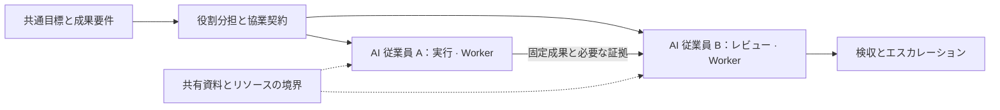
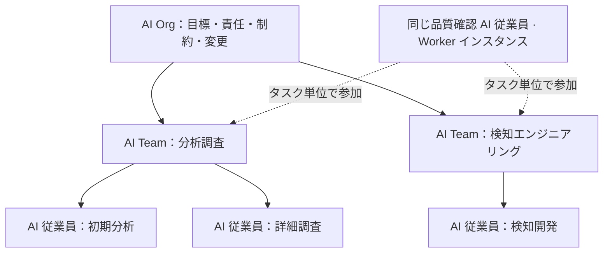
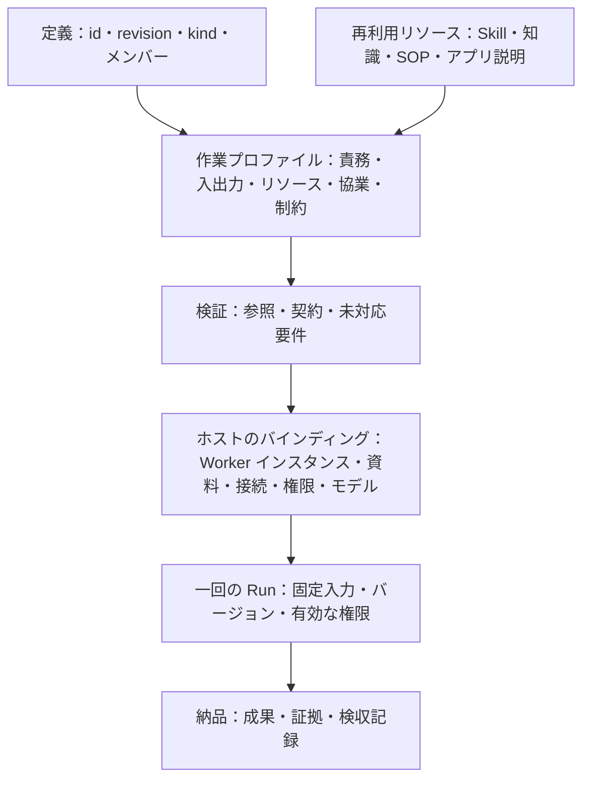
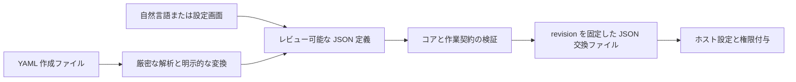

# AI Worker、AI Team、AI Organization オープン定義標準 1.0

[Languages / 语言](../docs/languages.md)

**Max Luo、Morgan Chen｜Teloa 共同創業者**

> 翻訳について：[簡体字中国語版](core.zh-CN.md)が正本です。本書は日本語訳であり、日本語を母語とする業界専門家による全面的なレビューは未実施です。相違点を見つけた場合は報告をお願いします。同一の例を比較できるよう、JSON／YAML の例の値は原文のまま掲載しています。Mermaid 図の表示ラベルと説明文は日本語に翻訳しています。

コアバージョン：`1.0`。公開日：2026-10-18。状態：オープン仕様。

本書と[作業・協業プロファイル](work-profile.ja.md)を合わせて本版の仕様を構成します。第 1–3 節は概念を説明し、第 4–9 節はコアの交換動作を規定します。インスタンスの設定と実際の実行は、別途検証します。

## 1. 構成を平易な言葉で理解する

**AI Worker は、タスクをまたいで識別できる持続的なアイデンティティを持ち、明示された権限の範囲内で責務を担い、仕事を受け付け、検収可能な成果を納品する AI の作業主体です。AI Team は、共通の成果のために分担・協業する構成です。AI Organization は、その構成に組織としての責任、リソース制約、変更ガバナンスを加えます。**

Teloa では、この作業主体を **AI 従業員**と呼びます。AI Worker は、その背後にある汎用的な標準概念です。利用者が作成して協業する対象は引き続き AI 従業員と呼び、Worker 定義が責務と作業契約を記述し、Worker インスタンスが特定の AI 従業員を識別します。Grok Bot も AI Worker として記述できます。この概念上の対応はベンダー認証を意味せず、実際の適合には契約とホストの動作を確認する必要があります。

ここでいう「持続的」とは、アイデンティティと責務がタスクをまたいで継続することです。常時オンライン、永続プロセス、専用マシン、長期記憶を必須とはしません。作業主体は複数のモデルや一時的な Agent を呼び出せますが、外部への納品は同一の追跡可能な Worker インスタンスに帰属します。

| 用語 | 本標準での意味 | 境界 |
| --- | --- | --- |
| AI Agent | 推論、ツール呼び出し、タスク実行に用いる汎用的な技術概念 | 一時的でもよく、その名称だけでは Worker 契約の存在を証明しない |
| AI Worker | 持続的に識別でき、制約を受け、成果の納品に責任を持つ AI 主体 | 「責任」は作業の帰属と追跡可能性を指し、法的人格を意味しない |
| AI Team | 共通の作業インターフェース、メンバーの分担、協業契約を持つ構成 | グループチャットやメンバー一覧だけでは適合を証明できない |
| AI Organization | 協業契約と組織ガバナンス契約を持つ構成 | 人数や階層数で区別せず、自動的に法人を意味しない |
| AI Workforce | 一定の範囲における AI の働き手と作業能力の集合を表す呼称 | 本版では独立したオブジェクトや形式を追加しない |
| AI 従業員、Bot | 製品や業務での呼称 | 実際の構成と動作に基づいて対応付け、製品名だけで適合とはしない |

AI Worker は、[11x](https://www.11x.ai/11x-manifesto) や [Delos](https://marketplace.microsoft.com/en-us/product/office/WA200011292) などで既に公開使用されています。本仕様は既存の用語を採用し、独自の規範的定義を与えます。名称の創始を主張せず、各ベンダーの呼称を統一された業界標準とも扱いません。対外的な初出では「AI Worker（ソフトウェアの作業主体）」と明記し、AI 業界で働く人との混同を避けます。

### 1.1 AI Worker の構成

| 構成 | 平易な問い | 内容 |
| --- | --- | --- |
| 役割と責務 | 自分は誰で、何を担当し、いつエスカレーションするか | 名前、責務、担当しない事項、判断と確認のルール |
| 方法と根拠 | どう進め、何に基づいて判断するか | Skills、知識、SOP。方法と事実は別々に参照する |
| 作業と予定 | どの仕事を受け、いつ実施するか | 作業テンプレート、入出力、必要に応じて設定する定例作業 |
| 実行条件 | どのツールを使い、どこまで実施できるか | アプリケーション要件、資料範囲、権限条件、モデルと予算の要件 |
| 経験と成果 | どの経験を引き継ぎ、どう完了を示すか | 記憶のルール、成果バージョン、証拠と検収 |

この五つのグループは理解のための整理であり、既存の 12 種類の構成要素を網羅します。新たな五つのリソース種別を追加するものではありません。最小の Worker 定義には、アイデンティティとリビジョン、責務と判断の境界、および入力、出力、責任を担う位置、検収要件を含む少なくとも一つの作業契約が必須です。スキルパッケージ、知識ベース、SOP、記憶、定例作業は必要に応じて用意します。空のリソースカタログは有効ですが、実際の依存関係を回避するために使ってはなりません。

### 1.2 AI Team の構成

**チーム＝共通目標＋メンバーと役割分担＋共有コンテキストの境界＋協業上の引き継ぎ＋作業の予定＋リソース制約＋成果の検収。** グループチャットは意思疎通を支え、チーム契約は誰が責任を持ち、何を渡し、誰が受け取り、いつ停止するかを定めます。コーディネーターは任意の協業役割であり、すべてのチームに管理者方式を要求しません。



図は Teloa を例にしています。共通目標から分担と協業契約を定め、実行担当の AI 従業員 A が固定された成果と必要な証拠をレビュー担当の AI 従業員 B に渡し、検収またはエスカレーションへ進みます。共有資料とリソースの境界は両者に適用されます。AI 従業員は Worker に対応し、AI チームは Team 契約によって共同成果と協業を定めます。

### 1.3 チームから AI Organization を構成する

**組織＝個体とチームの構成＋チーム間の責任＋リソースと情報の境界＋エスカレーションと変更のルール。** チームは組織のメンバーとなり、同じ作業インターフェースを使い続けられます。組織が約束するのは明示された仕事だけであり、メンバーの全能力や全権限を自動的に取得するわけではありません。



図は Teloa の AI 従業員と AI チームという呼称を使い、Worker、Team、Org の構成関係を示しています。AI Org が目標、責任、制約、変更を定め、その下の調査分析チームには初期分析・詳細調査担当、検知エンジニアリングチームには検知開発担当が属します。同じ品質確認担当の Worker インスタンスが、タスクごとに両チームへ参加します。これは構成図であり、これらの組織が既に配備されているとの主張ではありません。コンサルタントはタスク単位で参加でき、すべてのグループに入る必要はありません。複数チームで同じ AI 従業員を共有する場合、明示的なインスタンスのバインディングが必須です。一つの役割テンプレートから二人の AI 従業員を作る関係とは異なります。

## 2. 背後にある技術アーキテクチャ

コアの交換オブジェクトは引き続き **agent** と **organization** の二つだけで、既存の形式を維持します。完全な AI Worker 定義は agent と必須の作業プロファイルを用います。AI Team は organization と協業契約を用い、AI Organization は同じ構成オブジェクトにガバナンス契約を加えます。`kind: agent` は基礎構造の分類にすぎず、AI Worker への適合宣言ではありません。三つの利用形態から三種類のコア形式を作ることはありません。



技術的には、定義の id、revision、kind、メンバーと、再利用可能な Skill、知識、SOP、アプリケーション説明を作業プロファイルに結び付けます。参照、契約、対応できない要件を検証した後、ホストが Worker インスタンス、資料、接続、権限、モデルをバインドします。一回の Run が入力、バージョン、有効な権限を固定し、成果、証拠、検収記録につなげます。Teloa でホストがバインドするのは特定の AI 従業員であり、各 Run はその従業員による一回の実行です。定義、インスタンス、Run を別々に記録することで、製品上の呼称と技術概念を対応させます。

| 層 | 標準が担うこと | ホストが担うこと |
| --- | --- | --- |
| 定義 | 固定されたアイデンティティとリビジョン、構成、作業・協業要件 | 読み取り、検証、報告、損失のない保存 |
| インスタンス | バインディングで区別すべきアイデンティティと範囲の規定 | 従業員の新規作成または再利用、接続・モデル・権限・私的記憶のバインド |
| 実行 | 入出力、引き継ぎ、停止、検収の意味 | 推論、作業割当、スケジューリング、予算管理、権限確認、実行記録 |

個体も構成体も、**どの入力を受け、どの条件を必要とし、何を納品し、どの境界を守るか**という四つの問いに答えます。インスタンスのアイデンティティはホストが確認します。改名、グループ参加、テンプレートのインポート、同じ定義の参照はいずれも権限を発生させません。過去の実行は旧バージョンを固定し、テンプレート更新で書き換えません。

本仕様は、一従業員一マシン、単一モデル、単一スケジューラー、完全な組織管理システムを規定しません。決済、法的人格、身体を持つ機器の制御も含みません。必須能力が不足する場合は必ず報告し、ファイルを読み取れたことを実行可能であることと扱ってはなりません。初版は従業員、チーム、組織の構成を対象とします。

### 2.1 本版への適合を判定する

以下の「必須／しなければならない／してはならない」は強制要件、「推奨／すべき」は推奨、「できる／任意」は選択可能な事項を示します。例は形式を説明するだけで、配備済みまたは実行検証済みとは意味しません。

| 宣言範囲 | 必須要件 | 導ける結論 |
| --- | --- | --- |
| コア定義の交換 | 第 4–9 節のコアルール | ファイルを正しく解釈し損失なく保存できる。これだけで AI Worker の対応完了とはいえない |
| AI Worker 定義 | agent コア＋必須の作業附属書＋完全な責務・作業・検収契約 | 定義は完全。接続、実際のアイデンティティ、実行能力はホストでのバインドが必要 |
| AI Worker インスタンス | 検証済み定義＋安定したインスタンス識別子＋信頼できる管理主体＋作業ごとの権限と実行記録 | タスクをまたいでアイデンティティを追跡できる。モデル変更や新規 Run は新しい従業員を意味しない |
| AI Team 定義 | organization コア＋作業附属書＋メンバー分担・引き継ぎ・共有・停止のルール | 協業契約を解釈できる。自動割当と実際の引き継ぎは別途検証 |
| AI Organization 定義 | AI Team 契約＋governance＋組織制約 | ガバナンス契約は完全。実際のアイデンティティ、制度、制約の適用は別途検証 |

ガバナンスを含む同一の構成定義は、Team と Organization の両方の宣言を満たせます。互いに排他的な製品種別ではありません。定義適合には先行する実行成功を要求しません。インスタンスの準備完了と特定の実行成功には、それぞれ証拠が必要です。ガバナンスを宣言していない構成は、名称変更だけで本版の AI Organization に適合すると宣言してはなりません。

安定したインスタンス識別子は、宣言されたホストと信頼できる主体の範囲で一意に識別できればよく、世界共通のアカウントや分散型 ID ネットワークは不要です。Worker は必要に応じて起動、停止、退役できます。ホストは各状態に対応する実際の動作を記録し、再開前に有効な権限を再確認しなければなりません。退役によって過去の成果の帰属を新しいインスタンスへ移してはなりません。具体的な保存方法と保持期間は、実際の配備ポリシーで決定します。

### 2.2 JSON で交換し、YAML で記述する

**本版で唯一の規範的な交換表現は JSON であり、YAML は任意の作成用入力です。** 利用者は自然言語やフォームから同じ定義を生成することもできます。受信側が JSON だけを実装していても、コア交換への適合を宣言できます。YAML 記述能力は別途対応範囲として示し、すべての製品に YAML エディターを要求しません。



図の経路は、自然言語または設定画面からレビュー可能な JSON 定義を生成する経路と、YAML 作成ファイルを厳密に解析して明示的に JSON へ変換する経路です。双方ともコアと作業契約の検証を経て、revision を固定した JSON 交換ファイルとなり、ホストの設定と権限確認へ進みます。

本版の YAML 記述規約への対応を宣言する変換器は、YAML 1.2 の Core Schema による型解析を使い、すべてのキーが文字列である単一のマッピング文書を受け付けなければなりません。重複キー、非有限数、カスタムタグまたは明示的なタグ、アンカー、エイリアス、キー文字列が `<<` の項目、複数文書のストリームは拒否しなければなりません。JSON で損失なく表せる値だけを受け付け、数値を黙って丸めてはなりません。環境変数、テンプレート式、ファイルインクルードは評価しません。`revision: "1"` は文字列、`revision: 1` は数値であり、後者はフィールド検証で拒否しなければなりません。変換記録にパーサーとそのバージョンを記載します。[YAML 1.2.2](https://yaml.org/spec/1.2.2/)

YAML のコメントは交換の意味に含まれません。権限、制限、検収要件をコメントだけに記述してはなりません。ブロックテキストの解析後の改行は文字列の内容であり、R02 に従って比較します。作成者は YAML を作成元として保持し、毎回固定した JSON を出力できますが、同一リビジョンについて独立して変更可能な二つの正本にしてはなりません。出力結果を変更した場合は、統一された作成元に戻って新しいリビジョンを生成する必要があります。

これは JSON のバイト正規化や署名プロトコルではありません。R02 が比較するのは JSON 値であり、リソースパッケージの digest は引き続き実際のバイト列を対象とします。Work の入出力は JSON Schema 2020-12 で記述し、どちらの作成経路にも同じ契約検証を適用しなければなりません。[JSON Schema](https://json-schema.org/draft/2020-12)

## 3. 外部定義の再利用

| 出典 | 本版が採用するもの | 明示する相違 |
| --- | --- | --- |
| OASF | ネイティブ discovery の能力分類、ドメイン、バージョン情報。メタデータとリソース位置は必要に応じて対応付ける | 分類上のスキルは実行可能な方法パッケージではなく、分類は作業品質を証明しない |
| Oracle Agent Spec 26.1.2 | コンポーネント参照と構成の考え方、明示的な入出力、定義と呼び出しの分離、方向を持つ協業関係 | 本版の作業インターフェースは JSON Schema オブジェクトを使用し、そのコンポーネント設定を装ったり実行グラフ全体を複製したりしない |
| Grok Bot | 持続的な役割、共有方法、役割コンテキスト、Skill と Routine の分離 | 公開 recipe はテンプレート素材。Team Bot は複数人が使う一つの Bot であり、複数従業員のチームとは異なる |

OASF discovery データは固定バージョンのまま保持します。詳細は附属書 §7 を参照してください。これを基に discovery レコードを生成でき、同義の能力分類を別に構築しません。[OASF Record Guide](https://docs.agntcy.org/oasf/agent-record-guide/) · [Discovery Extension](https://docs.agntcy.org/oasf/discovery-extension/)

Agent Spec のコンポーネント参照は設定内の `$component_ref` を使います。入出力は JSON Schema に基づき、Swarm と ManagerWorkers は具体的な協業動作を含みます。本版はファイルをまたぐ id＋revision を維持し、責任の引き継ぎ、会話の引き継ぎ、権限を別々に扱います。変換時には実際のパターンを検証しなければなりません。会話全体を既定で共有したり、入出力型を暗黙に変換したりしてはなりません。[Agent Spec 26.1.2](https://oracle.github.io/agent-spec/26.1.2/agentspec/language_spec_26_1_2.html)

設計の参照、ネイティブデータの保持、互換性検証の合格は別々の宣言です。これらの設計を採り入れたことは、すべての OASF モジュールや Agent Spec ランタイムへの互換性を意味しません。[Grok の設計説明](https://x.ai/news/designing-grok-bot) · [Team Bots](https://docs.x.ai/grok-bot/team-bots)

## 4. コア定義から完全な AI Worker へ

### 4.1 最小のコア交換定義

```json
{
  "specVersion": "1.0",
  "id": "urn:example:definition:research-assistant",
  "revision": "5",
  "kind": "agent",
  "name": "研究助手",
  "instructions": "根据提供的资料回答问题，保留来源，区分事实、推断和未知。"
}
```

この六つのフィールドは最小の交換定義だけを構成し、完全な AI Worker にはなりません。個体全体に必須の外部能力がある場合に capabilities を追加します。本版の Worker 作業またはチーム協業契約への対応を宣言する場合は、附属書の作業プロファイルにも対応しなければなりません。プロンプトを保存するだけで完全な対応を宣言してはなりません。

### 4.2 最小の完全な AI Worker 定義

以下は業界を問わない資料要約 Worker です。外部アプリケーション、スキルパッケージ、自動定例作業はありませんが、責務、入出力、検収が明確です。要約を繰り返し担当できる役割を定義し、実際のインスタンスと管理主体は配備時にバインドします。

```json
{
  "specVersion": "1.0",
  "id": "urn:example:definition:document-worker",
  "revision": "2",
  "kind": "agent",
  "name": "材料摘要工作者",
  "instructions": "持续承担已提供材料的摘要工作，注明材料之外无法核实的内容。",
  "extensions": [{
    "id": "urn:teloa:profile:ai-work",
    "version": "1.0",
    "required": true,
    "data": {
      "responsibility": {
        "triggers": ["收到已授权的摘要任务"],
        "autonomousActions": ["读取本次提供的材料并撰写摘要"],
        "confirmationPoints": ["对外发布须由任务负责人另行确认"],
        "escalationRules": ["材料缺失或相互矛盾时报告缺口"],
        "deliveryChecks": ["摘要可回查材料，不补造事实"]
      },
      "resources": [],
      "authorityRoles": [{"id": "owner", "name": "任务负责人", "kind": "human"}],
      "works": [{
        "id": "summarize",
        "title": "材料摘要",
        "instructions": "根据输入材料交付摘要和未决问题。",
        "inputs": {
          "$schema": "https://json-schema.org/draft/2020-12/schema",
          "type": "object",
          "properties": {"material": {"type": "string", "minLength": 1}},
          "required": ["material"],
          "additionalProperties": false
        },
        "outputs": {
          "$schema": "https://json-schema.org/draft/2020-12/schema",
          "type": "object",
          "properties": {
            "summary": {"type": "string", "minLength": 1},
            "openQuestions": {"type": "array", "items": {"type": "string"}}
          },
          "required": ["summary", "openQuestions"],
          "additionalProperties": false
        },
        "requires": [],
        "responsible": "self",
        "acceptance": {
          "criteria": ["摘要与输入材料一致，未决问题单列"],
          "reviewer": "authority/owner",
          "independent": true
        }
      }]
    }
  }]
}
```

この例の [JSON ファイル](../examples/document-worker.json)と [YAML 作成ファイル](../examples/document-worker.yaml)は本文から生成され、同じ JSON 値を表します。完全なチーム、組織、インスタンス共有の例は[構成例](../examples/composition-fixture.json)を参照してください。いずれも定義例であり、これによって接続、実行、公開の権限を得ることはありません。

## 5. 一つのファイルでチームや組織を構成する

```json
{
  "specVersion": "1.0",
  "id": "urn:example:definition:research-team",
  "revision": "5",
  "kind": "organization",
  "name": "研究小组",
  "instructions": "research 整理证据，review 检查来源和结论；发现分歧时保留分歧。",
  "members": [
    {
      "id": "research",
      "ref": {
        "id": "urn:example:definition:research-assistant",
        "revision": "5"
      }
    },
    {
      "id": "review",
      "ref": {
        "id": "urn:example:definition:research-assistant",
        "revision": "5"
      }
    }
  ]
}
```

この例はコアの構成参照だけを表し、完全な AI Team または AI Organization 定義ではありません。作業附属書と、対応する協業・ガバナンス契約を補う必要があります。

メンバー項目は個体またはサブ組織の定義を参照します。同じテンプレートを再利用できますが、二つのメンバー項目には別々の名前を付けます。これだけで実際の実行者二者の独立性を証明したり、二者承認を成立させたりすることはありません。Member は構成内の定義スロットであり、グループメンバーや就任記録と直接同じものではありません。附属書はメンバー、コンサルタント、外部責任役割、インスタンスのバインディングを明確にします。実際のアイデンティティと権限はホストが実現します。

## 6. コアフィールド

拡張の data 内部を除き、すべてのオブジェクトは以下の表および後述するフィールドだけを受け付けます。追加の意味は extensions で表します。

| フィールド | 型と範囲 | 保持する理由 |
| --- | --- | --- |
| specVersion | 必須。厳密に `1.0` | ファイルの解釈方法を確定する |
| id | 必須。絶対 URI または URN | ファイルをまたいで同じ定義を参照する |
| revision | 必須。空でない文字列。latest は禁止 | 内容を固定し、参照が密かに変化することを防ぐ |
| kind | 必須。agent または organization | 個体と構成を区別する |
| name | 必須。空でない文字列 | 人が識別し共有できるようにする |
| instructions | 必須。空でない文字列 | エージェントの責務または組織の協業要件を表す |
| capabilities | 任意。Capability 配列。agent のみ使用可能 | 必須の外部能力を参照する |
| members | organization に必須の空でない Member 配列。agent での使用は禁止 | 組織の構成を表す |
| extensions | 任意。Extension 配列 | コア以外の意味を格納する |

- 空でない文字列は、空白文字だけであってはなりません。トップレベルの任意配列 capabilities、extensions は省略しても空配列にしても有効で、既定の解釈は同じです。ただし元の JSON 値は異なり、R02 に従って比較します。null で代用してはなりません。
- LocalId は `^[a-z][a-z0-9-]{0,63}$` に一致します。Member と Capability の id は所属配列内で一意です。拡張契約は各項目への参照を定義できますが、所属する定義と配列を明示する必要があり、LocalId の大域的な一意性を仮定してはなりません。
- DefinitionRef は `id`、`revision` のみを含み、型は上表と同じです。
- Member は `id: LocalId`、`ref: DefinitionRef` のみを含みます。すべてのメンバー参照は必須です。
- Capability は `id: LocalId`、`kind: "mcp" | "skills" | "a2a" | "resource"`、`config: object` のみを含みます。config は第 7 節を参照してください。
- Extension は `id: 絶対 URI または URN`、`version: 空でない正確なバージョン文字列`、`required: boolean`、`data: object` のみを含みます。version に範囲や latest を指定してはなりません。同一定義内の拡張 id は一意です。

## 7. 外部能力は参照のみを行う

以下の四つの kind は任意のバインディングです。定義を読み取るだけの受信側に、それらの実行は要求しません。あるバインディングを使用可能と宣言する場合にのみ、対応するネイティブプロトコルまたは形式の実装が必要です。config は本表のフィールドのみを受け付け、任意と明記したもの以外はすべて必須です。

| kind | config フィールド | バインディングの境界 |
| --- | --- | --- |
| mcp | `protocolVersion: 空でない文字列`；`transport: "stdio" \| "streamable-http"`；`connectionRef: 空でない文字列`；`selectors: Selector[]、任意` | ホストが解決する MCP 接続を参照し、指定したネイティブバージョンに従って能力と権限を確認する |
| skills | `formatSnapshot: URI`；`packageRef: URI`；`packageMediaType: "application/zip" \| "application/x-tar"`；`packageDigest: Digest` | 完全なスキルパッケージと固定された形式スナップショットを参照し、SKILL.md と関連ファイルを保持する |
| a2a | `protocolVersion: 空でない文字列`；`agentCardRef: URI`；`interfaceUrl: URI`；`protocolBinding: 空でない文字列`；`skillIds: 空でない文字列[]、任意`；`requiredExtensions: URI[]、任意` | A2A サービスの指定インターフェースを参照し、ネイティブのタスク、成果、状態を維持する |
| resource | `uri: URI`；`mediaType: 空でない文字列`；`digest: Digest、任意` | リソースは読み取りのみとし、内容を自動実行しない |

Selector は `{"type":"tool"または"prompt","name":空でない文字列}`、または `{"type":"resource","uri":URI}` のみです。selectors を宣言する場合、配列は空であってはならず、各項目をすべて満たす必要があります。省略はその接続が必要なことだけを表し、全ツールの使用が許可されたことを意味しません。

URI はすべて絶対 URI または URN です。Digest は `sha256:` に 64 桁の小文字 16 進文字を続けます。プロトコルバージョンは正確でなければならず、範囲や latest は禁止です。接続名、Card のアドレス、パッケージの位置は権限を表しません。

例として、以下の項目をエージェントの capabilities 配列に置くと、この MCP 接続を必要とすることを表します。例の接続とバージョンも、実際の配備時に検証する必要があります。

```json
{
  "id": "knowledge",
  "kind": "mcp",
  "config": {
    "protocolVersion": "2026-07-28",
    "transport": "streamable-http",
    "connectionRef": "project-knowledge"
  }
}
```

**MCP：** connectionRef は配備担当者が対応付けます。実際の接続を表示し、独立に権限を付与することが必須です。token や起動コマンドは含めません。宣言したバージョンの discovery、トランスポート、認可に従い、ツール名だけで別の接続へ自動対応付けしてはなりません。コアは個々のツールパラメーターを記述せず、汎用的なツール権限言語も策定しません。[MCP のバージョン規則](https://modelcontextprotocol.io/docs/2026-07-28/learn/versioning)

**Skills：** formatSnapshot は不変の形式仕様の出典でなければなりません。ダイジェストは完全なパッケージの元のバイト列を対象とします。展開ルートは一つのスキルディレクトリとし、パス逸脱、正規化後の重複パス、シンボリックリンク／ハードリンクを拒否します。インポート時にスクリプトを実行してはなりません。ZIP／TAR は本仕様のパッケージング規約であり、Agent Skills のネイティブ要件ではありません。[Agent Skills 形式](https://agentskills.io/specification)

**A2A：** interfaceUrl、protocolBinding、protocolVersion は、実際の Card の同一インターフェースに対応しなければなりません。宣言された skillIds と双方の必須拡張をネイティブ仕様に従って検証し、権限は別途確認します。サーバー側の完了は業務目標の達成と同義ではありません。A2A AgentSkill は Agent Skills のファイルパッケージとは異なります。[A2A 仕様](https://a2a-protocol.org/latest/specification/)

**リソース：** digest がない場合は可変コンテンツとして扱い、実際の使用時に取得バージョンまたは時刻を記録します。再現可能であると宣言してはなりません。私的リソースは実際の権限に従って読み取ります。

これらのフィールドは本仕様の参照記述であり、ネイティブサービスに送信するリクエスト本文ではありません。本版で表現できない重要な制約が必要な場合、required 拡張で明示しなければなりません。ホストの推測に依存したり、黙って捨てたりしてはなりません。ネイティブの詳細と実行保証は各バインディングに残し、汎用実行プロトコルとして重複定義しません。

## 8. 八つの共通ルール

**R01 明確な形式。** 交換ファイルは UTF-8 の JSON オブジェクトでなければなりません。重複キー、未知のコアフィールド、不正なフィールド型、非有限数は拒否します。コアバージョンが未対応の場合は明確に報告し、旧版の解釈を適用してはなりません。未知の拡張 data 内のフィールドはコア検証の対象外です。

**R02 不変のリビジョン。** id と revision は元の文字列を厳密に比較し、URI の正規化は行いません。この組み合わせで一つの固定定義を特定します。以下の規則で比較した JSON 値が変わる場合、新しい revision を割り当てなければなりません。同じ組み合わせに異なる値がある場合は競合を報告し、上書きしてはなりません。比較ではオブジェクトのキー順と文字列外の空白を無視し、配列順序と文字列内容を保持します。異なる JSON 型は等しくなく、数値は数学的な値で比較します（例：10 と 10.0 は等しい）。丸めによって異なる数値を同一と判定してはなりません。フィールドの省略と明示的な空配列は異なる JSON 値であり、既定の解釈が同じでも統合してはなりません。

**R03 解決可能な参照。** 組織を組み立てる前に、直接・間接のすべてのメンバー参照を指定リビジョンまで再帰的に解決しなければなりません。欠落、バージョン不一致、循環があれば報告して組み立てを停止し、自動的に別バージョンへ置換してはなりません。組織全体への完全な対応を宣言するには、この参照閉包内にあるすべてのメンバー定義の必須能力と拡張を網羅しなければなりません。定義参照は非循環グラフを構成しますが、実際の協業の往復を制限するものではありません。id はダウンロード先ではありません。定義の取得方法はホストが決め、ファイル読み取りによって自動的にネットワークへ接続してはなりません。

**R04 構成しても権限を統合しない。** メンバーはそれぞれ自分の定義と能力を使用します。組織の instructions は協業要件を記述し、メンバーの instructions を上書きしたり、ツールや権限を自動追加したりしません。競合が未解決の場合、影響する作業を開始してはなりません。同名の能力は所属メンバーごとに区別し、接続を統合してはなりません。コアはスケジューリング、プロンプト統合、実際のアイデンティティの割当を定義しません。

**R05 宣言した要件を満たす。** capabilities 内の各項目は、そのエージェントが宣言した必須依存関係です。「既定で無視可能」なバインディングはありません。提供できない項目がある場合、不足項目を列挙し、その定義で起動したり完全な対応を宣言したりしてはなりません。組織も必須メンバーの不足を迂回して実行してはなりません。閲覧と保存は引き続き可能ですが、能力の削除・変更には新しい revision が必要です。実行時にはネイティブ対応と権限を確認しなければなりません。読み取り成功は実行可能を意味しません。

附属書の resources は仕事ごとに選ぶカタログであり、capabilities とは異なります。全体条件と選択した作業の必須条件をともに満たす必要があります。他の作業に固有の未準備リソースが阻止するのは、その作業だけです。完全な対応、特定作業の準備完了、実際の権限取得は別々に報告し、作業プロファイルによって本ルールの全体依存要件を回避してはなりません。

**R06 拡張の失敗を明示する。** 拡張契約は id と正確な version で固定し、少なくとも data の構造、意味、検証方法を定義しなければなりません。構造または意味を変更する場合はバージョンを変更します。利用側は明示的に対応する必要があり、URI を読むだけで検証器やコードを自動ダウンロードしてはなりません。未知の拡張は JSON 値を保持して報告しなければなりません。required=true の場合、その定義で組み立て・実行したり完全な対応を宣言したりしてはなりません。required=false は基礎的な実行の意味を変えない補助情報にのみ使用します。発行者は権限、決済、実行条件、検収制約を無視可能にしてはなりません。利用側が、対応済み拡張におけるこの要件違反を発見した場合、組み立て、実行、完全な対応宣言を拒否し、検証合格としてはなりません。問題のファイルは保持、閲覧、またはエラー報告を付けてそのままエクスポートできます。コアは未知の data の全意味を認識できるとは主張しません。互いに競合する必須制約の一方を選んで緩和してはなりません。

**R07 定義は権利を付与しない。** インポートによって実行個体の作成、コードのインストール、サービス接続、タスク実行、決済を自動的に行ってはなりません。定義には秘密鍵、token、cookie、直接利用できる認証・認可資格情報を含めてはなりません。テンプレート、役割説明、組織関係は、アイデンティティ、代理権、実行権限を発生させません。これらは実際の操作前にホストが検証します。

**R08 適合宣言には証拠を伴わせる。** 最小の適合範囲は「本バージョンの定義交換への対応」だけであり、正しい読み取り、検証、報告、保存、損失のないエクスポートを要求します。有効な文書をインポートして再エクスポートした場合、未知の拡張を含む JSON 値を変更せず保持しなければなりません。編集には新しいリビジョンが必須です。バインディングと拡張の実際の対応は、名称、バージョン、検証範囲を別途列挙します。交換適合性から実行、業務品質、プラットフォーム間の個体移行を推定してはなりません。

## 9. 適合性と検証

適合性は、コア交換、作業プロファイルの解釈、指定した出典／バージョンのマッピング、特定ホスト・作業・入力範囲の実行という明確な範囲ごとに宣言します。一つの「互換」という表現で全能力をまとめません。業務品質にはタスクに応じた別の評価が必要であり、構造検査から導くことはできません。

以下の六項目はコア定義交換の検証です。作業プロファイルの正例と反例は附属書、検証範囲は[適合性の説明](../CONFORMANCE.md)を参照してください。補助的な例の検査は、完全な適合実装や二つの独立した実装間の相互運用と同じではありません。

| 番号 | 入力または操作 | 必ず観測されるべき結果 |
| --- | --- | --- |
| T01 | 重複キー、未知のコアフィールド、不正な kind／型、未知のコアバージョン | 拒否するか、バージョン未対応を明確に報告する |
| T02 | 第 4、5 節、および未知の拡張を含む有効な定義をインポートして再エクスポート | JSON 値を変更せず保持する。別メンバーの同名能力を統合しない |
| T03 | 同じ id／revision で異なる値。加えてキー順、空白、10 と 10.0、配列の省略と明示的な空配列を比較 | R02 で判定する。値が異なる場合のみ競合とし、上書きしない。省略と空配列は競合し、値の変更には新しい revision が必要 |
| T04 | A → B → C の入れ子参照。参照の欠落、リビジョン不一致、循環、大文字小文字だけの相違。C の必須能力または required 拡張の不足 | 参照エラーの位置を示して組み立てを停止し、自動ネットワーク接続や正規化で補わない。C に不足があれば A は完全な対応を宣言できず、R05／R06 に従って実行を制限する |
| T05 | 未知の optional／required 拡張。対応済みの制約拡張を不正に optional と指定 | 未知項目はすべて保持して報告し、required は組み立て・実行・完全な対応宣言を阻止する。既知の不正な制約も拒否し、検証合格としない。エラー報告とともに元ファイルを保持できる |
| T06 | 能力参照を含むファイルのインポートのみ | インストール、接続、実行を行わない。実行未検証を明示し、設定済み・利用可能と宣言しない |

バインディングとホストの実行は別途検証します。少なくとも必須能力不足時に起動しないこと、実際の権限、組織構成の分離、ネイティブの失敗と結果不明を確認します。JSON 検査でこれらに合格したと装ってはなりません。

すべてのホストに共通のエラーコードや内部状態機械を強制しませんが、エラーは対象オブジェクトを特定し、理由を説明しなければなりません。異なる実装でも、上記の受け付け／拒否と保持動作について同じ結果を得ることが推奨されます。

## 10. 発展と導入の境界

現時点では共通の作業プロファイルを一つ維持し、Worker、Team、Organization の作業契約と必要なホスト要件を表します。記憶内容、実際のスケジュール、アカウントのアイデンティティ、組織管理はホストが実装し、新たな相互運用要件が出た段階で拡張を評価します。新しいプロトコルは required URI 拡張で接続でき、すべてをコアの列挙値に加える必要はありません。

最初のデモはローカルディレクトリを使い、定義ごとに一つの JSON ファイルを置いて内容中の id／revision で索引を作れます。ファイル名は意味を持ちません。これは例の提供方法であり、新たな配布プロトコルではありません。入れ子、欠落、競合の反例と期待結果を添え、二つの独立した実装で検証、インポート、エクスポートの動作を照合します。その後、実際に必要な能力バインディングを一つ選び、「インポート → 接続設定／権限付与 → 実行 → 成果取得」を検証します。この経路が完了する前に、汎用実行、決済、ライフサイクル管理の標準へ対象を広げません。

仕様バージョンを更新する際は再検証し、specVersion と附属書のバージョンを更新し、新しい revision を生成しなければなりません。メンバー参照も同期して固定します。旧定義と旧 Run はその場で書き換えません。異なる仕様バージョンが自動的に互換であるとはみなしません。意味の変更には移行説明が必須です。[保守規則](../GOVERNANCE.md)を参照してください。

### 10.1 汎用コアと業界別設定

| 分野の例 | 異なる設定内容 | 再利用する共通契約 |
| --- | --- | --- |
| SOC | 証拠の出典、アラート分析方法、エスカレーション条件、対応権限 | アイデンティティ、責務、作業 I/O、引き継ぎ、成果検収 |
| カスタマーサポート | 製品知識、チケット分類、サービス期限、人へのエスカレーション | 同上。SOC のツールや用語を持ち込まない |
| コンテンツ制作 | 資料範囲、編集ルール、レビュー・公開権限 | 同上。原稿の完成は公開済みを意味しない |

この表は、定義層でこれらの作業を表現できることだけを示し、各業界の検証完了を主張しません。業界要件はリソース、作業、必須拡張で設定します。コアは固定の役割数、モデル、ツールベンダー、品質スコア、実行頻度を規定しません。

### 10.2 現在の位置付けと推進条件

現時点では Teloa が保守するオープン仕様であり、業界標準または国際標準としての地位は取得していません。独自仕様と例は [Apache-2.0](../LICENSE) ライセンスを採用します。保守、フィードバック、バージョンの規則は [GOVERNANCE.md](../GOVERNANCE.md)、宣言範囲は [CONFORMANCE.md](../CONFORMANCE.md) を参照してください。業界での相互運用を主張するには、少なくとも二つの独立した実装と、非 SOC シナリオを含む公開された再現可能な検証証拠が必要です。レビュー意見や例の検査はこれらの証拠の代わりにはなりません。

定義の解釈は、Teloa アカウント、クラウドサービス、私有データベースに依存してはなりません。`urn:teloa:profile:ai-work` は既存拡張の発行者名前空間であり、同義の識別子が分裂するのを避けるために保持します。Teloa ホストを要求するものでも、業界の管理機関による承認を示すものでもありません。製品は引き続き一段落の自然言語から確認待ちの定義を生成できます。
