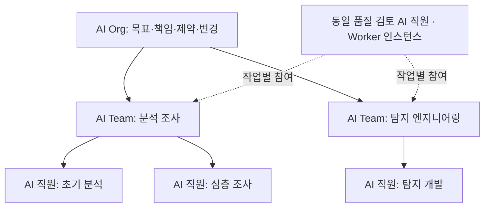
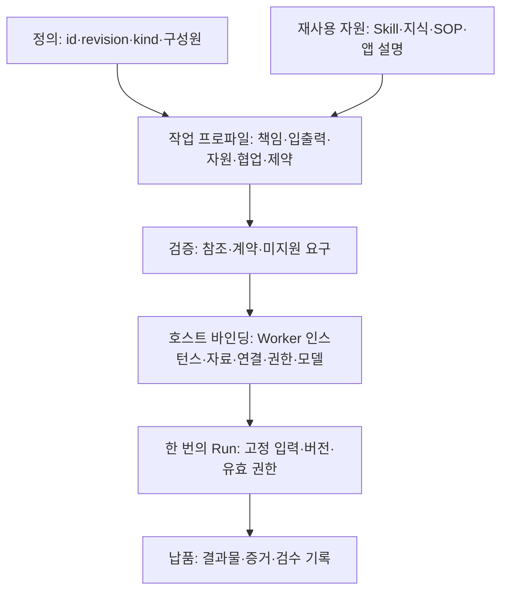
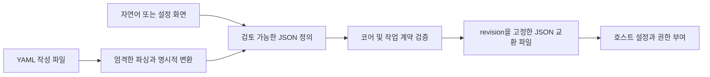

# AI Worker, AI Team 및 AI Organization 개방형 정의 표준 1.0

[Languages / 语言](../docs/languages.md)

**Max Luo, Morgan Chen｜Teloa 공동 창업자**

> 번역 안내: [중국어 간체판](core.zh-CN.md)이 기준 원문입니다. 이 문서는 한국어 번역본이며, 한국어가 모국어인 업계 전문가의 전면 검토는 아직 거치지 않았습니다. 차이를 발견하면 알려 주시기 바랍니다. 동일한 예제를 비교할 수 있도록 JSON／YAML 예제의 값은 원문 그대로 유지합니다. Mermaid 도표의 표시 라벨과 설명은 한국어로 번역했습니다.

코어 버전: `1.0`. 발행일: 2026-10-18. 상태: 개방형 명세.

이 문서와 [작업 및 협업 프로파일](work-profile.ko.md)이 함께 이번 판의 명세를 구성합니다. 제 1–3 절은 개념을 설명하고, 제 4–9 절은 코어 교환 동작을 규정합니다. 인스턴스 설정과 실제 실행은 별도로 검증합니다.

## 1. 쉬운 말로 구성 이해하기

**AI Worker는 작업을 넘어 지속적으로 식별할 수 있는 정체성을 갖고, 명시된 권한 범위 안에서 책임을 맡아 작업을 수락하며 검수 가능한 결과물을 제공하는 AI 작업 주체입니다. AI Team은 공동 결과물을 위해 역할을 나누고 협업하는 구성입니다. AI Organization은 그 구성 위에 조직 책임, 자원 제약 및 변경 거버넌스를 명시합니다.**

Teloa에서는 이러한 작업 주체를 **AI 직원**이라고 부릅니다. AI Worker는 그 바탕이 되는 범용 표준 개념입니다. 사용자가 만들고 함께 일하는 대상의 제품 명칭은 계속 AI 직원이며, Worker 정의는 책임과 작업 계약을 설명하고 Worker 인스턴스는 특정 AI 직원을 식별합니다. Grok Bot도 AI Worker로 기술할 수 있습니다. 이러한 개념 대응은 공급업체 인증을 의미하지 않으며, 실제 적용 시 계약과 호스트 동작을 확인해야 합니다.

여기서 '지속적'이란 정체성과 책임이 작업을 넘어 이어질 수 있다는 뜻입니다. 상시 접속, 영구 프로세스, 전용 기계 또는 장기 기억을 필수로 요구하지 않습니다. 작업 주체는 여러 모델과 임시 Agent를 호출할 수 있지만, 외부에 제공하는 결과물은 추적 가능한 동일한 Worker 인스턴스에 귀속됩니다.

| 용어 | 이 표준에서의 의미 | 경계 |
| --- | --- | --- |
| AI Agent | 추론, 도구 호출 또는 작업 실행에 사용하는 일반 기술 개념 | 일시적으로 존재할 수 있으며, 이름만으로 Worker 계약을 갖췄음을 증명하지 않음 |
| AI Worker | 지속적으로 식별할 수 있고 제약을 받으며 결과물 제공에 책임을 지는 AI 주체 | '책임'은 작업 귀속과 추적 가능성을 뜻하며 법인격을 의미하지 않음 |
| AI Team | 공통 작업 인터페이스, 구성원 역할 분담 및 협업 계약을 갖춘 구성 | 그룹 채팅이나 구성원 목록만으로 적합성을 증명할 수 없음 |
| AI Organization | 협업 계약과 조직 거버넌스 계약을 갖춘 구성 | 인원수나 계층 수로 구분하지 않으며, 자동으로 기업 법인을 뜻하지 않음 |
| AI Workforce | 특정 범위의 AI 작업자와 작업 역량을 통칭 | 이번 판에서 독립적인 객체나 형식을 추가하지 않음 |
| AI 직원, Bot | 제품이나 업무에서 사용하는 명칭 | 실제 구성과 동작에 따라 대응시키며, 제품 이름만으로 적합성을 인정하지 않음 |

AI Worker는 [11x](https://www.11x.ai/11x-manifesto), [Delos](https://marketplace.microsoft.com/en-us/product/office/WA200011292) 등에서 이미 공개적으로 사용되는 용어입니다. 이 명세는 기존 용어를 채택하고 자체 규범적 정의를 제시합니다. 이름을 처음 만들었다고 주장하지 않으며, 공급업체의 명칭을 통일된 업계 표준으로 보지도 않습니다. 외부에 처음 사용할 때는 'AI Worker(소프트웨어 작업 주체)'라고 명시하여 AI 업계에 종사하는 사람과 혼동하지 않도록 합니다.

### 1.1 AI Worker의 구성

| 구성 | 쉽게 표현한 질문 | 세부 내용 |
| --- | --- | --- |
| 역할과 책임 | 나는 누구이며, 무엇을 담당하고, 언제 상위로 보고하는가 | 이름, 책임, 담당하지 않는 사항, 판단 및 확인 규칙 |
| 방법과 근거 | 어떻게 일하고, 무엇으로 판단하는가 | Skills, 지식, SOP. 방법과 사실을 각각 참조 |
| 작업과 일정 | 어떤 일을 받아 언제 수행하는가 | 작업 템플릿, 입력과 출력, 필요에 따라 설정하는 정기 작업 |
| 실행 조건 | 어떤 도구로 어느 범위까지 수행할 수 있는가 | 애플리케이션 요구, 자료 범위, 권한 조건, 모델 및 예산 요구 |
| 경험과 결과물 | 어떤 경험을 이어가며, 어떻게 완료를 증명하는가 | 기억 규칙, 결과물 버전, 증거 및 검수 |

이 다섯 그룹은 이해를 돕기 위한 것으로, 기존 12가지 구성 요소를 포괄하며 다섯 가지 새 자원 유형을 추가하지 않습니다. 최소 Worker 정의에는 정체성과 리비전, 책임과 판단 경계, 그리고 입력·출력·책임 위치·검수 요구를 갖춘 작업 계약이 최소 하나 필요합니다. 스킬 패키지, 지식 베이스, SOP, 기억 및 정기 작업은 필요에 따라 제공합니다. 빈 자원 카탈로그는 유효하지만 실제 의존성을 우회하는 데 사용해서는 안 됩니다.

### 1.2 AI Team의 구성

**팀＝공동 목표＋구성원과 역할 분담＋공유 맥락 경계＋협업 인계＋작업 일정＋자원 제약＋결과물 검수.** 그룹 채팅은 의사소통을 지원할 수 있고, 팀 계약은 누가 책임지며 무엇을 전달하고 누가 받으며 언제 중단할지를 설명합니다. 조정자는 선택적인 협업 역할이며 모든 팀이 관리자 체계를 채택할 필요는 없습니다.


그림은 Teloa를 예로 듭니다. 공동 목표에서 역할 분담과 협업 계약을 정하고, 실행 담당 AI 직원 A가 고정된 결과물과 필요한 증거를 검토 담당 AI 직원 B에게 전달한 뒤 검수 또는 에스컬레이션으로 이어집니다. 공유 자료와 자원 경계는 두 직원 모두에게 적용됩니다. AI 직원은 Worker에 대응하고, AI 팀은 Team 계약으로 공동 결과물과 협업을 정합니다.

### 1.3 팀에서 AI Organization으로 확장하기

**조직＝개별 주체와 팀의 구성＋팀 간 책임＋자원 및 정보 경계＋에스컬레이션과 변경 규칙.** 팀은 조직의 구성원으로 참여하면서 동일한 작업 인터페이스를 계속 사용할 수 있습니다. 조직은 명시적으로 나열한 작업만 약속하며, 구성원의 모든 능력과 권한을 자동으로 갖지 않습니다.



그림은 Teloa의 AI 직원과 AI 팀이라는 명칭을 사용하여 Worker, Team, Org의 구성 관계를 설명합니다. AI Org가 목표·책임·제약·변경을 정하고, 분석 조사 팀에는 초기 분석 및 심층 조사 직원이, 탐지 엔지니어링 팀에는 탐지 개발 직원이 속합니다. 동일한 품질 검토 Worker 인스턴스가 작업별로 두 팀에 참여합니다. 이는 구성 예시이며 이 조직들이 이미 배포되었다고 주장하지 않습니다. 자문역은 작업별로 참여할 수 있고 모든 그룹에 가입할 필요가 없습니다. 여러 팀에서 동일한 AI 직원을 공유하려면 명시적인 인스턴스 바인딩이 필수입니다. 하나의 역할 템플릿을 재사용해 두 AI 직원을 만드는 것은 다른 관계입니다.

## 2. 바탕이 되는 기술 아키텍처

코어 교환 객체는 여전히 **agent**와 **organization** 두 종류뿐이며 기존 형식을 유지합니다. 완전한 AI Worker 정의는 agent와 필수 작업 프로파일을 사용합니다. AI Team은 organization과 협업 계약을 사용하며, AI Organization은 동일한 구성 객체에 거버넌스 계약을 추가합니다. `kind: agent`는 하위 구조 분류일 뿐 AI Worker 적합성 선언이 아닙니다. 세 가지 사용 형태가 세 벌의 코어 형식을 만들지는 않습니다.



기술 경로는 id·revision·kind·구성원을 포함하는 정의와 재사용 가능한 Skill·지식·SOP·애플리케이션 설명을 작업 프로파일에 연결하는 것입니다. 참조·계약·미지원 요구를 검증한 뒤 호스트가 Worker 인스턴스·자료·연결·권한·모델을 바인딩합니다. 한 번의 Run은 입력·버전·유효한 권한을 고정하고, 결과물·증거·검수 기록으로 이어집니다. Teloa에서 호스트가 바인딩하는 것은 특정 AI 직원이며, 각 Run은 그 직원의 한 번의 실행입니다. 정의, 인스턴스, Run을 각각 기록하여 제품 명칭과 기술 개념을 대응시킵니다.

| 계층 | 표준의 책임 | 호스트의 책임 |
| --- | --- | --- |
| 정의 | 고정된 정체성과 리비전, 구성, 작업 및 협업 요구 | 읽기, 검증, 보고 및 무손실 저장 |
| 인스턴스 | 바인딩에서 구분해야 하는 정체성과 범위 규정 | 직원 생성 또는 재사용, 연결·모델·권한·개인 기억 바인딩 |
| 실행 | 입력과 출력, 인계, 중단 및 검수의 의미 | 추론, 작업 배정, 스케줄링, 예산 집행, 권한 확인 및 실행 기록 |

개별 주체와 구성체 모두 네 가지 질문에 답합니다. **어떤 입력을 받고, 어떤 조건이 필요하며, 어떤 결과를 제공하고, 어떤 경계를 지키는가.** 인스턴스 정체성은 호스트가 확인합니다. 이름 변경, 그룹 가입, 템플릿 가져오기 또는 동일한 정의 참조는 권한을 발생시키지 않습니다. 과거 실행은 이전 버전을 고정하며, 템플릿 업그레이드가 이를 다시 쓰지 않습니다.

이 명세는 직원 한 명당 기계 한 대, 단일 모델, 단일 스케줄러 또는 완전한 조직 관리 시스템을 규정하지 않습니다. 결제, 법인격 또는 물리적 신체 제어도 포함하지 않습니다. 필수 능력이 없으면 반드시 보고해야 하며, 파일을 성공적으로 읽었다고 실행 가능하다고 판단해서는 안 됩니다. 초판은 직원, 팀 및 조직 구성을 포괄합니다.

### 2.1 이번 판의 적합성 판단

이하 '필수／해야 한다／해서는 안 된다'는 강제 요구, '권장한다'는 권고, '할 수 있다／선택 사항'은 선택 가능한 항목을 뜻합니다. 예제는 형식만 설명하며 배포 완료나 실행 검증 통과를 의미하지 않습니다.

| 선언 범위 | 필수 요소 | 내릴 수 있는 결론 |
| --- | --- | --- |
| 코어 정의 교환 | 제 4–9 절의 코어 규칙 | 파일을 올바르게 해석하고 무손실 저장할 수 있음. 이것만으로 AI Worker 적용 완료라고 할 수 없음 |
| AI Worker 정의 | agent 코어＋필수 작업 부록＋완전한 책임·작업·검수 계약 | 정의가 완전함. 연결, 실제 정체성 및 실행 능력은 호스트 바인딩이 필요함 |
| AI Worker 인스턴스 | 검증된 정의＋안정적인 인스턴스 식별자＋신뢰할 수 있는 관리 주체＋작업별 권한과 실행 기록 | 작업을 넘어 정체성을 추적할 수 있음. 모델 교체나 새 Run 시작은 새 직원을 뜻하지 않음 |
| AI Team 정의 | organization 코어＋작업 부록＋구성원 분담·인계·공유·중단 규칙 | 협업 계약을 해석할 수 있음. 자동 배정과 실제 인계는 별도 검증 |
| AI Organization 정의 | AI Team 계약＋governance＋조직 제약 | 거버넌스 계약이 완전함. 구체적 정체성·제도·제약 집행은 별도 검증 |

거버넌스를 포함한 동일한 구성 정의는 Team과 Organization 선언을 모두 만족할 수 있습니다. 상호 배타적인 제품 유형이 아닙니다. 정의 적합성은 먼저 실행에 성공할 것을 요구하지 않습니다. 인스턴스 준비 완료와 특정 실행 성공은 각각 증거를 제시해야 합니다. 거버넌스를 선언하지 않은 구성은 이름만 바꾸어 이번 판의 AI Organization에 적합하다고 선언해서는 안 됩니다.

안정적인 인스턴스 식별자는 선언된 호스트와 신뢰 주체 범위 안에서 고유하게 식별되면 충분하며, 전 세계 공통 계정이나 탈중앙화 신원 네트워크를 요구하지 않습니다. Worker는 필요에 따라 시작·일시 중지·퇴역할 수 있습니다. 호스트는 이 상태에 대응하는 실제 동작을 기록하고 재개 전에 유효한 권한을 다시 확인해야 합니다. 퇴역으로 과거 결과물의 귀속이 새 인스턴스로 넘어가서는 안 됩니다. 구체적인 저장 방법과 보존 기간은 실제 배포 정책이 결정합니다.

### 2.2 JSON 교환과 YAML 작성

**JSON은 이번 판의 유일한 규범적 교환 표현이며, YAML은 선택적인 작성용 입력입니다.** 사용자는 자연어나 양식으로 같은 정의를 생성할 수도 있습니다. 수신 측이 JSON만 구현해도 코어 교환 적합성을 선언할 수 있습니다. YAML 작성 능력은 별도의 지원 범위로 명시하며 모든 제품에 YAML 편집기를 요구하지 않습니다.



그림에는 자연어나 설정 화면에서 검토 가능한 JSON 정의를 만드는 경로와 YAML 작성 파일을 엄격하게 파싱한 뒤 명시적으로 JSON으로 변환하는 경로가 있습니다. 두 경로 모두 코어와 작업 계약을 검증한 후 revision을 고정한 JSON 교환 파일을 만들고, 호스트 설정 및 권한 확인으로 이어집니다.

이번 판의 YAML 작성 규약을 지원한다고 선언하는 변환기는 YAML 1.2 Core Schema의 타입 파싱을 사용해야 하며, 모든 키가 문자열인 단일 매핑 문서를 받아야 합니다. 중복 키, 비유한 수치, 사용자 정의 또는 명시적 태그, 앵커, 별칭, 키 텍스트가 `<<`인 항목 및 다중 문서 스트림은 거부해야 합니다. JSON으로 무손실 표현 가능한 값만 허용하며 수치를 조용히 반올림해서는 안 됩니다. 환경 변수, 템플릿 표현식 및 파일 포함은 평가하지 않습니다. `revision: "1"`은 문자열이고 `revision: 1`은 숫자이므로 후자는 필드 검증에서 거부해야 합니다. 변환 기록에 파서와 버전을 기록합니다. [YAML 1.2.2](https://yaml.org/spec/1.2.2/)

YAML 주석은 교환 의미에 포함되지 않습니다. 권한, 제한 및 검수 요구를 주석에만 적어서는 안 됩니다. 블록 텍스트를 파싱한 뒤의 줄바꿈은 문자열 내용이며 R02에 따라 비교합니다. 작성자는 YAML을 작성 원본으로 유지하고 매번 고정된 JSON을 내보낼 수 있지만, 둘을 동일 리비전에서 독립적으로 변경할 수 있는 두 기준 원본으로 삼아서는 안 됩니다. 내보낸 결과를 수정한 경우 통일된 원본으로 돌아가 새 리비전을 생성해야 합니다.

이는 JSON 바이트 정규화나 서명 프로토콜이 아닙니다. R02는 JSON 값을 비교하고, 자원 패키지의 digest는 실제 바이트를 대상으로 합니다. JSON Schema 2020-12로 Work 입력과 출력을 기술하며 두 작성 경로 모두 같은 계약 검사를 받아야 합니다. [JSON Schema](https://json-schema.org/draft/2020-12)

## 3. 외부 정의 재사용

| 출처 | 이번 판에서 채택하는 내용 | 명시적인 차이 |
| --- | --- | --- |
| OASF | 네이티브 discovery의 능력 분류·분야·버전 정보. 메타데이터와 자원 위치는 필요에 따라 매핑 | 분류 스킬은 실행 가능한 방법 패키지가 아니며, 분류 자체가 작업 품질을 증명하지 않음 |
| Oracle Agent Spec 26.1.2 | 컴포넌트 참조와 구성의 개념, 명시적 입력과 출력, 정의와 호출 분리, 방향을 가진 협업 관계 | 이번 판의 작업 인터페이스는 JSON Schema 객체를 사용하며, 그 컴포넌트 설정을 가장하거나 전체 실행 그래프를 복제하지 않음 |
| Grok Bot | 지속적인 역할, 공유 방법, 역할 맥락, Skill과 Routine 분리 | 공개 recipe는 템플릿 자료이며, Team Bot은 여러 사람이 사용하는 하나의 Bot이지 여러 직원으로 된 팀이 아님 |

OASF discovery 데이터는 고정 버전 그대로 담습니다. 자세한 내용은 부록 §7을 참조하십시오. 이를 바탕으로 discovery 레코드를 내보낼 수 있으며, 동의어로 된 별도의 능력 분류 체계를 만들지 않습니다. [OASF Record Guide](https://docs.agntcy.org/oasf/agent-record-guide/) · [Discovery Extension](https://docs.agntcy.org/oasf/discovery-extension/)

Agent Spec의 컴포넌트 참조는 설정 내부의 `$component_ref`를 사용합니다. 입력과 출력은 JSON Schema에 기반하며 Swarm과 ManagerWorkers는 구체적인 협업 동작을 포함합니다. 이번 판은 파일 간 id＋revision을 유지하고 책임 인계, 대화 전달 및 권한을 각각 처리합니다. 변환할 때 실제 입력·출력 제약과 협업 동작을 검증해야 합니다. 전체 대화를 기본으로 공유하거나 입력과 출력의 타입을 암묵적으로 변환해서는 안 됩니다. [Agent Spec 26.1.2](https://oracle.github.io/agent-spec/26.1.2/agentspec/language_spec_26_1_2.html)

정의를 참고하는 것, 네이티브 데이터를 유지하는 것, 호환성 검증을 통과하는 것은 서로 다른 선언입니다. 이 설계를 수용했다고 모든 OASF 모듈이나 Agent Spec 런타임과 호환되는 것은 아닙니다. [Grok 설계 설명](https://x.ai/news/designing-grok-bot) · [Team Bots](https://docs.x.ai/grok-bot/team-bots)

## 4. 코어 정의에서 완전한 AI Worker로

### 4.1 최소 코어 교환 정의

```json
{
  "specVersion": "1.0",
  "id": "urn:example:definition:research-assistant",
  "revision": "5",
  "kind": "agent",
  "name": "研究助手",
  "instructions": "根据提供的资料回答问题，保留来源，区分事实、推断和未知。"
}
```

이 여섯 필드는 최소 교환 정의만 구성하며, 아직 완전한 AI Worker를 구성하지 않습니다. 개별 주체 전체에 필수인 외부 능력이 있으면 capabilities를 추가합니다. 이번 판의 Worker 작업이나 팀 협업 계약을 지원한다고 선언하려면 부록의 작업 프로파일도 반드시 지원해야 합니다. 프롬프트만 저장하고 완전하게 적용했다고 선언해서는 안 됩니다.

### 4.2 최소한의 완전한 AI Worker 정의

다음은 업종에 상관없이 사용할 수 있는 자료 요약 Worker입니다. 외부 애플리케이션, 스킬 패키지, 자동 정기 작업은 없지만 명확한 책임, 입력과 출력, 검수가 있습니다. 반복적으로 요약 업무를 수행하는 역할을 정의하며 실제 인스턴스와 관리 주체는 배포 시 바인딩합니다.

```json
{
  "specVersion": "1.0",
  "id": "urn:example:definition:document-worker",
  "revision": "2",
  "kind": "agent",
  "name": "材料摘要工作者",
  "instructions": "持续承担已提供材料的摘要工作，注明材料之外无法核实的内容。",
  "extensions": [{
    "id": "urn:teloa:profile:ai-work",
    "version": "1.0",
    "required": true,
    "data": {
      "responsibility": {
        "triggers": ["收到已授权的摘要任务"],
        "autonomousActions": ["读取本次提供的材料并撰写摘要"],
        "confirmationPoints": ["对外发布须由任务负责人另行确认"],
        "escalationRules": ["材料缺失或相互矛盾时报告缺口"],
        "deliveryChecks": ["摘要可回查材料，不补造事实"]
      },
      "resources": [],
      "authorityRoles": [{"id": "owner", "name": "任务负责人", "kind": "human"}],
      "works": [{
        "id": "summarize",
        "title": "材料摘要",
        "instructions": "根据输入材料交付摘要和未决问题。",
        "inputs": {
          "$schema": "https://json-schema.org/draft/2020-12/schema",
          "type": "object",
          "properties": {"material": {"type": "string", "minLength": 1}},
          "required": ["material"],
          "additionalProperties": false
        },
        "outputs": {
          "$schema": "https://json-schema.org/draft/2020-12/schema",
          "type": "object",
          "properties": {
            "summary": {"type": "string", "minLength": 1},
            "openQuestions": {"type": "array", "items": {"type": "string"}}
          },
          "required": ["summary", "openQuestions"],
          "additionalProperties": false
        },
        "requires": [],
        "responsible": "self",
        "acceptance": {
          "criteria": ["摘要与输入材料一致，未决问题单列"],
          "reviewer": "authority/owner",
          "independent": true
        }
      }]
    }
  }]
}
```

이 예제의 [JSON 파일](../examples/document-worker.json)과 [YAML 작성 파일](../examples/document-worker.yaml)은 본문에서 생성되었으며 동일한 JSON 값을 표현합니다. 완전한 팀·조직·공유 인스턴스 예제는 [구성 예제](../examples/composition-fixture.json)를 참조하십시오. 모두 정의 예제이며 이로 인해 연결·실행·게시 권한이 부여되지는 않습니다.

## 5. 하나의 파일로 팀이나 조직 구성하기

```json
{
  "specVersion": "1.0",
  "id": "urn:example:definition:research-team",
  "revision": "5",
  "kind": "organization",
  "name": "研究小组",
  "instructions": "research 整理证据，review 检查来源和结论；发现分歧时保留分歧。",
  "members": [
    {
      "id": "research",
      "ref": {
        "id": "urn:example:definition:research-assistant",
        "revision": "5"
      }
    },
    {
      "id": "review",
      "ref": {
        "id": "urn:example:definition:research-assistant",
        "revision": "5"
      }
    }
  ]
}
```

이 예제는 코어 구성 참조만 표현하며 완전한 AI Team 또는 AI Organization 정의가 아닙니다. 작업 부록과 해당 협업·거버넌스 계약을 추가해야 합니다.

구성원 항목은 개별 주체나 하위 조직 정의를 참조합니다. 동일한 템플릿을 재사용할 수 있지만 두 구성원 항목은 따로 이름을 지정합니다. 이것이 실제 실행자 두 명의 독립성을 자동으로 증명하거나 2인 승인을 만들지는 않습니다. Member는 구성 내 정의 슬롯이며, 그룹 구성원 또는 임명 기록과 직접 같지 않습니다. 부록은 구성원·자문역·외부 책임 역할·인스턴스 바인딩을 명시하고, 실제 정체성과 권한은 호스트가 구현합니다.

## 6. 코어 필드

확장 data 내부를 제외한 모든 객체는 아래 표와 뒤에서 정의하는 필드만 허용합니다. 새로운 의미는 extensions로 표현합니다.

| 필드 | 타입과 범위 | 유지하는 이유 |
| --- | --- | --- |
| specVersion | 필수, 정확히 `1.0` | 파일 해석 방식을 확정 |
| id | 필수, 절대 URI 또는 URN | 파일 간 동일한 정의 참조 |
| revision | 필수, 비어 있지 않은 문자열, latest 금지 | 내용을 고정하여 참조의 묵시적 변경 방지 |
| kind | 필수, agent 또는 organization | 개별 주체와 구성 구분 |
| name | 필수, 비어 있지 않은 문자열 | 사람이 식별하고 공유할 수 있게 함 |
| instructions | 필수, 비어 있지 않은 문자열 | 에이전트 책임 또는 조직 협업 요구 표현 |
| capabilities | 선택 사항, Capability 배열, agent만 사용 가능 | 필수 외부 능력 참조 |
| members | organization에 필수인 비어 있지 않은 Member 배열, agent는 사용 금지 | 조직 구성 표현 |
| extensions | 선택 사항, Extension 배열 | 코어 이외의 의미 수용 |

- 비어 있지 않은 문자열은 공백 문자만으로 구성되어서는 안 됩니다. 최상위 선택 배열 capabilities, extensions는 생략하거나 빈 배열로 쓸 수 있고 기본 해석은 같습니다. 하지만 원래 JSON 값은 다르므로 R02로 비교합니다. null로 대체해서는 안 됩니다.
- LocalId는 `^[a-z][a-z0-9-]{0,63}$`와 일치합니다. Member와 Capability의 id는 소속 배열 안에서 고유합니다. 확장 계약은 해당 항목 참조를 정의할 수 있지만 소속 정의와 배열을 명시해야 하며 LocalId가 전역적으로 고유하다고 가정해서는 안 됩니다.
- DefinitionRef는 `id`, `revision`만 포함하며 타입은 위 표와 같습니다.
- Member는 `id: LocalId`, `ref: DefinitionRef`만 포함합니다. 모든 구성원 참조는 필수입니다.
- Capability는 `id: LocalId`, `kind: "mcp" | "skills" | "a2a" | "resource"`, `config: object`만 포함합니다. config는 제 7 절을 참조하십시오.
- Extension은 `id: 절대 URI 또는 URN`, `version: 비어 있지 않은 정확한 버전 문자열`, `required: boolean`, `data: object`만 포함합니다. version은 범위나 latest여서는 안 되며 동일 정의에서 확장 id는 고유해야 합니다.

## 7. 외부 능력은 참조만 하기

다음 네 kind는 선택적인 바인딩입니다. 정의를 읽는 것만으로 수신 측이 이를 실행할 필요는 없습니다. 특정 바인딩을 사용할 수 있다고 선언할 때 해당 네이티브 프로토콜이나 형식을 구현해야 합니다. config는 이 표의 필드만 허용하며 선택 사항이라고 표시하지 않은 필드는 모두 필수입니다.

| kind | config 필드 | 바인딩 경계 |
| --- | --- | --- |
| mcp | `protocolVersion: 비어 있지 않은 문자열`; `transport: "stdio" \| "streamable-http"`; `connectionRef: 비어 있지 않은 문자열`; `selectors: Selector[], 선택 사항` | 호스트가 해석하는 MCP 연결을 참조하고, 지정 네이티브 버전에 따라 능력과 권한 확인 |
| skills | `formatSnapshot: URI`; `packageRef: URI`; `packageMediaType: "application/zip" \| "application/x-tar"`; `packageDigest: Digest` | 전체 스킬 패키지와 고정 형식 스냅샷을 참조하며 SKILL.md와 관련 파일 유지 |
| a2a | `protocolVersion: 비어 있지 않은 문자열`; `agentCardRef: URI`; `interfaceUrl: URI`; `protocolBinding: 비어 있지 않은 문자열`; `skillIds: 비어 있지 않은 문자열[], 선택 사항`; `requiredExtensions: URI[], 선택 사항` | A2A 서비스의 지정 인터페이스를 참조하며 네이티브 작업·결과물·상태 유지 |
| resource | `uri: URI`; `mediaType: 비어 있지 않은 문자열`; `digest: Digest, 선택 사항` | 자원을 읽기만 하며 내용을 자동 실행하지 않음 |

Selector는 `{"type":"tool"또는"prompt","name":비어 있지 않은 문자열}` 또는 `{"type":"resource","uri":URI}`만 가능합니다. selectors를 선언하면 배열은 비어 있어서는 안 되며 모든 항목을 만족해야 합니다. 생략은 연결이 필요하다는 의미일 뿐 모든 도구가 허가되었다는 뜻은 아닙니다.

모든 URI는 절대 URI 또는 URN입니다. Digest는 `sha256:` 뒤에 소문자 16진수 64자리를 붙인 값입니다. 프로토콜 버전은 정확해야 하며 범위나 latest를 사용해서는 안 됩니다. 연결 이름, Card 주소 및 패키지 위치는 권한을 의미하지 않습니다.

예를 들어 다음 항목을 에이전트의 capabilities 배열에 넣으면 이 MCP 연결이 필요함을 나타냅니다. 예제 연결과 버전도 실제 배포 환경에서 검증해야 합니다.

```json
{
  "id": "knowledge",
  "kind": "mcp",
  "config": {
    "protocolVersion": "2026-07-28",
    "transport": "streamable-http",
    "connectionRef": "project-knowledge"
  }
}
```

**MCP:** connectionRef는 배포 담당자가 매핑하며, 실제 연결을 표시하고 별도로 권한을 부여해야 합니다. token이나 실행 명령을 포함하지 않습니다. 선언된 버전의 탐색·전송·권한 부여 규칙을 따르고, 도구 이름만으로 다른 연결에 자동 매칭해서는 안 됩니다. 코어는 도구별 매개변수를 기술하거나 범용 도구 권한 언어를 제정하지 않습니다. [MCP 버전 규칙](https://modelcontextprotocol.io/docs/2026-07-28/learn/versioning)

**Skills:** formatSnapshot은 변경 불가능한 형식 명세 출처여야 하며, 다이제스트는 전체 패키지의 원래 바이트를 대상으로 합니다. 압축 해제 루트는 하나의 스킬 디렉터리입니다. 경로 이탈, 정규화 후 중복 경로, 심볼릭 링크와 하드 링크를 거부해야 하며 가져오기 중 스크립트를 실행해서는 안 됩니다. ZIP／TAR는 이 명세의 패키징 규약이지 Agent Skills의 네이티브 요구가 아닙니다. [Agent Skills 형식](https://agentskills.io/specification)

**A2A:** interfaceUrl, protocolBinding, protocolVersion은 실제 Card의 동일한 인터페이스와 대응해야 합니다. 선언된 skillIds 및 양측의 필수 확장은 네이티브 명세로 검증하고 권한은 별도로 확인합니다. 서버 측 완료가 업무 목표 달성을 뜻하지 않으며, A2A AgentSkill은 Agent Skills 파일 패키지와 다릅니다. [A2A 명세](https://a2a-protocol.org/latest/specification/)

**자원:** digest가 없으면 가변 콘텐츠로 취급하고 실제 사용 시 가져온 버전 또는 시간을 기록합니다. 재현 가능하다고 주장해서는 안 됩니다. 비공개 자원은 실제 권한에 따라 읽습니다.

이 필드는 이 명세의 참조 기술이며 네이티브 서비스에 보내는 요청 본문이 아닙니다. 이번 판으로 표현할 수 없는 핵심 제약이 필요하면 required 확장으로 명확하게 표현해야 합니다. 호스트의 추측에 의존하거나 조용히 버려서는 안 됩니다. 네이티브 세부 사항과 실행 보장은 각 바인딩에 두며 범용 실행 프로토콜로 복제하지 않습니다.

## 8. 여덟 가지 공통 규칙

**R01 명확한 형식.** 교환 파일은 UTF-8 JSON 객체여야 하며, 중복 키·알 수 없는 코어 필드·잘못된 필드 타입·비유한 수치는 거부해야 합니다. 코어 버전을 지원하지 않으면 명확히 보고해야 하며 이전 버전 해석을 적용해서는 안 됩니다. 알 수 없는 확장 data 내부 필드는 코어가 검증하지 않습니다.

**R02 변경 불가능한 리비전.** id와 revision은 원래 문자열 그대로 정확히 비교하며 URI 정규화를 하지 않습니다. 두 값의 조합이 하나의 고정 정의를 식별합니다. 아래 규칙으로 비교한 JSON 값이 바뀌면 새 revision을 할당해야 합니다. 동일 조합에 다른 값이 있으면 충돌을 보고해야 하며 덮어써서는 안 됩니다. 비교 시 객체 키 순서와 문자열 밖 공백은 무시하고 배열 순서와 문자열 내용은 유지합니다. 다른 JSON 타입은 같지 않으며 숫자는 수학적 값으로 비교합니다(예: 10과 10.0은 같음). 반올림 때문에 다른 숫자를 같다고 판단해서는 안 됩니다. 필드 생략과 명시적 빈 배열은 서로 다른 JSON 값이며, 기본 해석이 같다는 이유로 합쳐서는 안 됩니다.

**R03 해석 가능한 참조.** 조직을 조립하기 전에 모든 직접·간접 구성원 참조를 지정 리비전까지 재귀적으로 해석해야 합니다. 누락·버전 불일치·순환이 있으면 보고하고 조립을 중단해야 하며 자동으로 버전을 바꾸어서는 안 됩니다. 조직의 완전 지원 선언은 이 참조 폐쇄에 속한 모든 구성원 정의의 필수 능력과 확장을 포괄해야 합니다. 정의 참조는 비순환 그래프를 이루지만 실제 협업의 왕복을 제한하지는 않습니다. id는 다운로드 주소가 아니며 정의를 얻는 방법은 호스트가 결정합니다. 파일을 읽는다고 자동으로 네트워크에 연결해서는 안 됩니다.

**R04 구성해도 권한은 합치지 않는다.** 구성원은 각자의 정의와 능력을 사용합니다. 조직 instructions는 협업 요구를 설명하며 구성원 instructions를 덮어쓰거나 도구·권한을 자동으로 추가하지 않습니다. 충돌이 해결되지 않았으면 영향을 받는 작업을 시작해서는 안 됩니다. 같은 이름의 능력은 소속 구성원별로 구분하며 연결을 합쳐서는 안 됩니다. 코어는 스케줄링, 프롬프트 병합 또는 실제 정체성 할당을 정의하지 않습니다.

**R05 선언은 이행해야 한다.** capabilities의 모든 항목은 해당 에이전트가 선언한 필수 의존성입니다. '기본적으로 무시 가능한' 바인딩은 없습니다. 항목을 제공할 수 없으면 부족한 항목을 나열해야 하며, 해당 정의로 시작하거나 완전 지원을 선언해서는 안 됩니다. 조직도 필수 구성원의 부족한 항목을 우회하여 실행해서는 안 됩니다. 조회와 저장은 가능하지만 능력을 삭제하거나 변경하면 새 revision을 생성해야 합니다. 실제 실행에서는 네이티브 지원과 권한을 확인해야 하며 읽기 성공이 실행 가능을 의미하지 않습니다.

부록의 resources는 작업별로 선택하는 카탈로그이며 capabilities와 다릅니다. 전체 조건과 선택 작업의 필수 조건을 모두 만족해야 합니다. 다른 작업에만 필요한 미준비 자원은 그 작업만 차단합니다. 완전 지원, 특정 작업의 준비 완료, 실제 권한 획득은 각각 보고해야 하며, 작업 프로파일을 이용해 이 규칙의 전체 의존성 요구를 우회해서는 안 됩니다.

**R06 확장은 실패를 명시한다.** 확장 계약은 id와 정확한 version으로 고정하며 최소한 data 구조·의미·검증 방법을 정의해야 합니다. 구조나 의미가 바뀌면 버전을 바꿔야 합니다. 소비자는 명시적으로 지원해야 하며 URI를 읽었다는 이유로 검증기나 코드를 자동 다운로드해서는 안 됩니다. 알 수 없는 확장은 JSON 값을 유지하고 보고해야 합니다. required=true이면 해당 정의로 조립·실행하거나 완전 지원을 선언해서는 안 됩니다. required=false는 기본 실행 의미를 바꾸지 않는 보조 정보에만 사용합니다. 발행자는 권한·결제·실행 조건·검수 제약을 무시 가능하게 설정해서는 안 됩니다. 소비자가 지원하는 확장에서 이 요구의 위반을 발견하면 조립·실행·완전 지원 선언을 거부해야 하고 검증 통과로 표시해서는 안 됩니다. 문제 파일을 보관·조회하거나 오류 보고와 함께 그대로 내보낼 수는 있습니다. 코어는 알 수 없는 data의 모든 의미를 식별할 수 있다고 주장하지 않습니다. 서로 충돌하는 필수 제약 중 하나를 선택해 완화해서는 안 됩니다.

**R07 정의는 권리를 부여하지 않는다.** 가져오기가 실행 주체 생성·코드 설치·서비스 연결·작업 실행·결제를 자동으로 수행해서는 안 됩니다. 정의에는 비밀 키·token·cookie 또는 직접 사용할 수 있는 권한 자격 증명을 포함해서는 안 됩니다. 템플릿·역할 설명·조직 관계는 정체성·대리권·실행 권한을 발생시키지 않으며, 호스트가 실제 작업 전에 이를 확인합니다.

**R08 적합성 선언에는 증거가 필요하다.** 최소 적합성은 '이 버전의 정의 교환 지원'이며 올바른 읽기·검증·보고·저장·무손실 내보내기를 요구합니다. 유효한 문서를 가져온 뒤 내보냈을 때 알 수 없는 확장을 포함한 JSON 값을 그대로 유지해야 합니다. 편집에는 새 리비전이 필요합니다. 바인딩과 확장의 실제 지원은 이름·버전·검증 범위를 별도로 나열해야 하며, 교환 적합성으로부터 실행·업무 품질·플랫폼 간 주체 이동을 추론해서는 안 됩니다.

## 9. 적합성과 검증

적합성은 명확한 범위별로 선언합니다. 코어 교환, 작업 프로파일 해석, 지정 출처／버전 매핑, 특정 호스트·작업·입력 범위의 실행을 구분하며 하나의 '호환' 표현으로 모든 능력을 포괄하지 않습니다. 업무 품질은 작업별 평가가 필요하며 구조 검사에서 추론하지 않습니다.

다음 여섯 항목은 코어 정의 교환 검증입니다. 작업 프로파일의 양성·음성 예제는 부록, 검증 범위는 [적합성 설명](../CONFORMANCE.md)을 참조하십시오. 보조 예제 검사는 완전한 적합성 구현이나 두 독립 구현의 상호운용과 같지 않습니다.

| 번호 | 입력 또는 작업 | 반드시 관찰해야 할 결과 |
| --- | --- | --- |
| T01 | 중복 키, 알 수 없는 코어 필드, 잘못된 kind／타입, 알 수 없는 코어 버전 | 거부하거나 버전 미지원을 명확히 보고 |
| T02 | 제 4·5 절의 예제, 알 수 없는 확장을 포함한 유효 정의, 각 구성원이 동명 능력을 선언한 구성 정의와 그 구성원 정의를 가져온 뒤 내보내기 | JSON 값 유지, 다른 구성원의 동명 능력을 합치지 않음 |
| T03 | 같은 id／revision의 서로 다른 값. 키 순서·공백·10과 10.0·배열 생략과 명시적 빈 배열도 비교 | R02로 판단. 값이 다를 때만 충돌하며 덮어쓸 수 없음. 생략과 빈 배열은 충돌하고 값 변경에는 새 revision 필요 |
| T04 | A → B → C 중첩 참조. 누락·리비전 불일치·순환·대소문자만 다른 참조. C의 필수 능력 또는 required 확장 누락 | 참조 오류 위치를 보고하고 조립 중단. 자동 네트워크 접속이나 정규화로 보완하지 않음. C가 부족하면 A는 완전 지원을 선언할 수 없고 R05／R06에 따라 실행 제한 |
| T05 | 알 수 없는 optional／required 확장. 지원 중인 제약 확장을 잘못 optional로 표시 | 미지 항목은 모두 유지·보고. required는 조립·실행·완전 지원 선언 차단. 알려진 불법 제약도 거부하고 검증 통과로 표시 금지. 오류 보고와 원본 파일 보존은 가능 |
| T06 | 능력 참조를 포함한 파일만 가져오기 | 설치·연결·실행하지 않음. 실행 미검증을 명시하며 설정 완료·사용 가능으로 선언하지 않음 |

바인딩과 호스트의 실제 실행은 별도로 검증합니다. 최소한 필수 능력 부족 시 시작하지 않는지, 실제 권한, 조직 구성의 격리, 네이티브 실패 및 결과 불명을 확인합니다. JSON 검사로 이 검증을 통과한 것처럼 주장해서는 안 됩니다.

모든 호스트에 동일한 오류 코드나 내부 상태 머신을 강제하지는 않지만, 오류는 객체를 특정하고 원인을 설명해야 합니다. 구현마다 위의 수락／거부 및 보존 동작에서 일관된 결과를 내는 것을 권장합니다.

## 10. 발전과 도입의 경계

현재 하나의 공통 작업 프로파일로 Worker·Team·Organization의 작업 계약과 필요한 호스트 요구를 표현합니다. 기억 내용, 실제 일정, 계정 정체성 및 조직 관리는 호스트가 구현하며, 새로운 상호운용 요구가 생기면 확장을 평가합니다. 새 프로토콜은 required URI 확장으로 접속할 수 있으므로 모두 코어 열거형에 추가할 필요가 없습니다.

첫 시연은 로컬 디렉터리에서 정의별 JSON 파일 하나를 두고 내용의 id／revision으로 색인을 만들 수 있습니다. 파일 이름은 의미를 담당하지 않습니다. 이는 예제 전달 방식이지 새 배포 프로토콜이 아닙니다. 중첩·누락·충돌 반례와 예상 결과를 함께 제공한 뒤 두 독립 구현으로 검증·가져오기·내보내기 동작을 확인합니다. 이후 실제로 필요한 능력 바인딩을 하나 선택하여 '가져오기 → 연결 설정／권한 부여 → 실행 → 결과물 획득'을 검증합니다. 이 경로를 완료하기 전에는 범용 실행·결제·수명 주기 관리 표준으로 확장하지 않습니다.

명세 버전을 올릴 때는 재검증하고 specVersion과 부록 버전을 갱신하며 새 revision을 생성해야 합니다. 구성원 참조도 함께 고정합니다. 기존 정의와 기존 Run을 제자리에서 다시 쓰지 않습니다. 서로 다른 명세 버전이 자동 호환되는 것은 아닙니다. 의미 변경에는 마이그레이션 설명이 필수입니다. [유지 관리 규칙](../GOVERNANCE.md)을 참조하십시오.

### 10.1 범용 코어와 업종별 설정

| 예시 분야 | 다르게 설정할 내용 | 재사용하는 공통 계약 |
| --- | --- | --- |
| SOC | 증거 출처, 경보 분석 방법, 에스컬레이션 조건, 대응 권한 | 정체성, 책임, 작업 I/O, 인계, 결과물 검수 |
| 고객 지원 | 제품 지식, 티켓 분류, 서비스 기한, 사람에게 에스컬레이션 | 위와 같음. SOC 도구나 용어를 고객 지원에 가져오지 않음 |
| 콘텐츠 작업 | 자료 범위, 편집 규칙, 검토 및 게시 권한 | 위와 같음. 원고 완성이 게시 완료를 의미하지 않음 |

이 표는 정의 계층에서 이런 작업을 표현할 수 있다는 점만 보여 주며 해당 업종 검증을 완료했다고 주장하지 않습니다. 업종 요구는 자원·작업·필수 확장으로 설정합니다. 코어는 고정된 역할 수·모델·도구 공급업체·품질 점수·실행 빈도를 규정하지 않습니다.

### 10.2 현재 지위와 추진 조건

현재 Teloa가 관리하는 개방형 명세이며 업계 표준이나 국제 표준 지위를 얻은 것은 아닙니다. 독자 명세와 예제는 [Apache-2.0](../LICENSE) 라이선스를 따릅니다. 유지 관리·피드백·버전 규칙은 [GOVERNANCE.md](../GOVERNANCE.md), 선언 범위는 [CONFORMANCE.md](../CONFORMANCE.md)를 참조하십시오. 업계 상호운용을 주장하려면 최소 두 독립 구현과 비 SOC 시나리오를 포함하는 공개적이고 재현 가능한 검증 증거가 필요합니다. 검토 의견이나 예제 검사는 이러한 증거를 대체하지 않습니다.

정의 해석은 Teloa 계정·클라우드 서비스·비공개 데이터베이스에 의존해서는 안 됩니다. `urn:teloa:profile:ai-work`는 기존 확장의 발행자 이름 공간이며, 같은 의미의 식별자가 갈라지는 것을 막기 위해 유지합니다. Teloa 호스트를 요구하거나 업계 관리 기관의 승인을 뜻하지 않습니다. 제품은 계속 한 단락의 자연어로 확인 대기 중인 정의를 생성할 수 있습니다.
