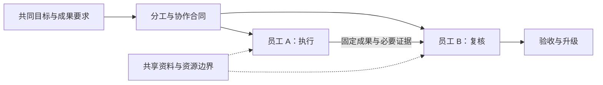
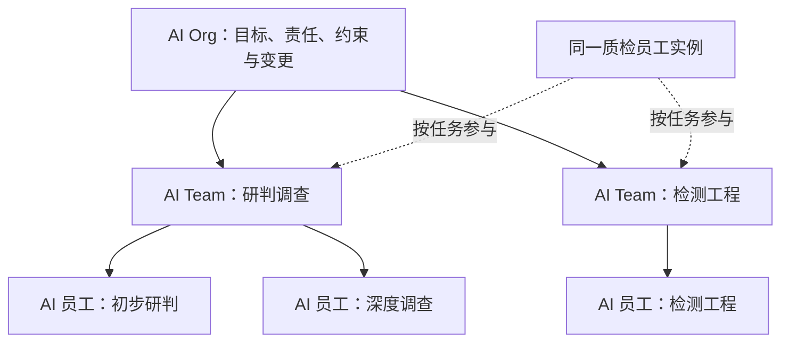
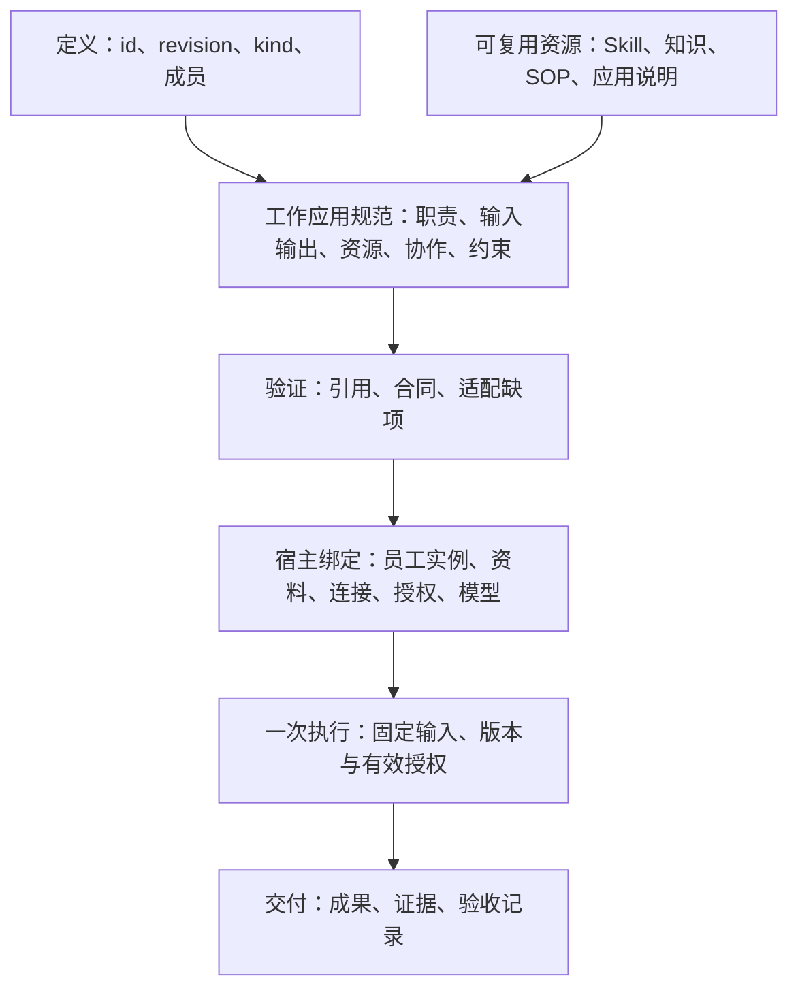
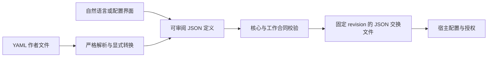

# AI Worker、AI Team 与 AI Organization 开放定义标准 1.0

**Max、Morgan｜Teloa 联合创始人**

核心版本：`1.0`。发布日期：2026-10-18。状态：开放规范。

本文与[工作与协作应用规范](work-profile.zh-CN.md)共同构成本版规范。第 1–3 节解释概念，第 4–9 节规定核心交换行为。实例配置和真实运行另行验收。

## 1. 先用通俗语言理解组成

**AI Worker 是具有可持续识别的身份，在明确授权边界内承担职责、接受工作并交付可验收成果的 AI 工作个体。AI Team 是围绕共同成果分工协作的组合。AI Organization 在组合之上明确组织责任、资源约束和变更治理。**

这里的“持续”指身份与职责可跨任务延续，不要求全天在线、永久进程、独占机器或一定具有长期记忆。工作个体可以调用多个模型和临时 Agent；其对外交付仍归属于同一可追溯的 Worker 实例。

| 术语 | 本标准中的含义 | 边界 |
| --- | --- | --- |
| AI Agent | 用于推理、工具调用或任务执行的通用技术概念 | 可以临时存在；名称本身不证明具备 Worker 合同 |
| AI Worker | 可持续识别、受约束并对工作交付负责的 AI 个体 | “负责”是工作归属与可追溯性，不表示法律人格 |
| AI Team | 有共同工作接口、成员分工及协作合同的组合 | 群聊或成员名单不能单独证明符合 |
| AI Organization | 具备协作合同及组织治理合同的组合 | 不以人数或层级数量区分，不自动代表企业法律实体 |
| AI Workforce | 某范围内 AI 工作者及工作容量的集合称谓 | 本版不增加独立对象或格式 |
| AI 员工、Bot | 产品或业务中的称呼 | 按实际组成和行为映射，不凭产品名称自动符合 |

AI Worker 已有公开使用，例如 [11x](https://www.11x.ai/11x-manifesto) 与 [Delos](https://marketplace.microsoft.com/en-us/product/office/WA200011292)。本规范采用已有术语并给出自身的规范性定义；不主张名称首创，也不把厂商称呼当作统一行业标准。首次对外使用时写明“AI Worker（软件工作个体）”，避免与从事 AI 行业的人类工作者混淆。

### 1.1 AI Worker 由什么组成

| 组成 | 通俗问题 | 背后的内容 |
| --- | --- | --- |
| 岗位与职责 | 我是谁，负责什么，何时升级 | 名称、职责、反职责、判断与确认规则 |
| 方法与依据 | 怎么做，凭什么判断 | Skills、知识、SOP；方法与事实分别引用 |
| 工作与安排 | 接什么工作，什么时候做 | 工作模板、输入输出、按需配置的例行任务 |
| 执行条件 | 用什么工具，可以做到哪一步 | 应用需求、资料范围、权限条件、模型与预算要求 |
| 经验与成果 | 延续什么经验，怎样证明完成 | 记忆规则、成果版本、证据与验收 |

这五组帮助阅读，覆盖现有 12 类组成要素，不新增五种资源类型。最小 Worker 定义必须具备身份与修订、职责与判断边界，以及至少一项含输入、输出、责任位置和验收要求的工作合同。技能包、知识库、SOP、记忆和例行任务按需提供；空资源目录合法，不能用空目录绕过实际依赖。

### 1.2 AI Team 由什么组成

**团队＝共同目标＋成员与岗位分工＋共享上下文边界＋协作交接＋工作安排＋资源约束＋成果验收。** 群聊可以承载沟通，团队合同说明谁负责、交什么、谁接收和何时停止。协调者是可选的协作角色，不要求每个团队都采用主管制。



### 1.3 AI Organization 怎样从团队长出来

**组织＝个体和团队的组合＋跨团队责任＋资源与信息边界＋升级与变更规则。** 团队可以作为组织的成员，继续使用相同的工作接口。组织只承诺明确列出的工作，不自动拥有成员全部能力和权限。



这是组成示意，不声明已经部署这些组织。顾问可以按任务参与，不必加入所有群；跨团队共用同一员工须有明确实例绑定。复用一个岗位模板创建两个员工，是另一种关系。

## 2. 背后的技术架构

核心交换对象仍只有 **agent** 与 **organization**，保留已有格式。完整 AI Worker 定义使用 agent 加必需的工作应用规范；AI Team 使用 organization 加协作合同；AI Organization 在同一组合对象上补充治理合同。`kind: agent` 只是底层结构类别，不是 AI Worker 符合性声明。三种使用形态不产生三套核心格式。



| 层次 | 标准负责 | 宿主负责 |
| --- | --- | --- |
| 定义 | 固定身份与修订、组成、工作和协作要求 | 读取、验证、报告与无损保存 |
| 实例 | 规定绑定必须区分的身份与范围 | 创建或复用员工，绑定连接、模型、权限和私有记忆 |
| 执行 | 输入输出、交接、停止和验收语义 | 推理、派工、调度、预算执行、授权核验与运行记录 |

个体和组合体都回答四个问题：**接收什么输入、需要什么条件、交付什么结果、遵守什么边界。** 实例身份由宿主确认；改名、入群、导入模板或相同定义引用都不产生授权。历史执行固定旧版本，模板升级不改写它。

本规范不规定一员工一机器、唯一模型、唯一调度器或完整组织管理系统；不包含支付、法律人格或具身控制。缺少必要能力时必须报告，不能把成功读取文件当成可执行。首版覆盖员工、团队和组织组合。

### 2.1 怎样判定符合本版

下文“必须／不得”为强制要求，“应”为建议，“可”为可选。示例只说明格式，不代表已部署或通过运行验证。

| 声明范围 | 必须具备 | 能据此得出的结论 |
| --- | --- | --- |
| 核心定义交换 | 第 4–9 节核心规则 | 文件可正确解释与无损保存；不能单独称 AI Worker 已适配 |
| AI Worker 定义 | agent 核心＋必需工作附录＋完整职责、工作和验收合同 | 定义完整；连接、实际身份与执行能力仍待宿主绑定 |
| AI Worker 实例 | 已验证定义＋稳定实例标识＋可信管理主体＋按工作授权与运行记录 | 身份可跨任务追踪；替换模型或启动新 Run 不等于新员工 |
| AI Team 定义 | organization 核心＋工作附录＋成员分工、交接、共享和停止规则 | 协作合同可解释；自动派工与实际交接另验 |
| AI Organization 定义 | AI Team 合同＋governance＋组织约束 | 治理合同完整；具体身份、制度和约束执行另验 |

同一份带治理的组合定义可满足 Team 与 Organization 两种声明；不是互斥产品类型。定义符合性不要求先运行成功，实例就绪和某次执行成功须分别出具证据。未声明治理的组合不得仅靠改名宣称符合本版 AI Organization。

稳定实例标识只要求在声明的宿主与可信主体范围内可唯一识别，不要求全球账号或去中心化身份网络。Worker 可以按需启动、暂停或退休；宿主必须记录这些状态对应的实际行为，并在恢复前重新核对有效授权。退休不把历史成果转署给新实例。具体存储与保留期限由实际部署政策决定。

### 2.2 JSON 交换，YAML 编写

**JSON 是本版唯一的规范性交换表示；YAML 是可选的作者输入。** 用户也可通过自然语言或表单生成同一份定义。接收方只实现 JSON，仍可声明核心交换符合性。YAML 编写能力另列支持范围，不要求所有产品提供 YAML 编辑器。



若声称支持本版 YAML 编写约定，转换器必须使用 YAML 1.2 的 Core Schema 类型解析，接受单一映射文档且键均为字符串；拒绝重复键、非有限数值、自定义或显式标签、锚点、别名、键文本为 `<<` 的条目及多文档流。仅接受可无损表示为 JSON 的值；不得静默舍入数值。环境变量、模板表达式和文件包含不求值。`revision: "1"` 是字符串，`revision: 1` 是数值，后者须被字段校验拒绝。解析器及其版本写入转换记录。[YAML 1.2.2](https://yaml.org/spec/1.2.2/)

YAML 注释不进入交换语义；权限、限制与验收不能只写在注释里。块文本解析后的换行属于字符串内容，按 R02 比较。作者可保留 YAML 为编写源，每次导出固定 JSON；两者不得作为同一修订的两份独立可修改真源。修改导出结果后须回到统一来源生成新修订。

这不是 JSON 字节规范化或签名协议。R02 比较 JSON 值；资源包的 digest 仍针对实际字节。JSON Schema 2020-12 用于描述 Work 的输入输出，两种作者入口都必须接受相同合同检查。[JSON Schema](https://json-schema.org/draft/2020-12)

## 3. 外部定义的复用

| 来源 | 本版采用 | 明确差异 |
| --- | --- | --- |
| OASF | 原生 discovery 的能力分类、领域和版本信息；元数据、资源定位按需映射 | 分类技能不等于可执行方法包，分类也不证明工作质量 |
| Oracle Agent Spec 26.1.2 | 组件引用与组合的思路；明确输入输出；定义与调用分离；有方向的协作关系 | 本版工作接口采用 JSON Schema 对象；不会直接冒充其组件配置或复制完整执行图 |
| Grok Bot | 持续岗位、共享方法、岗位上下文，以及 Skill 与 Routine 分离 | 公开 recipe 是模板材料；Team Bot 是多人使用的一个 Bot，不等于多员工团队 |

OASF discovery 数据按固定版本原样承载，详见附录 §7。可由此导出发现记录，不建立另一套同义能力分类。[OASF Record Guide](https://docs.agntcy.org/oasf/agent-record-guide/) · [Discovery Extension](https://docs.agntcy.org/oasf/discovery-extension/)

Agent Spec 的组件引用采用配置内的 `$component_ref`；输入输出基于 JSON Schema，Swarm 与 ManagerWorkers 则带有具体协作行为。本版保留跨文件的 id＋revision，并把责任交接、会话转交与权限分别处理。转换时须验证实际模式；不默认共享整个会话，不隐式转换输入输出类型。[Agent Spec 26.1.2](https://oracle.github.io/agent-spec/26.1.2/agentspec/language_spec_26_1_2.html)

借鉴定义、保留原生数据和通过兼容验证是不同声明。吸收这些设计不代表已兼容所有 OASF 模块或 Agent Spec 运行时。[Grok 设计说明](https://x.ai/news/designing-grok-bot) · [Team Bots](https://docs.x.ai/grok-bot/team-bots)

## 4. 从核心定义到完整 AI Worker

### 4.1 最小核心交换定义

```json
{
  "specVersion": "1.0",
  "id": "urn:example:definition:research-assistant",
  "revision": "5",
  "kind": "agent",
  "name": "研究助手",
  "instructions": "根据提供的资料回答问题，保留来源，区分事实、推断和未知。"
}
```

这六个字段只构成最小交换定义，尚不构成完整 AI Worker。需要个体整体必需的外部能力时，再添加 capabilities。声称支持本版 Worker 工作或团队协作合同时，还必须支持附录中的工作应用规范，不能只保存提示词便宣称完整适配。

### 4.2 最小完整 AI Worker 定义

下面是跨行业的材料摘要工作者：没有外部应用、技能包或自动例行，但有明确职责、输入输出和验收。它定义一个可重复承担摘要工作的岗位；实际实例与管理主体在部署时绑定。

```json
{
  "specVersion": "1.0",
  "id": "urn:example:definition:document-worker",
  "revision": "2",
  "kind": "agent",
  "name": "材料摘要工作者",
  "instructions": "持续承担已提供材料的摘要工作，注明材料之外无法核实的内容。",
  "extensions": [{
    "id": "urn:teloa:profile:ai-work",
    "version": "1.0",
    "required": true,
    "data": {
      "responsibility": {
        "triggers": ["收到已授权的摘要任务"],
        "autonomousActions": ["读取本次提供的材料并撰写摘要"],
        "confirmationPoints": ["对外发布须由任务负责人另行确认"],
        "escalationRules": ["材料缺失或相互矛盾时报告缺口"],
        "deliveryChecks": ["摘要可回查材料，不补造事实"]
      },
      "resources": [],
      "authorityRoles": [{"id": "owner", "name": "任务负责人", "kind": "human"}],
      "works": [{
        "id": "summarize",
        "title": "材料摘要",
        "instructions": "根据输入材料交付摘要和未决问题。",
        "inputs": {
          "$schema": "https://json-schema.org/draft/2020-12/schema",
          "type": "object",
          "properties": {"material": {"type": "string", "minLength": 1}},
          "required": ["material"],
          "additionalProperties": false
        },
        "outputs": {
          "$schema": "https://json-schema.org/draft/2020-12/schema",
          "type": "object",
          "properties": {
            "summary": {"type": "string", "minLength": 1},
            "openQuestions": {"type": "array", "items": {"type": "string"}}
          },
          "required": ["summary", "openQuestions"],
          "additionalProperties": false
        },
        "requires": [],
        "responsible": "self",
        "acceptance": {
          "criteria": ["摘要与输入材料一致，未决问题单列"],
          "reviewer": "authority/owner",
          "independent": true
        }
      }]
    }
  }]
}
```

该示例的 [JSON 文件](../examples/document-worker.json)与 [YAML 作者文件](../examples/document-worker.yaml)由正文生成，表达相同 JSON 值。完整团队、组织及共用实例的示例见[组成示例](../examples/composition-fixture.json)。这些内容是定义示例，均未因此获得连接、执行或发布授权。

## 5. 一个文件组合团队或组织

```json
{
  "specVersion": "1.0",
  "id": "urn:example:definition:research-team",
  "revision": "5",
  "kind": "organization",
  "name": "研究小组",
  "instructions": "research 整理证据，review 检查来源和结论；发现分歧时保留分歧。",
  "members": [
    {
      "id": "research",
      "ref": {
        "id": "urn:example:definition:research-assistant",
        "revision": "5"
      }
    },
    {
      "id": "review",
      "ref": {
        "id": "urn:example:definition:research-assistant",
        "revision": "5"
      }
    }
  ]
}
```

该示例仅表达核心组合引用，不构成完整 AI Team 或 AI Organization 定义；还须补齐工作附录及相应协作、治理合同。

成员项引用个体或子组织定义。同一模板可以复用，但两个成员项仍分别命名；这不自动证明两个实际执行者独立，也不产生双人审批。Member 是组成中的定义槽位，不直接等于群成员或任职记录。附录明确成员、顾问、外部责任角色及实例绑定；实际身份与权限由宿主落实。

## 6. 核心字段

除扩展 data 内部外，所有对象只接受下表及后文定义的字段；新增语义通过 extensions 表达。

| 字段 | 类型与范围 | 为什么保留 |
| --- | --- | --- |
| specVersion | 必需，精确为 `1.0` | 确定怎样解释文件 |
| id | 必需，绝对 URI 或 URN | 跨文件引用同一定义 |
| revision | 必需，非空字符串，不得为 latest | 固定内容，避免引用悄悄变化 |
| kind | 必需，agent 或 organization | 区分单体与组合 |
| name | 必需，非空字符串 | 让人能够识别和分享 |
| instructions | 必需，非空字符串 | 表达智能体职责或组织协作要求 |
| capabilities | 可选，Capability 数组，仅 agent 可用 | 引用所需的外部能力 |
| members | organization 必需的非空 Member 数组；agent 不得使用 | 表达组织组成 |
| extensions | 可选，Extension 数组 | 容纳核心以外的语义 |

- 非空字符串不得仅含空白。顶层可选数组 capabilities、extensions 省略或写为空数组均合法，默认解释相同；原 JSON 值仍不同，比较按 R02。不得以 null 代替。
- LocalId 匹配 `^[a-z][a-z0-9-]{0,63}$`。Member 与 Capability 的 id 在所属数组内唯一；扩展契约可定义对相应条目的引用，须明确所属定义与数组，不能假定 LocalId 全局唯一。
- DefinitionRef 仅含 `id`、`revision`，类型与上表一致。
- Member 仅含 `id: LocalId`、`ref: DefinitionRef`。所有成员引用均为必需。
- Capability 仅含 `id: LocalId`、`kind: "mcp" | "skills" | "a2a" | "resource"`、`config: object`；config 见第 7 节。
- Extension 仅含 `id: 绝对 URI 或 URN`、`version: 非空精确版本字符串`、`required: boolean`、`data: object`。version 不得为范围或 latest，同一定义内扩展 id 唯一。

## 7. 外部能力只做引用

下面四种 kind 是可选绑定：读取定义不要求接收方执行它们。声明能使用某绑定时，才需要实现相应原生协议或格式。config 仅接受本表字段；未标可选的字段均必需。

| kind | config 字段 | 绑定边界 |
| --- | --- | --- |
| mcp | `protocolVersion: 非空字符串`；`transport: "stdio" \| "streamable-http"`；`connectionRef: 非空字符串`；`selectors: Selector[]，可选` | 引用由宿主解析的 MCP 连接，按指定原生版本核实能力与授权 |
| skills | `formatSnapshot: URI`；`packageRef: URI`；`packageMediaType: "application/zip" \| "application/x-tar"`；`packageDigest: Digest` | 引用完整技能包和固定格式快照，保留 SKILL.md 与配套文件 |
| a2a | `protocolVersion: 非空字符串`；`agentCardRef: URI`；`interfaceUrl: URI`；`protocolBinding: 非空字符串`；`skillIds: 非空字符串[]，可选`；`requiredExtensions: URI[]，可选` | 引用 A2A 服务的指定接口，保留原生任务、成果和状态 |
| resource | `uri: URI`；`mediaType: 非空字符串`；`digest: Digest，可选` | 只读取资源，不自动执行内容 |

Selector 仅为 `{"type":"tool"或"prompt","name":非空字符串}` 或 `{"type":"resource","uri":URI}`。声明 selectors 时数组不得为空，每项均须满足；未声明只表示需要该连接，不表示所有工具均获授权。

URI 均为绝对 URI 或 URN；Digest 为 `sha256:` 加 64 位小写十六进制字符。协议版本必须精确，不得为范围或 latest。连接名、Card 地址及包位置均不代表授权。

示例：把下面条目放入智能体的 capabilities 数组，表示它需要这个 MCP 连接。示例连接与版本仍须在实际部署中验证。

```json
{
  "id": "knowledge",
  "kind": "mcp",
  "config": {
    "protocolVersion": "2026-07-28",
    "transport": "streamable-http",
    "connectionRef": "project-knowledge"
  }
}
```

**MCP：** connectionRef 由部署者映射，必须展示实际连接并独立授权，不包含 token 或启动命令。遵守所声明版本的发现、传输和授权；不得仅按工具名称自动匹配到另一连接。核心不逐项描述工具参数或制定通用工具权限语言。[MCP 版本规则](https://modelcontextprotocol.io/docs/2026-07-28/learn/versioning)

**Skills：** formatSnapshot 必须是不可变的格式规范来源，摘要针对完整包原始字节。解包根目录为一个技能目录，拒绝路径逃逸、重复归一化路径及软／硬链接；导入不执行脚本。ZIP／TAR 是本规范的包装约定，不是 Agent Skills 的原生要求。[Agent Skills 格式](https://agentskills.io/specification)

**A2A：** interfaceUrl、protocolBinding、protocolVersion 必须对应实际 Card 的同一接口；所声明的 skillIds 及双方必需扩展按原生规范核验，授权另查。服务端完成不等于业务目标达成；A2A AgentSkill 不等于 Agent Skills 文件包。[A2A 规范](https://a2a-protocol.org/latest/specification/)

**资源：** 无 digest 时按可变内容处理，实际使用记录取得版本或时间；不能声称可重现。私有资源按实际权限读取。

这些字段是本规范的引用描述，不是发给原生服务的请求体。需要本版无法表达的关键约束时，必须用 required 扩展明确表达，不能靠宿主猜测或静默丢弃。原生细节与执行保证留在各绑定，不再复制成通用运行协议。

## 8. 八条共同规则

**R01 格式明确。** 交换文件必须是 UTF-8 JSON 对象，拒绝重复键、未知核心字段、非法字段类型和非有限数值。核心版本不支持时必须明确报告，不能套用旧版解释。未知扩展 data 的内部字段不由核心校验。

**R02 修订不可变。** id 与 revision 按原始字符串精确比较，不做 URI 归一化；两者定位一个固定定义。按下述规则比较的 JSON 值改变时，必须分配新 revision；同一组合出现不同值必须报告冲突，不得覆盖。比较忽略对象键序和字符串外的空白，保留数组次序与字符串内容；不同 JSON 类型不相等，数值按数学值比较（如 10 与 10.0 相等），不得因舍入把不同数值判为相同。省略字段与显式空数组属于不同 JSON 值，不因默认解释相同而合并。

**R03 引用可解析。** 装配组织前，必须递归解析全部直接和间接成员引用至指定修订；发现缺失、版本不符或循环时必须报告并停止装配，不得自动换版。组织的完整支持声明必须覆盖该引用闭包内全部成员定义的必要能力和扩展。定义引用形成无环图；这不限制实际协作往返。id 不等于下载地址，取得定义的方法由宿主决定，读取文件不得自动联网。

**R04 组合不合并权限。** 成员分别使用各自定义与能力。组织 instructions 描述协作要求，不覆盖成员 instructions，也不自动给成员增加工具或权限；冲突未解决时不得启动受影响工作。同名能力按所属成员区分，不能合并连接。核心不定义调度、提示词合并或实际身份分配。

**R05 声明必须兑现。** capabilities 中每个条目都是该智能体声明的必要依赖；没有“默认可忽略”的绑定。无法提供某项时，必须列出缺项，不得按该定义启动或声称完整支持；组织也不得绕过缺项的必需成员执行。仍可查看和保存，删改能力须生成新 revision。实际执行须核实原生支持和授权，读取成功不等于可执行。

附录的 resources 是可按工作选用的目录，不等于 capabilities。整体条件与所选工作的必要条件都须满足；其他工作独有的未就绪资源只阻塞那些工作。完整支持、特定工作就绪和获得实际授权分别报告，不能利用应用规范绕过本条的整体依赖要求。

**R06 扩展明确失败。** 扩展契约由 id 与精确 version 固定，至少定义 data 结构、语义和验证方法；结构或语义变化必须换版本。消费者须显式支持，不能因读取 URI 自动下载校验器或代码。未知扩展必须保留 JSON 值并报告；required=true 时不得按该定义装配、执行或声称完整支持。required=false 只用于不改变基础运行含义的辅助信息。发布者不得把权限、付款、执行条件和验收约束设为可忽略；消费者发现已支持的扩展违反此要求时必须拒绝装配、执行和完整支持声明，不得标为校验通过。仍可保留、查看或带错误报告原样导出问题文件。核心不声称能识别未知 data 的全部含义。互相冲突的必需约束不得择一放宽。

**R07 定义不授予权利。** 导入不得自动创建运行个体、安装代码、连接服务、执行任务或付款。定义不得包含密钥、token、cookie 或可直接支用的授权凭证。模板、角色说明和组织关系不产生身份、代表权或执行授权；这些由宿主在真实操作前核验。

**R08 声明符合性要有证据。** 最小符合性只有“支持本版本的定义交换”，要求正确读取、验证、报告、保存和无损导出。对有效文档，导入再导出的 JSON 值必须保持不变，包括未知扩展；编辑必须生成新修订。绑定与扩展的实际支持另列名称、版本及验证范围，不能从交换符合性推导运行、业务质量或跨平台个体迁移。

## 9. 符合性与验收

符合性按明确范围声明，不使用一个“兼容”涵盖全部能力：核心交换；工作应用规范解释；指定来源/版本的映射；特定宿主、工作与输入范围的运行。业务质量另有任务相关的评估，不由结构检查推导。

下列六项是核心定义交换验收；应用规范的正反例见附录，验证范围见[符合性说明](../CONFORMANCE.md)。辅助示例检查不等于完整符合性实现或两个独立实现的互通。

| 编号 | 输入或操作 | 必须观察到的结果 |
| --- | --- | --- |
| T01 | 重复键、未知核心字段、非法 kind／类型、未知核心版本 | 拒绝或明确报告版本不支持 |
| T02 | 导入第 4、5 节以及含未知扩展的有效定义，再导出 | JSON 值保持不变；不同成员的同名能力不合并 |
| T03 | 相同 id／revision 的值不同；另比较键序、空白、10 与 10.0、省略数组与显式空数组 | 按 R02 判断；仅值不同才冲突，不能覆盖；省略与空数组冲突，改值须新 revision |
| T04 | A → B → C 嵌套引用；引用缺失、修订不符、循环或仅大小写不同；C 缺必要能力或 required 扩展 | 引用错误定位并停止装配，不自动联网或归一化补齐；C 缺项时 A 不得声称完整支持，按 R05／R06 限制执行 |
| T05 | 未知 optional／required 扩展；已支持的约束扩展非法标为 optional | 未知项均保留并报告，required 阻止装配、执行和完整支持声明；已知非法约束同样拒绝且不得标为校验通过，允许带错误报告保留原文件 |
| T06 | 只导入含能力引用的文件 | 不安装、连接或执行；列明执行未验证，不宣称已配置可用 |

绑定和宿主的真实执行另验：至少核对必要能力缺失时不启动、实际授权、组织组合隔离，以及原生失败和未知结果。它们不由 JSON 检查冒充通过。

不强制所有宿主共用一套错误代码或内部状态机，但错误必须定位对象并说明原因。不同实现应在上述接受／拒绝和保留行为上得到一致结果。

## 10. 演进与落地边界

当前保留一份共同工作应用规范，表达 Worker、Team 与 Organization 的工作合同及必要宿主要求。记忆内容、真实排程、账号身份和组织管理由宿主实现；新互通需求再评估扩展。新协议可用 required URI 扩展接入，无需全部加入核心枚举。

首个演示可使用本地目录，每份定义一个 JSON 文件，按内容中的 id／revision 建索引，文件名不承担语义；这是示例交付方式，不是新增的分发协议。配上嵌套、缺失和冲突反例及预期结果，再用两个独立实现核对校验、导入和导出行为。随后选一个实际需要的能力绑定，验证“导入 → 配置连接／授权 → 执行 → 取得成果”。未完成此路径前，不扩大为通用运行、支付或生命管理标准。

规范版本升级必须重新校验、更新 specVersion 和附录版本，并生成新 revision；成员引用同步固定。旧定义与旧 Run 不原地改写。不同规范版本不自动兼容；语义变更须提供迁移说明，见[维护规则](../GOVERNANCE.md)。

### 10.1 通用核心与行业配置

| 示例领域 | 配置不同的内容 | 复用的共同合同 |
| --- | --- | --- |
| SOC | 证据来源、告警研判方法、升级条件、响应授权 | 身份、职责、工作 I/O、交接、成果验收 |
| 客服 | 产品知识、工单分类、服务时限、人工升级 | 同上；不把 SOC 的工具或术语带入客服 |
| 内容工作 | 资料范围、编辑规则、复核与发布权限 | 同上；完成文稿不等于已发布 |

表中仅说明定义层可表达这些工作，没有声称完成对应行业验证。行业要求通过资源、工作和必要扩展配置；核心不规定固定岗位数、模型、工具厂商、质量分数或运行频率。

### 10.2 当前地位与推进条件

当前是由 Teloa 维护的开放规范，未获得行业或国际标准地位。原创规范与示例采用 [Apache-2.0](../LICENSE) 许可；维护、反馈与版本规则见 [GOVERNANCE.md](../GOVERNANCE.md)，声明范围见 [CONFORMANCE.md](../CONFORMANCE.md)。行业互操作主张还需至少两个独立实现，以及包含非 SOC 场景的公开可重复验证证据。评审意见与示例检查不替代这些证据。

解释定义不得依赖 Teloa 账号、云服务或私有数据库。`urn:teloa:profile:ai-work` 是既有扩展的发布者命名空间，保留它以避免同义标识分裂；它不要求 Teloa 宿主，也不是行业管理机构背书。产品仍可用一段自然语言生成待确认的定义。
