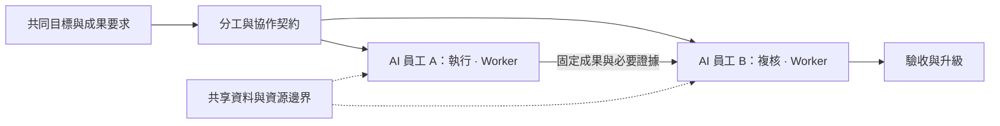
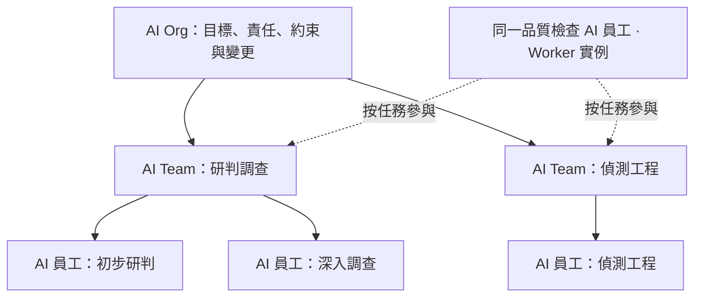
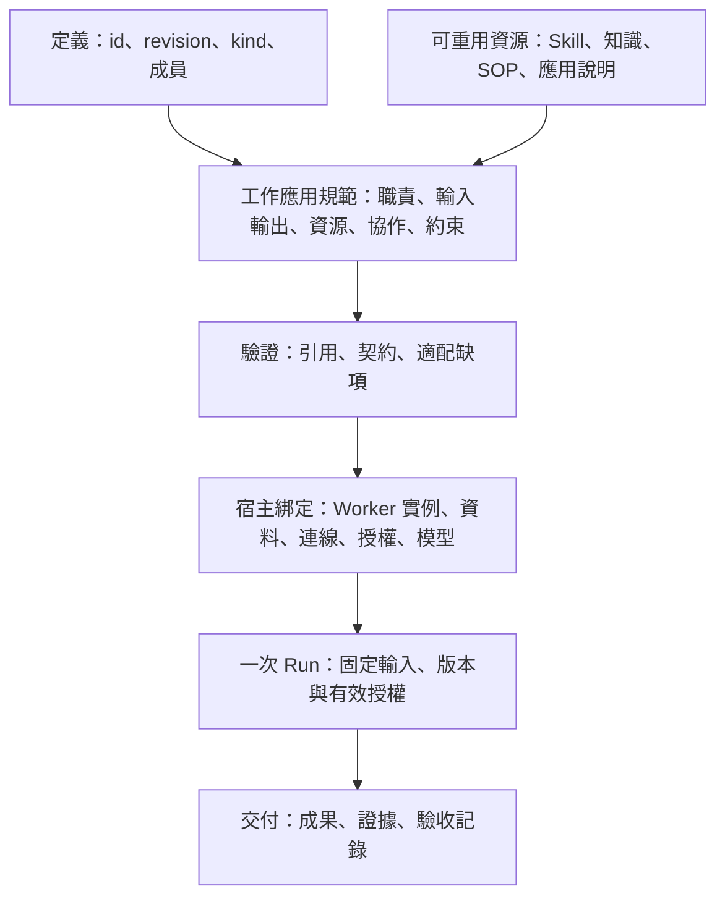
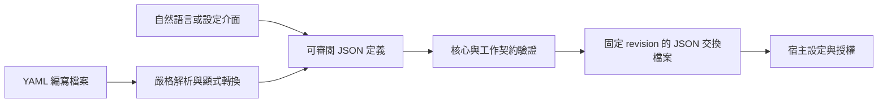

# AI Worker、AI Team 與 AI Organization 開放定義標準 1.0

[Languages / 语言](../docs/languages.md)

**Max Luo、Morgan Chen｜Teloa 共同創辦人**

> 本文是[簡體中文權威版本](core.zh-CN.md)的完整繁體中文譯文，尚未經母語業界專家完整複核。如有歧義或衝突，以簡體中文版為準；歡迎回報翻譯問題。JSON／YAML 範例保留原始中文值，以確保各語言的範例相同。Mermaid 展示標籤已翻譯；節點識別碼與圖結構維持原樣。

核心版本：`1.0`。發佈日期：2026-10-18。狀態：開放規範。

本文與[工作與協作應用規範](work-profile.zh-Hant.md)共同構成本版規範。第 1–3 節解釋概念，第 4–9 節規定核心交換行為。實例設定和真實執行另行驗收。

## 1. 先用通俗語言理解組成

**AI Worker 是具有可持續辨識的身分，在明確授權邊界內承擔職責、接受工作並交付可驗收成果的 AI 工作個體。AI Team 是圍繞共同成果分工協作的組合。AI Organization 在組合之上明確組織責任、資源約束和變更治理。**

在 Teloa 中，這類工作個體稱為 **AI 員工**；AI Worker 是其背後的通用標準概念。使用者建立和協作的對象仍叫 AI 員工，Worker 定義說明職責與工作契約，Worker 實例識別一位具體 AI 員工。Grok Bot 也可按 AI Worker 描述；這種概念對應不代表廠商認證，實際適配仍須核對契約與宿主行為。

這裡的「持續」指身分與職責可跨任務延續，不要求全天保持連線、永久程序、獨佔機器或一定具有長期記憶。工作個體可以呼叫多個模型和臨時 Agent；其對外交付仍歸屬於同一可追溯的 Worker 實例。

| 術語 | 本標準中的含義 | 邊界 |
| --- | --- | --- |
| AI Agent | 用於推理、工具呼叫或任務執行的通用技術概念 | 可以臨時存在；名稱本身不證明具備 Worker 契約 |
| AI Worker | 可持續辨識、受約束並對工作交付負責的 AI 個體 | 「負責」是工作歸屬與可追溯性，不表示法律人格 |
| AI Team | 有共同工作介面、成員分工及協作契約的組合 | 群組聊天或成員名單不能單獨證明符合 |
| AI Organization | 具備協作契約及組織治理契約的組合 | 不以人數或層級數量區分，不自動代表企業法律實體 |
| AI Workforce | 某範圍內 AI 工作者及工作容量的集合稱謂 | 本版不增加獨立物件或格式 |
| AI 員工、Bot | 產品或業務中的稱呼 | 按實際組成和行為映射，不憑產品名稱自動符合 |

AI Worker 已有公開使用，例如 [11x](https://www.11x.ai/11x-manifesto) 與 [Delos](https://marketplace.microsoft.com/en-us/product/office/WA200011292)。本規範採用已有術語並給出自身的規範性定義；不主張名稱首創，也不把廠商稱呼當作統一產業標準。首次對外使用時寫明「AI Worker（軟體工作個體）」，避免與從事 AI 產業的人類工作者混淆。

### 1.1 AI Worker 由什麼組成

| 組成 | 通俗問題 | 背後的內容 |
| --- | --- | --- |
| 職務與職責 | 我是誰，負責什麼，何時升級 | 名稱、職責、不承擔的職責、判斷與確認規則 |
| 方法與依據 | 怎麼做，憑什麼判斷 | Skills、知識、SOP；方法與事實分別引用 |
| 工作與安排 | 接什麼工作，什麼時候做 | 工作範本、輸入輸出、按需設定的例行任務 |
| 執行條件 | 用什麼工具，可以做到哪一步 | 應用需求、資料範圍、權限條件、模型與預算要求 |
| 經驗與成果 | 延續什麼經驗，怎樣證明完成 | 記憶規則、成果版本、證據與驗收 |

這五組幫助閱讀，覆蓋現有 12 類組成要素，不新增五種資源類型。最小 Worker 定義必須具備身分與修訂、職責與判斷邊界，以及至少一項含輸入、輸出、責任位置和驗收要求的工作契約。技能套件、知識庫、SOP、記憶和例行任務按需提供；空資源目錄合法，不能用空目錄繞過實際依賴。

### 1.2 AI Team 由什麼組成

**團隊＝共同目標＋成員與職務分工＋共享上下文邊界＋協作交接＋工作安排＋資源約束＋成果驗收。** 群組聊天可以承載溝通，團隊契約說明誰負責、交什麼、誰接收和何時停止。協調者是可選用的協作角色，不要求每個團隊都採用主管制。



圖中以 Teloa 為例：AI 員工對應 Worker，AI 團隊用 Team 契約約定共同成果與協作。

### 1.3 AI Organization 怎樣從團隊長出來

**組織＝個體和團隊的組合＋跨團隊責任＋資源與資訊邊界＋升級與變更規則。** 團隊可以作為組織的成員，繼續使用相同的工作介面。組織只承諾明確列出的工作，不自動擁有成員全部能力和權限。



圖中延續 Teloa 的 AI 員工與 AI 團隊稱呼，說明 Worker、Team 與 Org 的組合關係。這是組成示意，不聲明已經部署這些組織。顧問可以按任務參與，不必加入所有群組；跨團隊共用同一 AI 員工須有明確實例綁定。重用一個職務範本建立兩個 AI 員工，是另一種關係。

## 2. 背後的技術架構

核心交換物件仍只有 **agent** 與 **organization**，保留已有格式。完整 AI Worker 定義使用 agent 加必需的工作應用規範；AI Team 使用 organization 加協作契約；AI Organization 在同一組合物件上補充治理契約。`kind: agent` 只是底層結構類別，不是 AI Worker 符合性聲明。三種使用形態不產生三套核心格式。



在 Teloa 中，宿主綁定的是一位具體 AI 員工；每次 Run 是該員工的一次執行。定義、實例與 Run 分別記錄，產品稱呼與技術概念由此對應。

| 層次 | 標準負責 | 宿主負責 |
| --- | --- | --- |
| 定義 | 固定身分與修訂、組成、工作和協作要求 | 讀取、驗證、報告與無損保存 |
| 實例 | 規定綁定必須區分的身分與範圍 | 建立或重用員工，綁定連線、模型、權限和私有記憶 |
| 執行 | 輸入輸出、交接、停止和驗收語義 | 推理、派工、排程、預算執行、授權核驗與執行記錄 |

個體和組合體都回答四個問題：**接收什麼輸入、需要什麼條件、交付什麼結果、遵守什麼邊界。** 實例身分由宿主確認；改名、加入群組、匯入範本或相同定義引用都不產生授權。歷史執行固定舊版本，範本升級不改寫它。

本規範不規定一員工一機器、唯一模型、唯一排程器或完整組織管理系統；不包含支付、法律人格或具身控制。缺少必要能力時必須報告，不能把成功讀取檔案當成可執行。首版覆蓋員工、團隊和組織組合。

### 2.1 怎樣判定符合本版

下文「必須／不得」為強制要求，「應」為建議，「可」為選用。範例只說明格式，不代表已部署或通過執行驗證。

| 聲明範圍 | 必須具備 | 能據此得出的結論 |
| --- | --- | --- |
| 核心定義交換 | 第 4–9 節核心規則 | 檔案可正確解釋與無損保存；不能單獨稱 AI Worker 已適配 |
| AI Worker 定義 | agent 核心＋必需工作附錄＋完整職責、工作和驗收契約 | 定義完整；連線、實際身分與執行能力仍待宿主綁定 |
| AI Worker 實例 | 已驗證定義＋穩定實例識別碼＋可信管理主體＋按工作授權與執行記錄 | 身分可跨任務追蹤；替換模型或啟動新 Run 不等於新員工 |
| AI Team 定義 | organization 核心＋工作附錄＋成員分工、交接、共享和停止規則 | 協作契約可解釋；自動派工與實際交接另驗 |
| AI Organization 定義 | AI Team 契約＋governance＋組織約束 | 治理契約完整；具體身分、制度和約束執行另驗 |

同一份帶治理的組合定義可滿足 Team 與 Organization 兩種聲明；不是互斥產品類型。定義符合性不要求先執行成功，實例就緒和某次執行成功須分別出具證據。未聲明治理的組合不得僅靠改名宣稱符合本版 AI Organization。

穩定實例識別碼只要求在聲明的宿主與可信主體範圍內可唯一辨識，不要求全球帳號或去中心化身分網路。Worker 可以按需啟動、暫停或退休；宿主必須記錄這些狀態對應的實際行為，並在恢復前重新核對有效授權。退休不把歷史成果轉署給新實例。具體儲存與保留期限由實際部署政策決定。

### 2.2 JSON 交換，YAML 編寫

**JSON 是本版唯一的規範性交換表示；YAML 是可選用的作者輸入。** 使用者也可通過自然語言或表單生成同一份定義。接收方只實現 JSON，仍可聲明核心交換符合性。YAML 編寫能力另列支援範圍，不要求所有產品提供 YAML 編輯器。



若聲稱支援本版 YAML 編寫約定，轉換器必須使用 YAML 1.2 的 Core Schema 類型解析，接受單一映射文件且鍵均為字串；拒絕重複鍵、非有限數值、自定義或顯式標籤、錨點、別名、鍵文字為 `<<` 的條目及多文件流。僅接受可無損表示為 JSON 的值；不得靜默捨入數值。環境變數、範本運算式和檔案引入不求值。`revision: "1"` 是字串，`revision: 1` 是數值，後者須被欄位驗證拒絕。解析器及其版本寫入轉換記錄。[YAML 1.2.2](https://yaml.org/spec/1.2.2/)

YAML 註解不進入交換語義；權限、限制與驗收不能只寫在註解裡。區塊文字解析後的換行屬於字串內容，按 R02 比較。作者可保留 YAML 為編寫來源，每次匯出固定 JSON；兩者不得作為同一修訂的兩份獨立可修改權威來源。修改匯出結果後須回到統一來源生成新修訂。

這不是 JSON 位元組規範化或簽名協定。R02 比較 JSON 值；資源套件的 digest 仍針對實際位元組。JSON Schema 2020-12 用於描述 Work 的輸入輸出，兩種作者入口都必須接受相同契約檢查。[JSON Schema](https://json-schema.org/draft/2020-12)

## 3. 外部定義的重用

| 來源 | 本版採用 | 明確差異 |
| --- | --- | --- |
| OASF | 原生 discovery 的能力分類、領域和版本資訊；中繼資料、資源定位按需映射 | 分類技能不等於可執行方法套件，分類也不證明工作品質 |
| Oracle Agent Spec 26.1.2 | 元件引用與組合的思路；明確輸入輸出；定義與呼叫分離；有方向的協作關係 | 本版工作介面採用 JSON Schema 物件；不會直接冒充其元件設定或複製完整執行圖 |
| Grok Bot | 持續職務、共享方法、職務上下文，以及 Skill 與 Routine 分離 | 公開 recipe 是範本材料；Team Bot 是多人使用的一個 Bot，不等於多員工團隊 |

OASF discovery 資料按固定版本原樣承載，詳見附錄 §7。可由此匯出發現記錄，不建立另一套同義能力分類。[OASF Record Guide](https://docs.agntcy.org/oasf/agent-record-guide/) · [Discovery Extension](https://docs.agntcy.org/oasf/discovery-extension/)

Agent Spec 的元件引用採用設定內的 `$component_ref`；輸入輸出基於 JSON Schema，Swarm 與 ManagerWorkers 則帶有具體協作行為。本版保留跨檔案的 id＋revision，並把責任交接、工作階段轉交與權限分別處理。轉換時須驗證實際輸入輸出約束與協作行為；不預設共享整個工作階段，不隱式轉換輸入輸出類型。[Agent Spec 26.1.2](https://oracle.github.io/agent-spec/26.1.2/agentspec/language_spec_26_1_2.html)

借鏡定義、保留原生資料和通過相容驗證是不同聲明。吸收這些設計不代表已相容所有 OASF 模組或 Agent Spec 執行環境。[Grok 設計說明](https://x.ai/news/designing-grok-bot) · [Team Bots](https://docs.x.ai/grok-bot/team-bots)

## 4. 從核心定義到完整 AI Worker

### 4.1 最小核心交換定義

```json
{
  "specVersion": "1.0",
  "id": "urn:example:definition:research-assistant",
  "revision": "5",
  "kind": "agent",
  "name": "研究助手",
  "instructions": "根据提供的资料回答问题，保留来源，区分事实、推断和未知。"
}
```

這六個欄位只構成最小交換定義，尚不構成完整 AI Worker。個體需要整體必需的外部能力時，再添加 capabilities。聲稱支援本版 Worker 工作或團隊協作契約時，還必須支援附錄中的工作應用規範，不能只保存提示詞便宣稱完整適配。

### 4.2 最小完整 AI Worker 定義

下面是跨產業的材料摘要工作者：沒有外部應用、技能套件或自動例行，但有明確職責、輸入輸出和驗收。它定義一個可重複承擔摘要工作的職務；實際實例與管理主體在部署時綁定。

```json
{
  "specVersion": "1.0",
  "id": "urn:example:definition:document-worker",
  "revision": "2",
  "kind": "agent",
  "name": "材料摘要工作者",
  "instructions": "持续承担已提供材料的摘要工作，注明材料之外无法核实的内容。",
  "extensions": [{
    "id": "urn:teloa:profile:ai-work",
    "version": "1.0",
    "required": true,
    "data": {
      "responsibility": {
        "triggers": ["收到已授权的摘要任务"],
        "autonomousActions": ["读取本次提供的材料并撰写摘要"],
        "confirmationPoints": ["对外发布须由任务负责人另行确认"],
        "escalationRules": ["材料缺失或相互矛盾时报告缺口"],
        "deliveryChecks": ["摘要可回查材料，不补造事实"]
      },
      "resources": [],
      "authorityRoles": [{"id": "owner", "name": "任务负责人", "kind": "human"}],
      "works": [{
        "id": "summarize",
        "title": "材料摘要",
        "instructions": "根据输入材料交付摘要和未决问题。",
        "inputs": {
          "$schema": "https://json-schema.org/draft/2020-12/schema",
          "type": "object",
          "properties": {"material": {"type": "string", "minLength": 1}},
          "required": ["material"],
          "additionalProperties": false
        },
        "outputs": {
          "$schema": "https://json-schema.org/draft/2020-12/schema",
          "type": "object",
          "properties": {
            "summary": {"type": "string", "minLength": 1},
            "openQuestions": {"type": "array", "items": {"type": "string"}}
          },
          "required": ["summary", "openQuestions"],
          "additionalProperties": false
        },
        "requires": [],
        "responsible": "self",
        "acceptance": {
          "criteria": ["摘要与输入材料一致，未决问题单列"],
          "reviewer": "authority/owner",
          "independent": true
        }
      }]
    }
  }]
}
```

該範例的 [JSON 檔案](../examples/document-worker.json)與 [YAML 作者檔案](../examples/document-worker.yaml)由正文生成，表達相同 JSON 值。完整團隊、組織及共用實例的範例見[組成範例](../examples/composition-fixture.json)。這些內容是定義範例，均未因此獲得連線、執行或發佈授權。

## 5. 一個檔案組合團隊或組織

```json
{
  "specVersion": "1.0",
  "id": "urn:example:definition:research-team",
  "revision": "5",
  "kind": "organization",
  "name": "研究小组",
  "instructions": "research 整理证据，review 检查来源和结论；发现分歧时保留分歧。",
  "members": [
    {
      "id": "research",
      "ref": {
        "id": "urn:example:definition:research-assistant",
        "revision": "5"
      }
    },
    {
      "id": "review",
      "ref": {
        "id": "urn:example:definition:research-assistant",
        "revision": "5"
      }
    }
  ]
}
```

該範例僅表達核心組合引用，不構成完整 AI Team 或 AI Organization 定義；還須補齊工作附錄及相應協作、治理契約。

成員項引用個體或子組織定義。同一範本可以重用，但兩個成員項仍分別命名；這不自動證明兩個實際執行者獨立，也不產生雙人審核。Member 是組成中的定義槽位，不直接等於群組成員或任職記錄。附錄明確成員、顧問、外部責任角色及實例綁定；實際身分與權限由宿主落實。

## 6. 核心欄位

除擴展 data 內部外，所有物件只接受下表及後文定義的欄位；新增語義通過 extensions 表達。

| 欄位 | 類型與範圍 | 為什麼保留 |
| --- | --- | --- |
| specVersion | 必需，精確為 `1.0` | 確定怎樣解釋檔案 |
| id | 必需，絕對 URI 或 URN | 跨檔案引用同一定義 |
| revision | 必需，非空字串，不得為 latest | 固定內容，避免引用悄悄變化 |
| kind | 必需，agent 或 organization | 區分單體與組合 |
| name | 必需，非空字串 | 讓人能夠辨識和分享 |
| instructions | 必需，非空字串 | 表達 agent 個體職責或組織協作要求 |
| capabilities | 選用，Capability 陣列，僅 agent 可用 | 引用所需的外部能力 |
| members | organization 必需的非空 Member 陣列；agent 不得使用 | 表達組織組成 |
| extensions | 選用，Extension 陣列 | 容納核心以外的語義 |

- 非空字串不得只含空白。頂層選用陣列 capabilities、extensions 省略或寫為空陣列均合法，預設解釋相同；原 JSON 值仍不同，比較按 R02。不得以 null 代替。
- LocalId 匹配 `^[a-z][a-z0-9-]{0,63}$`。Member 與 Capability 的 id 在所屬陣列內唯一；擴展契約可定義對相應條目的引用，須明確所屬定義與陣列，不能假定 LocalId 全域唯一。
- DefinitionRef 僅含 `id`、`revision`，類型與上表一致。
- Member 僅含 `id: LocalId`、`ref: DefinitionRef`。所有成員引用均為必需。
- Capability 僅含 `id: LocalId`、`kind: "mcp" | "skills" | "a2a" | "resource"`、`config: object`；config 見第 7 節。
- Extension 僅含 `id: 絕對 URI 或 URN`、`version: 非空精確版本字串`、`required: boolean`、`data: object`。version 不得為範圍或 latest，同一定義內擴展 id 唯一。

## 7. 外部能力只做引用

下面四種 kind 是可選用的綁定：讀取定義不要求接收方執行它們。聲明能使用某綁定時，才需要實現相應原生協定或格式。config 僅接受本表欄位；未標可選用的欄位均必需。

| kind | config 欄位 | 綁定邊界 |
| --- | --- | --- |
| mcp | `protocolVersion: 非空字串`；`transport: "stdio" \| "streamable-http"`；`connectionRef: 非空字串`；`selectors: Selector[]，選用` | 引用由宿主解析的 MCP 連線，按指定原生版本核實能力與授權 |
| skills | `formatSnapshot: URI`；`packageRef: URI`；`packageMediaType: "application/zip" \| "application/x-tar"`；`packageDigest: Digest` | 引用完整技能套件和固定格式快照，保留 SKILL.md 與配套檔案 |
| a2a | `protocolVersion: 非空字串`；`agentCardRef: URI`；`interfaceUrl: URI`；`protocolBinding: 非空字串`；`skillIds: 非空字串[]，選用`；`requiredExtensions: URI[]，選用` | 引用 A2A 服務的指定介面，保留原生任務、成果和狀態 |
| resource | `uri: URI`；`mediaType: 非空字串`；`digest: Digest，選用` | 僅讀取資源，不自動執行內容 |

Selector 僅為 `{"type":"tool"或"prompt","name":非空字串}` 或 `{"type":"resource","uri":URI}`。聲明 selectors 時陣列不得為空，每項均須滿足；未聲明只表示需要該連線，不表示所有工具均獲授權。

URI 均為絕對 URI 或 URN；Digest 為 `sha256:` 加 64 位小寫十六進位字元。協定版本必須精確，不得為範圍或 latest。連線名、Card 位址及套件位置均不代表授權。

範例：把下面條目放入 agent 個體的 capabilities 陣列，表示它需要這個 MCP 連線。範例連線與版本仍須在實際部署中驗證。

```json
{
  "id": "knowledge",
  "kind": "mcp",
  "config": {
    "protocolVersion": "2026-07-28",
    "transport": "streamable-http",
    "connectionRef": "project-knowledge"
  }
}
```

**MCP：** connectionRef 由部署者映射，必須展示實際連線並獨立授權，不包含 token 或啟動命令。遵守所聲明版本的發現、傳輸和授權；不得僅按工具名稱自動匹配到另一連線。核心不逐項描述工具參數或制定通用工具權限語言。[MCP 版本規則](https://modelcontextprotocol.io/docs/2026-07-28/learn/versioning)

**Skills：** formatSnapshot 必須是不可變的格式規範來源，摘要針對完整套件的原始位元組。解壓縮根目錄為一個技能目錄，拒絕路徑穿越、重複正規化路徑及符號連結／硬連結；匯入不執行腳本。ZIP／TAR 是本規範的包裝約定，不是 Agent Skills 的原生要求。[Agent Skills 格式](https://agentskills.io/specification)

**A2A：** interfaceUrl、protocolBinding、protocolVersion 必須對應實際 Card 的同一介面；所聲明的 skillIds 及雙方必需擴展按原生規範核驗，授權另查。伺服器端完成不等於業務目標達成；A2A AgentSkill 不等於 Agent Skills 檔案套件。[A2A 規範](https://a2a-protocol.org/latest/specification/)

**資源：** 無 digest 時按可變內容處理，實際使用記錄取得版本或時間；不能聲稱可重現。私有資源按實際權限讀取。

這些欄位是本規範的引用描述，不是發給原生服務的請求主體。需要本版無法表達的關鍵約束時，必須用 required 擴展明確表達，不能靠宿主猜測或靜默丟棄。原生細節與執行保證留在各綁定，不再複製成通用執行協定。

## 8. 八條共同規則

**R01 格式明確。** 交換檔案必須是 UTF-8 JSON 物件，拒絕重複鍵、未知核心欄位、非法欄位類型和非有限數值。核心版本不支援時必須明確報告，不能套用舊版解釋。未知擴展 data 的內部欄位不由核心驗證。

**R02 修訂不可變。** id 與 revision 按原始字串精確比較，不做 URI 正規化；兩者定位一個固定定義。按下述規則比較的 JSON 值改變時，必須分配新 revision；同一組合出現不同值必須報告衝突，不得覆蓋。比較忽略物件鍵順序和字串外的空白，保留陣列次序與字串內容；不同 JSON 類型不相等，數值按數學值比較（如 10 與 10.0 相等），不得因捨入把不同數值判為相同。省略欄位與顯式空陣列屬於不同 JSON 值，不因預設解釋相同而合併。

**R03 引用可解析。** 裝配組織前，必須遞迴解析全部直接和間接成員引用至指定修訂；發現缺失、版本不符或循環時必須報告並停止裝配，不得自動換版。組織的完整支援聲明必須覆蓋該引用閉包內全部成員定義的必要能力和擴展。定義引用形成無環圖；這不限制實際協作往返。id 不等於下載位址，取得定義的方法由宿主決定，讀取檔案不得自動連線至網路。

**R04 組合不合併權限。** 成員分別使用各自定義與能力。組織 instructions 描述協作要求，不覆蓋成員 instructions，也不自動給成員增加工具或權限；衝突未解決時不得啟動受影響工作。同名能力按所屬成員區分，不能合併連線。核心不定義排程、提示詞合併或實際身分分配。

**R05 聲明必須兌現。** capabilities 中每個條目都是該 agent 個體聲明的必要依賴；沒有「預設可忽略」的綁定。無法提供某項時，必須列出缺項，不得按該定義啟動或聲稱完整支援；組織也不得繞過缺項的必需成員執行。仍可查看和保存，刪改能力須生成新 revision。實際執行須核實原生支援和授權，讀取成功不等於可執行。

附錄的 resources 是可按工作選用的目錄，不等於 capabilities。整體條件與所選工作的必要條件都須滿足；其他工作獨有的未就緒資源只阻塞那些工作。完整支援、特定工作就緒和獲得實際授權分別報告，不能利用應用規範繞過本條的整體依賴要求。

**R06 擴展明確失敗。** 擴展契約由 id 與精確 version 固定，至少定義 data 結構、語義和驗證方法；結構或語義變化必須換版本。消費者須顯式支援，不能因讀取 URI 自動下載驗證器或程式碼。未知擴展必須保留 JSON 值並報告；required=true 時不得按該定義裝配、執行或聲稱完整支援。required=false 只用於不改變基礎執行含義的輔助資訊。發佈者不得把權限、付款、執行條件和驗收約束設為可忽略；消費者發現已支援的擴展違反此要求時必須拒絕裝配、執行和完整支援聲明，不得標為驗證通過。仍可保留、查看或帶錯誤報告原樣匯出問題檔案。核心不聲稱能辨識未知 data 的全部含義。互相衝突的必需約束不得擇一放寬。

**R07 定義不授予權利。** 匯入不得自動建立執行個體、安裝程式碼、連線服務、執行任務或付款。定義不得包含密鑰、token、cookie 或可直接支用的授權憑證。範本、角色說明和組織關係不產生身分、代表權或執行授權；這些由宿主在真實操作前核驗。

**R08 聲明符合性要有證據。** 最小符合性只有「支援本版本的定義交換」，要求正確讀取、驗證、報告、保存和無損匯出。對有效文件，匯入再匯出的 JSON 值必須保持不變，包括未知擴展；編輯必須生成新修訂。綁定與擴展的實際支援另列名稱、版本及驗證範圍，不能從交換符合性推導執行、業務品質或跨平台個體遷移。

## 9. 符合性與驗收

符合性按明確範圍聲明，不使用一個「相容」涵蓋全部能力：核心交換；工作應用規範解釋；指定來源/版本的映射；特定宿主、工作與輸入範圍的執行。業務品質另有任務相關的評估，不由結構檢查推導。

下列六項是核心定義交換驗收；應用規範的正反例見附錄，驗證範圍見[符合性說明](../CONFORMANCE.md)。輔助範例檢查不等於完整符合性實現或兩個獨立實現的互通。

| 編號 | 輸入或操作 | 必須觀察到的結果 |
| --- | --- | --- |
| T01 | 重複鍵、未知核心欄位、非法 kind／類型、未知核心版本 | 拒絕或明確報告版本不支援 |
| T02 | 匯入第 4、5 節示例、含未知擴展的有效定義，以及成員各自聲明同名能力的組合定義連同其成員定義，再匯出 | JSON 值保持不變；不同成員的同名能力不合併 |
| T03 | 相同 id／revision 的值不同；另比較鍵序、空白、10 與 10.0、省略陣列與顯式空陣列 | 按 R02 判斷；僅值不同才衝突，不能覆蓋；省略與空陣列衝突，改值須新 revision |
| T04 | A → B → C 巢狀引用；引用缺失、修訂不符、循環或僅大小寫不同；C 缺必要能力或 required 擴展 | 引用錯誤定位並停止裝配，不自動連線至網路或正規化補齊；C 缺項時 A 不得聲稱完整支援，按 R05／R06 限制執行 |
| T05 | 未知 optional／required 擴展；已支援的約束擴展非法標為 optional | 未知項均保留並報告，required 阻止裝配、執行和完整支援聲明；已知非法約束同樣拒絕且不得標為驗證通過，允許帶錯誤報告保留原檔案 |
| T06 | 只匯入含能力引用的檔案 | 不安裝、連線或執行；列明執行未驗證，不宣稱已設定可用 |

綁定和宿主的真實執行另驗：至少核對必要能力缺失時不啟動、實際授權、組織組合隔離，以及原生失敗和未知結果。它們不由 JSON 檢查冒充通過。

不強制所有宿主共用一套錯誤代碼或內部狀態機，但錯誤必須定位物件並說明原因。不同實現應在上述接受／拒絕和保留行為上得到一致結果。

## 10. 演進與落地邊界

當前保留一份共同工作應用規範，表達 Worker、Team 與 Organization 的工作契約及必要宿主要求。記憶內容、真實排程、帳號身分和組織管理由宿主實現；新互通需求再評估擴展。新協定可用 required URI 擴展接入，無需全部加入核心枚舉。

首個演示可使用本機目錄，每份定義一個 JSON 檔案，按內容中的 id／revision 建索引，檔案名不承擔語義；這是範例交付方式，不是新增的分發協定。配上巢狀、缺失和衝突反例及預期結果，再用兩個獨立實現核對驗證、匯入和匯出行為。隨後選一個實際需要的能力綁定，驗證「匯入 → 設定連線／授權 → 執行 → 取得成果」。未完成此路徑前，不擴大為通用執行、支付或生命週期管理標準。

規範版本升級必須重新驗證、更新 specVersion 和附錄版本，並生成新 revision；成員引用同步固定。舊定義與舊 Run 不原地改寫。不同規範版本不自動相容；語義變更須提供遷移說明，見[維護規則](../GOVERNANCE.md)。

### 10.1 通用核心與產業設定

| 範例領域 | 設定不同的內容 | 重用的共同契約 |
| --- | --- | --- |
| SOC | 證據來源、警示研判方法、升級條件、應變授權 | 身分、職責、工作 I/O、交接、成果驗收 |
| 客服 | 產品知識、工單分類、服務時限、人工升級 | 同上；不把 SOC 的工具或術語帶入客服 |
| 內容工作 | 資料範圍、編輯規則、複核與發佈權限 | 同上；完成文稿不等於已發佈 |

表中僅說明定義層可表達這些工作，沒有聲稱完成對應產業驗證。產業要求通過資源、工作和必要擴展設定；核心不規定固定職務數、模型、工具廠商、品質分數或執行頻率。

### 10.2 當前地位與推進條件

當前是由 Teloa 維護的開放規範，未獲得產業或國際標準地位。原創規範與範例採用 [Apache-2.0](../LICENSE) 授權；維護、回饋與版本規則見 [GOVERNANCE.md](../GOVERNANCE.md)，聲明範圍見 [CONFORMANCE.md](../CONFORMANCE.md)。產業互通主張還需至少兩個獨立實現，以及包含非 SOC 場景的公開可重複驗證證據。評審意見與範例檢查不替代這些證據。

解釋定義不得依賴 Teloa 帳號、雲服務或私有資料庫。`urn:teloa:profile:ai-work` 是既有擴展的發佈者命名空間，保留它以避免同義識別碼分裂；它不要求 Teloa 宿主，也不是產業管理機構背書。產品仍可用一段自然語言生成待確認的定義。
